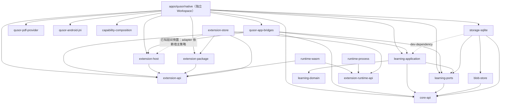
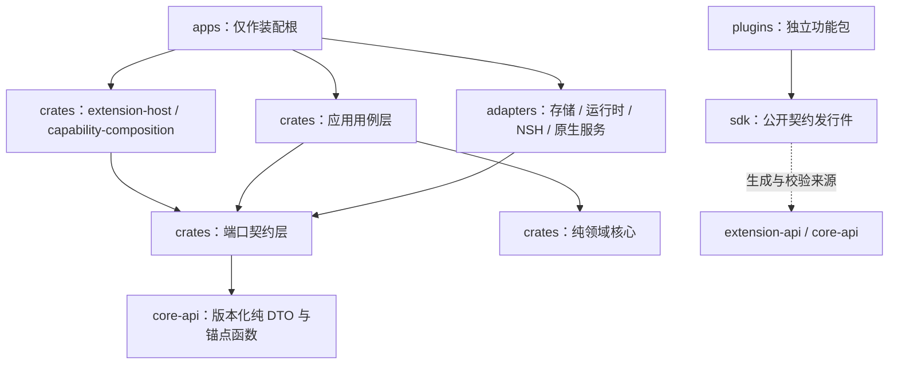

# QUSOR 架构基座

> 权威范围：本文件定义当前生产 Workspace 结构、**与 `cargo metadata` 对齐的实际依赖图**、目标依赖边界及 **ADR 索引表**。实现与多层级验证状态统一见 [项目状态表](../status.md)；目录归属与插件划分见 [目录与插件职责](workspace-layout.md)；平台目标见 [平台兼容规格](plugin-platforms.md)。

## 当前实际结构

```text
Cargo workspace（根生产成员）
├── learning-domain         FSRS-5 词汇调度内核；零外部依赖
├── core-api                捕获/来源/锚点、知识记录、词汇学习契约与归档校验（含待下沉的归档逻辑）
├── capability-composition  能力接缝、分层 profile 与确定性激活规划；零外部依赖
├── learning-ports          一致快照/原子提交恢复与词汇学习端口（待拆 Query/Command/Archive）
├── learning-application    文本/PDF/复合知识用例与词汇学习用例
├── blob-store              Unix 私有目录、单 writer 与耐久 CAS 适配器
├── storage-sqlite          schema/关系核验、整体 SQL 事务与词汇学习表（非 Unix 待补）
├── extension-package       有界签名容器、内容/发布者键绑定验证
├── extension-runtime-api   无授权副作用的执行端口与预算契约
├── runtime-wasm            Wasmi 执行适配器；不创建 Host 或读取包路径
├── runtime-process         Linux 进程身份、父死守卫与 pidfd 清理（仅 Linux/macOS 部分）
├── extension-store         包/安装/授权/私有配对与 worker lease SQL 持久化内核
├── extension-api           Host API 0.1–0.7 JSON 策略协议、manifest 投影与能力校验
└── extension-host          内存/持久安装元数据、授权、会话、生命周期与贡献查询

独立 Workspace 与治理目录
├── apps/qusor/             生产应用独立 Workspace（provider / bridges / android-jni / native）
├── plugins/                独立功能包（vocab / notes / library / reader 样例，当前仍缺独立 UI 协议）
├── sdk/                    公开契约发行入口（尚未正式发行）
├── experiments/            隔离验证（Wasm / 安装包 / 捕获 / PDF / NSH / 插件 UI）
├── config/architecture.toml 成员登记与依赖允许清单
├── scripts/                架构边界、原生 UI 与文档检查
└── docs/                   产品范围、设计、架构决策、状态表与研究
```

## 当前实际依赖图（与 `cargo metadata` 对齐）

以下依赖边已通过 `cargo metadata --no-deps --format-version 1` 核对（虚线表示仅 `dev-dependencies` 或已知待整改倒置）：



> [!NOTE]
> 核对结论：当前源码中 `core-api`、`learning-ports` 均**不**依赖 `learning-domain`，`extension-host` **不**依赖 `core-api`；`extension-store`（adapter）依赖 `extension-host` 属于已知层间倒置，计划在第二阶段抽离 `extension-ports` 消除。

## 目标依赖方向与层间边界



| 层 | 职责边界 |
|---|---|
| `learning-domain` / 领域核心 | 纯领域规则与调度不变量；零外部依赖，不含 UI、数据库或网络 |
| `core-api` / 端口层 | 版本化 DTO、纯锚点函数与 Query/Command/Archive 端口；无具体存储或平台实现 |
| `learning-application` | 用例编排、事务计划、审核与幂等校验 |
| `adapters/*` | 实现 ports 的 SQLite/CAS、受限运行时、NSH、PDF/EPUB 等原生服务 |
| `extension-api` / `extension-host` | 版本化能力协议、授权、会话、生命周期与贡献路由；不直接写知识库 |
| `apps/*` | 唯一装配根（依赖注入、平台入口、打包），不承载功能业务 UI 与私有写库旁路 |

Core API、文档版本、ReaderAnchor 与持久化 Schema 均独立版本化。NSH 节点 ID、编辑器位置与 DOM offset 不得作为永久来源地址。

## 插件扩展边界

插件化是正式基座要求，见 [插件架构与验证计划](extensions.md)。扩展提供能力，Core 持有知识；外部选段经统一 `CaptureDraft` 成为本地不可变快照，外部回跳单独表达能力等级。

第一阶段支持第三方独立包闭环及受限执行能力，官方功能亦须走公开 SDK（第一方静态 vs 动态交付细节待用户拍板，见 [ADR 0003](adr/0003-plugin-first-delivery.md) 与待决项）。当前生产协议已实现 Host API 0.1–0.7（0.1 策略基础、0.2 Reader Surface、0.3 组件草稿、0.4 `notes.read`、0.5 `vocab`、0.6–0.7 `library`），但独立第三方插件 UI 协议、仓库外生产 SDK 发行与六端隔离运行器仍待完成。

## 工程策略

[architecture.toml](../../config/architecture.toml) 定义允许成员与依赖白名单。`scripts/check_architecture.py` 读取 `cargo metadata`，检查 normal/dev/build、可选与 target-specific 声明及已解析传递闭包（含 proc-macro 与构建依赖）：`learning-domain` 与 `capability-composition` 保持零外部依赖；SQLite/CAS/系统调用限定在 `adapters/*`。不得创建假数据库、空导入、未验证生产 renderer 或用大量 `todo!` 占位。

## ADR 索引表

以下索引表由 `scripts/check_docs.py` 自动校验与 `docs/architecture/adr/` 目录双向一致（按编号升序）：

<!-- ADR-INDEX-START -->
| 编号 | 标题 | 状态 | 一句话决策 |
|---|---|---|---|
| 0001 | [技术架构基座的当前边界](adr/0001-foundation-boundary.md) | Accepted | 先建工程边界与守卫，暂缓未经验证的渲染器/SQLite/云接入 |
| 0002 | [将插件扩展作为基座能力](adr/0002-extension-boundary.md) | Superseded | 确立插件扩展基座与来源快照边界（分期已被 ADR 0003 更新） |
| 0003 | [第一阶段开放第三方，功能以插件交付](adr/0003-plugin-first-delivery.md) | Accepted | 第一阶段开放第三方开发安装分发，第一方功能围绕同一公开插件契约开发 |
| 0004 | [先实现无界面的插件宿主策略内核](adr/0004-headless-extension-policy.md) | Accepted | 优先交付无界面策略/授权/会话内核，不将内存注册视作完整运行隔离 |
| 0005 | [用独立 Wasm 实验验证外部代码执行边界](adr/0005-wasm-runtime-probe.md) | Accepted | 用隔离 Wasmi 实验验证预算/撤权/看门狗边界，暂不锁死生产运行时 |
| 0006 | [明确插件优先的目录与下一阶段边界](adr/0006-plugin-workspace-layout.md) | Accepted | 确立 apps/crates/adapters/plugins/sdk/experiments 六分目录边界 |
| 0007 | [独立签名包与持久安装事务实验](adr/0007-signed-package-persistence-probe.md) | Accepted | 以隔离实验验证整包 Ed25519 签名、键绑定与可中止安装事务 |
| 0008 | [持续授权与新策略会话恢复实验](adr/0008-durable-grant-recovery-probe.md) | Accepted | 以隔离实验验证重启后恢复持续授权并拒绝旧会话 |
| 0009 | [从持久授权恢复受限 Wasm 调用](adr/0009-restored-wasm-execution-probe.md) | Accepted | 验证持久化授权恢复后可驱动受限 Wasm 调用且保留撤权边界 |
| 0010 | [私有状态与包的成对迁移和回滚实验](adr/0010-paired-private-state-probe.md) | Accepted | 验证插件私有状态迁移与包版本成对提交/回滚 |
| 0011 | [同一长驻宿主中的多插件进程监督实验](adr/0011-persistent-supervisor-probe.md) | Accepted | 验证同宿主双插件进程监督、父 broker 判权与隔离回收 |
| 0012 | [宿主异常退出后的 worker 身份与执行排他恢复](adr/0012-supervisor-crash-reconciliation.md) | Accepted | 验证 Linux 进程身份固定、父死守卫与崩溃残留协调 |
| 0013 | [独立捕获与 Core 持久化资格切片](adr/0013-capture-core-qualification.md) | Accepted | 以纵切实验打通普通插件提案、原生批准、不可变快照与空库恢复 |
| 0014 | [原生优先与 PDF 服务资格验证](adr/0014-native-pdf-provider-qualification.md) | Accepted | 沿 C-09 原生优先验证 PDFium 渲染、几何字符映射与版本化选段 |
| 0015 | [PDF 原件与统一 Core 归档资格](adr/0015-pdf-core-snapshot-archive.md) | Accepted | 在 schema2 验证 PDF 原件、提取映射与单事务混合归档恢复 |
| 0016 | [原生 PDF 命中、手势与有序选段服务](adr/0016-native-pdf-selection-service.md) | Accepted | 验证原生字形点命中、视口坐标变换与有序多行选段服务 |
| 0017 | [复合 PDF 锚点与单一提交](adr/0017-compound-pdf-capture.md) | Accepted | 引入版本 2 复合锚点实现跨行多段摘录单事务原子保存 |
| 0018 | [捕获与锚点契约落位 Core API](adr/0018-core-api-contract-source.md) | Accepted | 将捕获/来源/锚点公开契约迁入 `core-api` 单一权威源 |
| 0019 | [知识用例与原子持久化适配器落位](adr/0019-atomic-knowledge-persistence.md) | Accepted | 将用例、原子端口与 SQLite/CAS 适配器落位生产目录 |
| 0020 | [原生 PDF Surface 与选区适配实验](adr/0020-native-pdf-surface-probe.md) | Accepted | 用隔离 NSH 探针验证原生 PDF 页图、窗口触点与选区交互 |
| 0021 | [签名包格式落位单一公开权威源](adr/0021-signed-package-authority.md) | Accepted | 将签名容器与键绑定校验落位 `extension-package` 生产 crate |
| 0022 | [无授权副作用的执行端口与 Wasmi 适配器](adr/0022-authority-free-wasm-runtime.md) | Accepted | 确立无授权副作用的 `extension-runtime-api` 端口与 `runtime-wasm` 适配器 |
| 0023 | [公开阅读 Surface 的版本与授权边界](adr/0023-public-reader-surface.md) | Accepted | 定义 Host API 0.2 公开 Reader Surface、临时选区 lease 与 Host registry |
| 0024 | [云存储采用可替换适配器](adr/0024-cloud-storage-adapters.md) | Accepted | 预留供应商无关的结构化同步、对象存储与身份适配器边界 |
| 0025 | [持久安装内核、统一授权恢复与进程身份边界](adr/0025-durable-installation-authority.md) | Accepted | 落位 `extension-store` 持久内核、统一授权恢复与 Linux 身份边界 |
| 0026 | [持续阅读权限与原生动态 PDF 通路](adr/0026-durable-reader-native-dynamic-pdf.md) | Accepted | 扩展持续权限至多能力精确集合并接通原生动态 PDF 选取保存 |
| 0027 | [独立监督的原始字节执行通道](adr/0027-supervised-raw-process-runtime.md) | Accepted | 确立独立控制线程、有界 raw 字节传输与 `ManagedRun` 生命周期 |
| 0028 | [原生工作区分区与组件提供者](adr/0028-extensible-native-workspace.md) | Accepted | 确立外壳区域、组件角色与提供者分离的原生工作区扩展模型 |
| 0029 | [本地 Agent 工作台与可替换后端](adr/0029-local-agent-workbench.md) | Accepted | 定义通用任务/会话/运行/视图分离及多 Agent 可替换后端架构 |
| 0030 | [与编辑独立的只读段落投影](adr/0030-readonly-paragraph-projection.md) | Accepted | 将只读段落投影与编辑状态分离，支持取消与版本失效边界 |
| 0031 | [按平台选择插件实现](adr/0031-platform-aware-plugins.md) | Accepted | 允许单平台与同包多实现，按 OS/架构/渠道选择并保持 Core 语义一致 |
| 0032 | [完整材料相等时复用验包结果](adr/0032-verified-package-material-cache.md) | Accepted | 当包材料完整哈希一致时复用验包结果，保留 fresh 授权与私有检查 |
| 0033 | [共享平台契约与原生宿主装配](adr/0033-cross-platform-runtime.md) | Accepted | 解除 Linux 专用绑定，以共享平台契约推进六端原生宿主装配 |
| 0034 | [想法读取的分页游标与正文分块](adr/0034-note-read-model.md) | Accepted | 为想法列表引入 keyset 游标分页与 UTF-8 安全有界正文分块 |
| 0035 | [想法读取的公开能力（协议 0.4）](adr/0035-notes-read-capability.md) | Accepted | 定义 Host API 0.4 `notes.read` 能力与 `notes-query-v1` 有界 wire |
| 0036 | [词汇学习的公开能力（协议 0.5）](adr/0036-vocabulary-study-capability.md) | Accepted | 定义 Host API 0.5 `vocab` 能力、FSRS-5 领域内核与 schema 4 学习表 |
| 0037 | [生产应用装配与自动更新发布](adr/0037-production-app-assembly.md) | Accepted | 确立 `apps/qusor` 独立 Workspace 装配形态与 GitHub Release 自动更新 |
| 0038 | [能力接缝与声明式 Profile 组合](adr/0038-capability-composition.md) | Accepted | 引入零依赖 `capability-composition` 做版本化接缝与确定性激活规划 |
| 0039 | [应用级单一 Core Provider](adr/0039-single-core-provider.md) | Accepted | 应用级 `VaultStore` 统一持有单一 SQLite/CAS 写者并迁移旧分库 |
| 0040 | [组合顺序驱动的 RuntimeScope 与统一 Host Runtime](adr/0040-runtime-mount-scope.md) | Accepted | 引入 `RuntimeScope` 按激活顺序挂载 Host 并保证逆序安全释放 |
| 0041 | [普通包 Manifest 驱动的 Workspace 贡献目录](adr/0041-manifest-workspace-contributions.md) | Accepted | 由 `package_catalog` 校验包 Manifest 并驱动工作区目录发现 |
| 0042 | [插件 UI 只走原生 NSH Surface](adr/0042-native-only-plugin-ui.md) | Accepted | 禁止 WebView/HTML/DOM/Electron 作为插件 UI，接入 `check_native_ui.py` |
| 0043 | [随应用包的持久启停与 Host 作用域重建](adr/0043-persistent-package-enable-intent.md) | Accepted | 持久化随应用包启停意图并按同一 Core 句柄重建 Host 作用域 |
| 0044 | [阅读预览包的 Manifest 工作区贡献](adr/0044-reader-preview-contribution.md) | Accepted | 以 `reader_workspace` 贡献接入阅读预览入口并受 `reader.surface` 门控 |
| 0045 | [有界 PDF Library 文档目录](adr/0045-bounded-pdf-library-listing.md) | Accepted | 提供按 vault 隔离的有界 PDF 元数据分页与不透明 keyset 游标 |
| 0046 | [Library Host API 0.6](adr/0046-library-host-api-0-6.md) | Accepted | 定义 0.6 `library.read`/`capture.propose` 与文字层浏览提交 wire |
| 0047 | [原生 PDF 导入与页图阅读](adr/0047-native-pdf-import-and-page-images.md) | Accepted | 接通原生 PDF 导入、LRU 页图缓存、页图选文与 0.7 保存范围高亮 |
| 0048 | [文档治理与单一状态源](adr/0048-doc-governance.md) | Accepted | 确立 ADR 只记决策、单一 `docs/status.md`、`AGENTS.md` 瘦身与脚本校验 |
<!-- ADR-INDEX-END -->

## 相关研究

- [来源模型](../research/03-core-data-architecture.md)：Schema、QLA、线程与导出设计
- [Agent 与检索](../research/04-agent-retrieval.md)：工具、引用与审批设计
- [本地优先同步](../research/05-local-first-sync.md)：操作日志、冲突及隐私设计
- [阶段验收](../research/06-milestones-risks.md)：具体技术验证门槛

研究建议可以被实验修正；用户的产品取舍记录在 [功能范围](../product/scope.md)，不能用技术文档替用户作产品确认。
