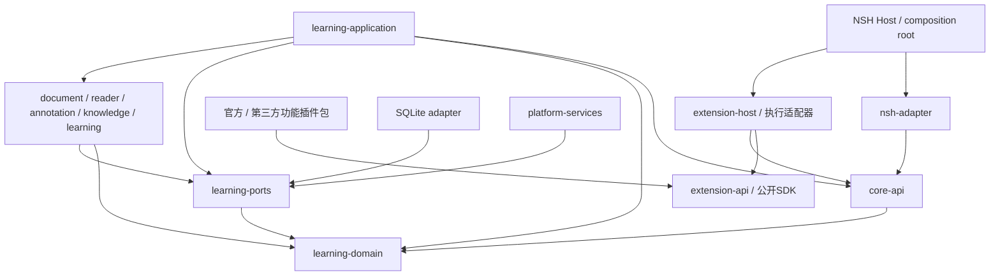

# QUSOR 架构基座

状态：工程边界已建立；业务协议仍是待 M-1 验证的设计。详细模型以 [Core 数据与定位研究](../research/03-core-data-architecture.md) 为参考，不把其所有实体预生成成代码。

## 当前实际结构

```text
Cargo workspace
└── learning-domain      无业务实现、无外部依赖

config/architecture.toml  当前成员与依赖允许清单
scripts/                 工程边界与文档检查
.agents/skills/           项目协作工作流
docs/product/            功能和体验设计
docs/research/           固定版本研究证据
experiments/             后续隔离技术验证约定
```

只建立 learning-domain，是为了验证可重复构建与独立核心边界；不引入一个与原计划重叠的 qusor-core 大模块，也不一次创建全部空业务 crate。

## 未来依赖方向



箭头是编译依赖。Host 未来也会链接 application 与具体 adapters 完成装配；动态调用依赖注入的实现，不要求 core-api 反向依赖 application。功能插件依赖公开SDK，通过extension-host间接调用Core；nsh-adapter直接访问Core仅用于宿主通用能力/恢复，不作为官方功能的私有旁路。

| 层 | 创建时机 | 边界 |
|---|---|---|
| learning-domain | 已创建文档空壳 | 纯领域数据/不变量，不含UI/数据库/网络 |
| core-api、learning-ports | 首个经确认用例需要契约时 | 版本化DTO、应用接口与基础设施port；无具体实现 |
| learning-application | 首个业务用例实施时 | 命令、事务、审核与流程编排 |
| document/reader/annotation等engine | 对应能力实施时 | 内容和算法职责，不含平台view |
| storage/provider/sync/platform adapters | 技术验证通过后 | 实现ports，通过统一用例提交业务写入 |
| extension-api/extension-host/执行适配器 | 获授权执行插件实验/具体实现时 | 版本化扩展契约、能力broker、贡献点；不直接写知识库，不让Core依赖runtime |
| nsh-adapter/host | NSH验证阶段先在独立实验 | 线程、序列化、事件与资源生命周期 |

Core API、文档版本、ReaderAnchor 和持久化 Schema 都独立版本化。NSH 的节点 ID、编辑器位置、DOM offset 不直接成为永久来源地址。

## 插件扩展边界

插件化是正式基座要求，见 [插件架构与验证计划](extensions.md)。扩展提供能力，Core持有知识；外部选文经统一CaptureDraft成为本地可复现快照，外部回跳单独表达能力等级。插件生命周期、UI贡献、审核、权限和运行策略都通过宿主边界。

统一协议不等于五端可运行任意动态代码。第一阶段必须提供第三方独立包闭环及实用受限执行能力，官方功能也用公开SDK。M-1验证JS/Wasm等候选，不能以仅内置或静态模板代替第三方验收。具体SDK和执行器尚未实现。

Core保留数据与应用服务；Host保留平台、运行管理及通用恢复；功能工作区、阅读/笔记/研究/复习流程由插件组合。官方预装功能与第三方走同一接口和权限规则，不能直连私有实现。边界及任务见 [功能归属](extensions.md#11-功能围绕插件开发) 与 [第一阶段交付顺序](extensions.md#12-第一阶段交付顺序与发布门槛)。

## 工程策略

[architecture.toml](../../config/architecture.toml) 定义当前允许成员和依赖。检查读取 Cargo metadata 的声明，包含 normal/dev/build、可选和 target-specific 依赖；当前清单为空，因此可阻止通过任一直接入口引入 UI 或基础设施依赖。

这个检查目前是基座允许清单，不宣称实现了未来任意依赖图的完整分层分析。真正拆分模块时扩展规则和反例测试，核对传递依赖、FFI 与平台边界。

无业务实现意味着不创建假数据库、返回固定结果的 Agent、空导入方法、未验证的生产 renderer 或大量 todo!。基础设施检查代码不属于业务功能。

## 决策与研究的关系

- [ADR 0003](adr/0003-plugin-first-delivery.md)：第一阶段第三方开发/安装/分发，以及第一方功能插件化。
- [ADR 0002](adr/0002-extension-boundary.md)：通用插件契约、来源所有权、执行与分发边界。
- [ADR 0001](adr/0001-foundation-boundary.md)：本轮基座边界与延后事项。
- [来源模型](../research/03-core-data-architecture.md)：Schema、QLA、线程与导出设计。
- [Agent 与检索](../research/04-agent-retrieval.md)：工具、引用与审批设计。
- [本地优先同步](../research/05-local-first-sync.md)：操作日志、冲突及隐私设计。
- [阶段验收](../research/06-milestones-risks.md)：具体技术验证门槛。

研究建议可以被实验修正；用户的产品取舍记录在 [功能范围](../product/scope.md)，不能用技术文档替用户作产品确认。
