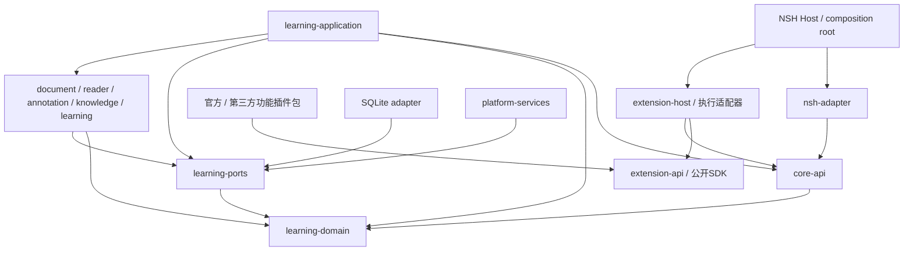

# QUSOR 架构基座

状态：工程边界与无界面插件宿主策略内核已建立；完整 SDK、运行隔离、存储与业务协议仍须各自验证。详细模型以 [Core 数据与定位研究](../research/03-core-data-architecture.md) 为参考，不把其所有实体预生成成代码。

## 当前实际结构

```text
Cargo workspace
├── learning-domain      无业务实现、无外部依赖
├── extension-api        0.1 JSON 策略协议、manifest 投影与能力校验
└── extension-host       内存安装元数据、授权、会话、生命周期与贡献查询

config/architecture.toml  当前成员与依赖允许清单
scripts/                 工程边界与文档检查
.agents/skills/           项目协作工作流
docs/product/            功能和体验设计
docs/research/           固定版本研究证据
experiments/             独立 Wasm 执行实验与验证记录
```

learning-domain 保持独立核心边界；新增两个模块承接已授权的实际协议与策略职责，见 [无界面基座规格](../product/foundation.md) 与 [ADR 0004](adr/0004-headless-extension-policy.md)。不引入与原计划重叠的 qusor-core 大模块，也不一次创建全部空业务 crate。

## 未来依赖方向



箭头是编译依赖。Host 未来也会链接 application 与具体 adapters 完成装配；动态调用依赖注入的实现，不要求 core-api 反向依赖 application。功能插件依赖公开SDK，通过extension-host间接调用Core；nsh-adapter直接访问Core仅用于宿主通用能力/恢复，不作为官方功能的私有旁路。

| 层 | 创建时机 | 边界 |
|---|---|---|
| learning-domain | 已创建文档空壳 | 纯领域数据/不变量，不含UI/数据库/网络 |
| core-api、learning-ports | 首个经确认用例需要契约时 | 版本化DTO、应用接口与基础设施port；无具体实现 |
| learning-application | 首个业务用例实施时 | 命令、事务、审核与流程编排 |
| document/reader/annotation等engine | 对应能力实施时 | 内容和算法职责，不含平台view |
| storage/provider/sync/platform adapters | 技术验证通过后 | 实现ports，通过统一用例提交业务写入 |
| extension-api/extension-host | 已实现无界面协议与策略部分 | 宿主仅普通依赖 extension-api；内存注册、授权、会话与贡献，不执行插件或知识写入 |
| 执行适配器 | 运行/隔离验证后按用例接入 | 版本化能力 broker 与受限执行；不直接写知识库，不让 Core 依赖 runtime |
| nsh-adapter/host | NSH验证阶段先在独立实验 | 线程、序列化、事件与资源生命周期 |

Core API、文档版本、ReaderAnchor 和持久化 Schema 都独立版本化。NSH 的节点 ID、编辑器位置、DOM offset 不直接成为永久来源地址。

## 插件扩展边界

插件化是正式基座要求，见 [插件架构与验证计划](extensions.md)。扩展提供能力，Core持有知识；外部选文经统一CaptureDraft成为本地可复现快照，外部回跳单独表达能力等级。插件生命周期、UI贡献、审核、权限和运行策略都通过宿主边界。

统一协议不等于五端可运行任意动态代码。第一阶段必须提供第三方独立包闭环及实用受限执行能力，官方功能也用公开SDK。M-1验证JS/Wasm等候选，不能以仅内置或静态模板代替第三方验收。当前已实现 0.1 策略协议及内存宿主内核；发布 SDK、独立包安装器和执行器仍未交付。

Core保留数据与应用服务；Host保留平台、运行管理及通用恢复；功能工作区、阅读/笔记/研究/复习流程由插件组合。官方预装功能与第三方走同一接口和权限规则，不能直连私有实现。边界及任务见 [功能归属](extensions.md#11-功能围绕插件开发) 与 [第一阶段交付顺序](extensions.md#12-第一阶段交付顺序与发布门槛)。

## 工程策略

[architecture.toml](../../config/architecture.toml) 定义当前允许成员和依赖。检查读取 Cargo metadata 的声明，包含 normal/dev/build、可选和 target-specific 依赖；当前直接依赖只允许 extension-api 使用 serde/serde_json，以及宿主到 extension-api 的依赖；learning-domain 仍拒绝全部外部依赖。两个新模块还按单独允许清单检查 Cargo 已解析的传递依赖闭包，包括构建与过程宏依赖。

检查覆盖当前成员的全部直接声明与显式配置模块的已解析传递闭包，并包含间接引入受限模块的反例。未被当前 Cargo 特性组合解析的第三方可选分支、FFI 语义和运行时权限不由这个检查证明；新增适配器时继续按实际边界扩展规则。

独立 Wasm 实验及其作者工具分别使用隔离 Workspace，依赖另列在相同策略文件的 experiments 表中，由 [实验验证脚本](../../experiments/extension-wasm/validate.py) 复用架构检查；根检查不代表实验已执行。实测范围见 [实验结果](../../experiments/extension-wasm/RESULTS.md)。

当前策略实现没有真实知识读写，不创建假数据库、返回固定结果的 Agent、空导入方法、未验证的生产 renderer 或大量 todo!。协议许可与同步回调只证明宿主策略，不证明数据库提交、独立包执行或业务功能完成。

## 决策与研究的关系

- [ADR 0005](adr/0005-wasm-runtime-probe.md)：独立 Wasm 实验及本机结果，不决定生产运行时。
- [ADR 0004](adr/0004-headless-extension-policy.md)：推进无界面插件策略实现，保留独立包、隔离与平台发布门槛。
- [ADR 0003](adr/0003-plugin-first-delivery.md)：第一阶段第三方开发/安装/分发，以及第一方功能插件化。
- [ADR 0002](adr/0002-extension-boundary.md)：通用插件契约、来源所有权、执行与分发边界。
- [ADR 0001](adr/0001-foundation-boundary.md)：本轮基座边界与延后事项。
- [来源模型](../research/03-core-data-architecture.md)：Schema、QLA、线程与导出设计。
- [Agent 与检索](../research/04-agent-retrieval.md)：工具、引用与审批设计。
- [本地优先同步](../research/05-local-first-sync.md)：操作日志、冲突及隐私设计。
- [阶段验收](../research/06-milestones-risks.md)：具体技术验证门槛。

研究建议可以被实验修正；用户的产品取舍记录在 [功能范围](../product/scope.md)，不能用技术文档替用户作产品确认。
