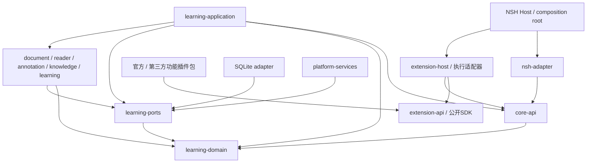

# QUSOR 架构基座

插件的平台目标、多实现包、能力与渠道协商见 [平台兼容规格](plugin-platforms.md) 和 [ADR 0031](adr/0031-platform-aware-plugins.md)；当前为设计，尚未实现。

状态：工程边界与无界面插件宿主策略内核已建立；完整 SDK、运行隔离、存储与业务协议仍须各自验证。详细模型以 [Core 数据与定位研究](../research/03-core-data-architecture.md) 为参考，不把其所有实体预生成成代码。

[目录与插件职责](workspace-layout.md) 是代码位置、全部 Feature 归属及独立 Workspace 边界的入口；[ADR 0006](adr/0006-plugin-workspace-layout.md) 记录本阶段授权。包安装/恢复的详细设计见 [生命周期](plugin-lifecycle.md)，实施顺序见 [下一阶段](../product/next-phase.md)。

## 当前实际结构

```text
Cargo workspace
├── learning-domain      FSRS-5 词汇调度内核；无外部依赖
├── core-api             捕获/来源/锚点、知识记录、词汇学习契约与纯归档不变量
├── learning-ports       一致快照/原子提交恢复与词汇学习端口
├── learning-application 文本/PDF/复合知识用例与词汇学习用例
├── blob-store           Unix私有目录、单writer与耐久CAS适配器
├── storage-sqlite       schema/关系核验、整体SQL事务与schema4词汇学习表
├── extension-package    有界签名容器、内容/发布者键绑定验证
├── extension-runtime-api 无授权副作用的执行端口/预算
├── runtime-wasm         Wasmi执行适配器；不创建Host或读取包路径
├── extension-api        0.5 JSON 策略协议、manifest 投影与能力校验
└── extension-host       内存安装元数据、授权、会话、生命周期与贡献查询

config/architecture.toml  当前成员与依赖允许清单
scripts/                 工程边界与文档检查
.agents/skills/           项目协作工作流
docs/product/            功能和体验设计
docs/research/           固定版本研究证据
apps/                   装配入口（只有目录说明）
adapters/               已有SQLite/CAS/Wasmi；NSH/平台等仍按门槛实施
plugins/ sdk/            plugins/vocab 普通包资格切片；SDK 尚未发行
experiments/             Wasm、签名包/安装事务证据、NSH 环境/构建记录
```

learning-domain 已从空壳变为 FSRS-5 词汇调度内核，仍保持独立核心边界与零外部依赖；extension-api/extension-host 承接已授权的实际协议与策略职责（当前 0.5），词汇学习切片见 [ADR 0036](adr/0036-vocabulary-study-capability.md)。core-api 随 C3 后续落位捕获/来源/锚点契约，见 [ADR 0018](adr/0018-core-api-contract-source.md)。不引入与原计划重叠的 qusor-core 大模块，也不一次创建全部空业务 crate。

## 未来依赖方向



箭头是编译依赖。Host 未来也会链接 application 与具体 adapters 完成装配；动态调用依赖注入的实现，不要求 core-api 反向依赖 application。功能插件依赖公开SDK，通过extension-host间接调用Core；nsh-adapter直接访问Core仅用于宿主通用能力/恢复，不作为官方功能的私有旁路。

| 层 | 创建时机 | 边界 |
|---|---|---|
| learning-domain | 已创建文档空壳 | 纯领域数据/不变量，不含UI/数据库/网络 |
| core-api、learning-ports | 首个经确认用例需要契约时 | 版本化DTO、应用接口与基础设施port；无具体实现 |
| learning-application | 首个业务用例实施时 | 命令、事务、审核与流程编排 |
| document/reader/annotation等engine | 对应能力实施时 | 内容和算法职责，不含平台view |
| storage/provider/sync/platform adapters | 技术验证通过后 | 实现ports，通过统一用例提交业务写入 |
| extension-api/extension-host | 已实现无界面协议与策略部分 | 宿主仅普通依赖 extension-api；内存注册、授权、会话与贡献，不执行插件或知识写入 |
| 执行适配器 | 运行/隔离验证后按用例接入 | 版本化能力 broker 与受限执行；不直接写知识库，不让 Core 依赖 runtime |
| nsh-adapter/host | NSH验证阶段先在独立实验 | 线程、序列化、事件与资源生命周期 |

Core API、文档版本、ReaderAnchor 和持久化 Schema 都独立版本化。NSH 的节点 ID、编辑器位置、DOM offset 不直接成为永久来源地址。

## 插件扩展边界

插件化是正式基座要求，见 [插件架构与验证计划](extensions.md)。扩展提供能力，Core持有知识；外部选文经统一CaptureDraft成为本地可复现快照，外部回跳单独表达能力等级。插件生命周期、UI贡献、审核、权限和运行策略都通过宿主边界。

统一协议不等于五端可运行任意动态代码。第一阶段必须提供第三方独立包闭环及实用受限执行能力，官方功能也用公开SDK。M-1验证JS/Wasm等候选，不能以仅内置或静态模板代替第三方验收。当前已实现 0.1 策略协议及内存宿主内核；发布 SDK、独立包安装器和执行器仍未交付。

Core保留数据与应用服务；Host保留平台、运行管理及通用恢复；功能工作区、阅读/笔记/研究/复习流程由插件组合。官方预装功能与第三方走同一接口和权限规则，不能直连私有实现。边界及任务见 [功能归属](extensions.md#11-功能围绕插件开发) 与 [第一阶段交付顺序](extensions.md#12-第一阶段交付顺序与发布门槛)。

## 工程策略

[architecture.toml](../../config/architecture.toml) 定义当前允许成员和依赖。检查读取 Cargo metadata 的声明，包含 normal/dev/build、可选和 target-specific 依赖；extension-api 使用 serde/serde_json，extension-host 仅依赖 extension-api；core-api 使用 serde/serde_json、SHA-256、Unicode 分段及 base64 进行契约/归档验证；application/ports 无SQL或平台依赖，SQLite/CAS依赖仅在相应适配器登记，learning-domain 仍拒绝全部外部依赖。各模块按单独允许清单检查 Cargo 已解析的传递依赖闭包，包括构建与过程宏依赖。

检查覆盖当前成员的全部直接声明与显式配置模块的已解析传递闭包，并包含间接引入受限模块的反例。未被当前 Cargo 特性组合解析的第三方可选分支、FFI 语义和运行时权限不由这个检查证明；新增适配器时继续按实际边界扩展规则。

独立 Wasm 实验及其作者工具分别使用隔离 Workspace，依赖另列在相同策略文件的 experiments 表中，由 [实验验证脚本](../../experiments/extension-wasm/validate.py) 复用架构检查；根检查不代表实验已执行。实测范围见 [实验结果](../../experiments/extension-wasm/RESULTS.md)。

extension-host 策略本身不写知识；新增 application 经 ports 调用真实 SQLite/CAS，并由捕获实验消费。不得创建假数据库、返回固定结果的 Agent、空导入方法、未验证的生产 renderer 或大量 todo!。协议许可与同步回调只证明宿主策略，不证明数据库提交、独立包执行或业务功能完成。

新增 [签名包与安装事务实验](../../experiments/extension-package/README.md) 使用独立 Workspace，显式签名/键绑定及 SQLite BLOB 管理事务已留证；生产依赖不变。候选和限制见 [ADR 0007](adr/0007-signed-package-persistence-probe.md)，不能替代正式授权恢复或知识写入。

## 决策与研究的关系

- [ADR 0028](adr/0028-extensible-native-workspace.md)：原生工作区区域、组件角色与提供者分离，兼容替换和数据保留；[设计工作基线](../design/README.md) 给出布局、视觉与UX验收，通用组合协议尚未实现。

- [ADR 0034](adr/0034-note-read-model.md)：想法读取的 keyset 分页、范围绑定游标与有界正文分块；应用层与 SQLite 重开已通过，公开 SDK wire、插件授权与窗口接线未完成。

- [ADR 0035](adr/0035-notes-read-capability.md)：协议0.4、`notes.read` 能力与 `notes-query-v1` 有界 wire、Host vault 绑定与许可失效；可信Core后端、普通包与实窗未完成。

- [ADR 0027](adr/0027-supervised-raw-process-runtime.md)：独立控制线程/原始字节传输与ManagedRun生命周期已通过真实Core九场景和完整兼容回归；正式应用装配与其他平台待完成。

- [ADR 0032](adr/0032-verified-package-material-cache.md)：完整材料相等时复用纯验包结果，fresh授权与私有检查保留。

- [ADR 0030](adr/0030-readonly-paragraph-projection.md)：与编辑独立的有界段落投影及取消/恢复边界。

- [ADR 0029](adr/0029-local-agent-workbench.md)：新增本地 Agent 工作台设计；任务/会话/视图分离，可替换后端、委派 broker、输入所有权、执行恢复和电脑操作边界，尚未实现。

- [ADR 0026](adr/0026-durable-reader-native-dynamic-pdf.md)：版本化阅读权限集合、逐次重核的DurableSurface和NSH原生动态PDF通路；动态保存/恢复资格已通过，正式阅读工作区仍待完成。

- [ADR 0025](adr/0025-durable-installation-authority.md)：持久安装/私有配对/运行租约的唯一SQL内核、统一Host恢复和精确版本校验；Linux进程身份同源迁移，完整监督仍须装配。

- [ADR 0024](adr/0024-cloud-storage-adapters.md)：云端结构化同步、对象存储和身份通过可替换适配器接入；Supabase 与 Cloudflare 为候选，Core 不绑定供应商。仅预留设计，未接入云服务。

- [ADR 0023](adr/0023-public-reader-surface.md)：保留0.1兼容的0.2公开Surface、临时选区lease和Host registry已实施；普通签名包的原生选文/笔记保存及Core恢复已有本机集成资格，正式阅读工作区仍待交付。

- [ADR 0020](adr/0020-native-pdf-surface-probe.md)：NSH 原生 PDF 页图、窗口触点与选区的独立适配探针；不将 NSH 引入业务 Core，也不代替普通插件或正式阅读旅程。

- [ADR 0019](adr/0019-atomic-knowledge-persistence.md)：真实 application/ports 与 SQLite/CAS 落位，同一捕获实验消费生产实现；公开计划重新核验，生产不包含进程终止故障注入。

- [ADR 0018](adr/0018-core-api-contract-source.md)：捕获与锚点公开契约迁入 core-api 单一权威源，实验转发与 SDK 仓库外消费；不包含生产存储或 NSH 集成。

- [ADR 0013](adr/0013-capture-core-qualification.md)：普通插件真实捕获、原生批准门、不可变快照、事务凭据及空库恢复资格切片；[本机结果](../../experiments/capture-core/RESULTS.md) 不代替生产 Core 或阅读 UI。

- [ADR 0014](adr/0014-native-pdf-provider-qualification.md)：按 C-09 原生优先验证 PDFium 页图/字符映射及几何；[本机子项](../../experiments/pdf-provider/RESULTS.md) 通过，可靠阅读顺序、正式 PDF 保存与 NSH 仍未通过。

- [ADR 0015](adr/0015-pdf-core-snapshot-archive.md)：实验 Core schema2 保留 PDF 原件/映射，普通插件提案与混合全局事务、迁移、完整归档及恢复后原生回源；[本机结果](../../experiments/capture-core/PDF_RESULTS.md) 不代表生产或 NSH 已集成。

- [ADR 0016](adr/0016-native-pdf-selection-service.md)：原生命中、视口/手势生命周期及有序分段服务；[本机子项](../../experiments/pdf-provider/SELECTION_RESULTS.md) 不代替 NSH 输入或复合锚点的单事务收录。

- [ADR 0017](adr/0017-compound-pdf-capture.md)：版本2复合锚点、普通插件整组提案与一次事务保存，schema3/V3归档兼容及旧入口防截断；[本机结果](../../experiments/capture-core/COMPOUND_RESULTS.md) 不等于生产或阅读 UI 完成。

- [ADR 0012](adr/0012-supervisor-crash-reconciliation.md)：Linux 身份固定、持久 worker 排他、GuardReady/Boot 与宿主异常退出协调；未知未绑定窗口仍隔离。

- [ADR 0011](adr/0011-persistent-supervisor-probe.md)：同一长驻宿主多插件进程监督、父 broker 判权、隔离回收与过期通道拒绝；异常退出协调另验。

- [ADR 0010](adr/0010-paired-private-state-probe.md)：真实私有迁移、预检与包/状态成对提交/回滚；长驻监督与正式知识另验。

- [ADR 0009](adr/0009-restored-wasm-execution-probe.md)：复用已授权会话恢复同步受限 Wasm 调用；私有迁移与长驻监督另验。

- [ADR 0008](adr/0008-durable-grant-recovery-probe.md)：持续元数据授权与新策略会话恢复实验，实际执行恢复仍待验证。

- [ADR 0007](adr/0007-signed-package-persistence-probe.md)：签名包、仓库外 SDK 工件与持久安装事务实验。

- [ADR 0006](adr/0006-plugin-workspace-layout.md)：插件目录、功能归属与下一阶段边界。

- [ADR 0005](adr/0005-wasm-runtime-probe.md)：独立 Wasm 实验及本机结果，不决定生产运行时。
- [ADR 0004](adr/0004-headless-extension-policy.md)：推进无界面插件策略实现，保留独立包、隔离与平台发布门槛。
- [ADR 0003](adr/0003-plugin-first-delivery.md)：第一阶段第三方开发/安装/分发，以及第一方功能插件化。
- [ADR 0002](adr/0002-extension-boundary.md)：通用插件契约、来源所有权、执行与分发边界。
- [ADR 0001](adr/0001-foundation-boundary.md)：本轮基座边界与延后事项。
- [来源模型](../research/03-core-data-architecture.md)：Schema、QLA、线程与导出设计。
- [Agent 与检索](../research/04-agent-retrieval.md)：工具、引用与审批设计。
- [本地优先同步](../research/05-local-first-sync.md)：操作日志、冲突及隐私设计。
- [阶段验收](../research/06-milestones-risks.md)：具体技术验证门槛。

研究建议可以被实验修正；用户的产品取舍记录在 [功能范围](../product/scope.md)，不能用技术文档替用户作产品确认。
