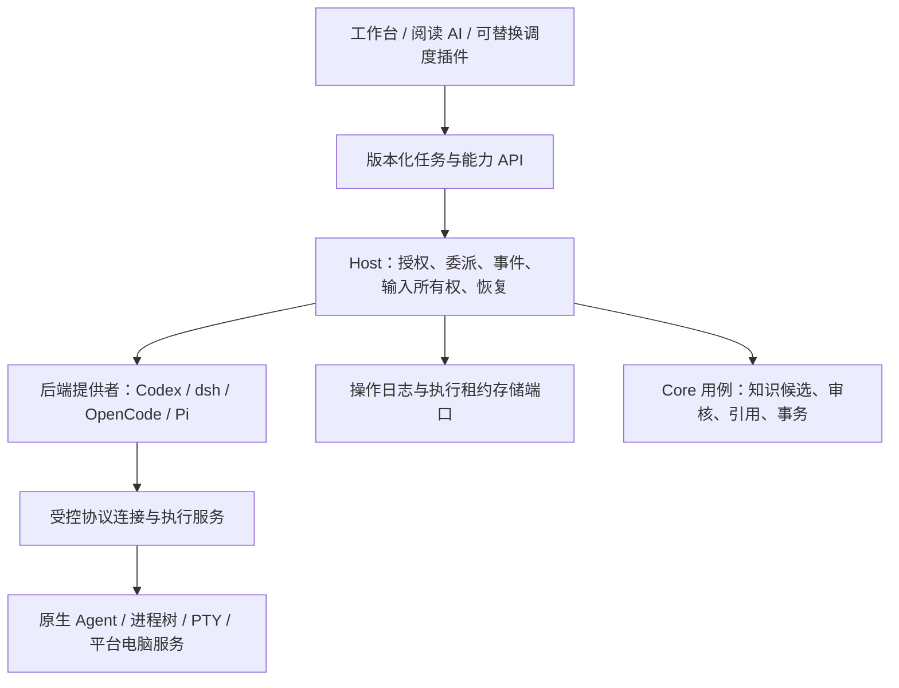

# ADR 0029：本地 Agent 工作台与可替换后端

日期：2026-11-08。状态：采用设计方向，协议、运行服务和后端适配尚未实现。关联 C-13、F-AGENT-01–05、F-AI-02/03/07、F-EXT-01/03/05/06。用户要求在阅读知识系统之外加入电脑操作、编程、多 Agent 调度与会话管理，并同步设计 UI/UX/UE。规格见 [Agent 工作台](../../product/agent-workbench.md)。

## 选择与理由

采用“QUSOR 管任务、授权、资源与恢复；外部 Agent 保留自身推理与原生会话；插件提供工作流、后端接入和调度策略”。Pi 可作为内置助手/调度器的候选执行引擎，不能成为所有外部 Agent 的强制宿主。完全自写各家 coding agent 成本高；直接把完整 Pi 或单个 CLI 当全局核心会绑定其会话、配置与运行时；只管理终端窗格则缺少可靠的任务结果和权限语义。

参考 Herdr 区分布局、pane 和 agent 的方式，进一步独立任务、执行尝试、原生会话与展示组件。统一接口表达共同能力，差异通过能力协商呈现；不伪造所有后端均支持恢复、分叉和逐工具拦截。

箭头表示调用方向，不意味着第三方 Agent 的所有文件/网络访问都会经过 Host。实际执行约束由执行环境提供；缺少隔离能力的接入必须明确标识。

## 实体与所有权

| 对象 | 所有者与不变量 |
|---|---|
| ProjectRef | Host 验证的项目根/设备/仓库身份；路径重命名、符号链接及设备差异须重验，不能只相信模型路径 |
| Task / Delegation | Host 保存目标、父子关系、范围、预算与成果；调度插件仅提出计划，不制造授权 |
| RunAttempt | 一次实际执行，有新 attempt ID、世代、租约和结果状态；重试不是覆盖旧执行 |
| SessionBinding | 后端安装/协议/版本、设备、项目、原生会话 ID 的组合；恢复不自动继承旧授权 |
| Event / ArtifactRef | 有序事件与带 hash/版本的成果引用；不能用一段最终聊天取代文件和检查事实 |
| View / Pane | 可关闭或替换的展示实例；不拥有任务寿命、原生会话或系统进程 |
| Knowledge | 仍由 Core 持有；从编程成果保存知识经过同一正式用例，无旁路 SQL |

操作记录使用独立逻辑 schema/端口，由 Host 应用服务提交；具体物理数据库待真实用例决定。不把任意运行日志塞进知识领域，不借 extension-store 的安装租约冒充通用任务库。涉及插件安装/升级仍以原安装内核为唯一权威源。

## 后端能力与协议

公开后端贡献至少协商：连接/协议版本、身份、支持的 provider/model、新建/列出/恢复/分叉、流式事件、取消/终止、结构化工具/批准、人工输入、历史导出、用量及执行约束。每项允许 supported/unsupported/unknown；未知不作为支持。所有新能力另行版本化，既有 Host API0.1/0.2 保持兼容。

接入优先级：官方结构化服务协议 → 官方非交互事件流 → 受控 PTY 兼容。PTY 屏幕识别只提供尽力的展示状态，不作为测试通过、权限批准或持久完成证据。输入凭 argv/结构化消息传递，不拼接模型给出的 shell 文本。

| 后端 | 候选接入 | 当前证据与缺口 |
|---|---|---|
| Codex | App Server 的 thread/turn、事件和批准 | 已查官方文档；尚未在 QUSOR 启动、认证、恢复或验证委派工具 |
| OpenCode | server/SDK 的 session、事件、provider/model | 已查官方文档；实际版本固定、取消与模型回执待测 |
| dsh | 固定官方项目后检查会话/工具扩展协议 | 当前只有候选发现；官方发布身份、具体 API 与取消恢复均待固定，不承诺某条命令可直接工作 |
| Pi | 内置助手的可替换执行器；或独立后端 | 官方 SDK 面向 Node/Bun；与 Rust 的运行/通信、许可和分发成本待验证 |
| Herdr | 借鉴或可选终端后端 | 已查官方 agent automation；是否嵌入/桥接/复用源码另验协议、版本、许可与平台，不直接引入依赖 |

这不是模型 API 与 Agent 的混用：指定 OpenCode 模型意味着交给 OpenCode 会话执行；直接调用同款模型另属 provider 能力，工具和权限不因此等同。

## 跨 Agent 委派与输入所有权

通过受控本地工具桥（候选 MCP/后端原生工具）暴露 `delegate`、`inspect`、`collect`、`cancel` 等语义；这些是设计操作，非已发布方法。后端请求附宿主绑定身份，不能自报父任务 ID 取得权限。任意 A→B 调用经 broker，创建持久 child Task 后再启动；结果按原请求关联返回，不注入错误会话。

子任务有效授权 = 父任务可委派范围 ∩ 后端权限 ∩ 执行环境限制 ∩ 用户当前策略。子任务和重试共享祖先剩余预算；限制深度、并发、总调用与期限，拒绝循环委派。明确区分允许调用另一个 Agent 和允许转发哪些内容。原文和工具结果均为不可信输入。

每个原生会话和交互终端有带世代的唯一输入租约。用户接管后调度器只读；后台再接管须显式交还，旧 epoch 输入拒绝。后端升级、断线或重新连接后重新验证所有权；不通过向同一终端同时打字实现协作。

## 生命周期、持久化与恢复

任务业务状态使用 Queued / Running / NeedsInput / Reconciling / Completed / Failed / Cancelled；进程使用 Starting / Live / StopRequested / ExitConfirmed / Unknown；成果整合另有 PendingReview / Integrated / Conflict。停止请求不等于进程退出，完成聊天不等于文件合并成功，窗口关闭不修改上述事实。

先持久记录启动意图与新 attempt，再由监督服务启动；核对身份后绑定租约。不可把现有同程序 Wasm worker 的 GuardReady/Boot 直接套给不支持握手的外部 CLI，须由受控启动包装和实际 OS 证据补齐资格。仅支持进程恢复的后端也不能声称会话可恢复。

事件信封含 task/attempt/backend session、epoch、序号、类型、来源时间和接收时间；有界输出、背压和持久游标。重复事件去重，缺口显示不完整；旧世代不驱动新视图或触发副作用。事件追加、状态变化和待发送控制意图在操作存储事务内提交；实际进程/文件系统不宣称与数据库原子。

重启先协调后端会话和可确认 OS 身份。无法确认是否执行过的写入、提交、发送或部署标为未知，禁止自动重放；可查询幂等键的适配器才自动核对。父任务取消先关新委派、再取消子树与输入，逐项核对进程树退出和持久清理。后台独立 watchdog 不依赖 UI 轮询。继承 ADR0027 的真实回收原则，但外部进程树需独立验证；未知身份保持隔离。

## 文件、终端与电脑操作

并行写代码默认采用独立 Git worktree，保留基线 commit、路径/内容 hash、已有未提交修改记录和写入租约；非 Git 项目只允许一个受控写任务。worktree 是协作隔离，不能作为 OS 安全沙箱。用户现有 dirty worktree 不自动 stash/reset/清理。结果整合重核基线，展示差异并处理冲突；代码测试执行同样有本机副作用。

文件/命令、网络、屏幕采集、应用可访问性操作、鼠标键盘输入是分开的能力。凭据由受控配置交给目标后端，不通过任务包和日志转发。任意 CLI 可能自行联网或访问文件；要展示“限定目录/禁止联网”须有对应平台 OS 约束和真实反例证据，否则显示本机宽权限执行事实，并只在用户选择该模式后启动。

电脑服务有独立控制租约、目标应用/窗口、显示器和坐标空间世代；截图帧绑定动作目标。焦点变化、锁屏、用户接管或显示缩放变化后暂停并重验，不向旧坐标盲输。持久可见控制指示和宿主停止入口不可被插件遮挡。屏幕内容送云属于另一个出站范围。

代码文件的撤回通过已验证补偿变更/检查冲突完成，不能对用户项目 git reset；外部发送/部署不承诺撤销。正式知识仍使用 Core 的批准、版本校验、审计与 outbox 事务，编程授权不能变成全库写权。

## 模块落位与 UI 边界

规划任务协议、纯状态机/应用端口留在 crates；存储/各平台执行/终端仿真/电脑服务在 adapters；Host 组合这些通用服务；apps 只装配。具体 crate 拆分由首个真实切片决定，不生成空模块，也不把 Node 或 NSH 引入 Core。

工作台、后端接入、调度策略与会话/差异组件使用独立插件；需要的本地连接与执行由受控服务完成，不向后端插件直接开放任意 FFI。具体职责见 [工作台交互](../../design/agent-workbench.md)，沿用 ADR0028 的角色与提供者替换。卸载工作台或后端后，Host 通用恢复/任务记录查看仍可用；关闭视图不停止后台任务，停用执行提供者则按受控停止与真实释放处理。

## 验证与阶段

依次验证两个固定版本后端的结构化会话/事件/恢复；跨后端委派与预算/取消；真实工作树隔离和冲突整合；原生终端输入/中文组合态；电脑目标绑定与用户接管。按 [AW 场景](../../product/agent-workbench.md) 留存真实回执、故障和原生交互证据。验证前不决定 Pi 或 Herdr 为生产依赖，不改变已确认平台目标。

## 本轮来源核对

访问日期：2026-11-08；仅文档/源码调研，未安装、登录或执行外部 Agent。

- [Codex App Server](https://learn.chatgpt.com/docs/app-server)：thread/turn、批准和事件；[OpenCode SDK](https://docs.opencode.ai/docs/sdk/)：session 与显式模型选择。
- [Herdr agent automation](https://herdr.dev/tui/docs/agent-automation/)：布局、pane、agent 分责与调度原语；[Pi SDK](https://pi.dev/docs/latest/sdk)：Node/Bun 嵌入及 CLI 集成。
- NSH [发布记录](https://github.com/longbridge/nsh/releases)：稳定 v0.4.0、nightly f81b965；GitHub commits API 核对 HEAD `1042a80d876adcc3b9f86e75ebdf52bef4352083`（2026-11-08 06:05:30 UTC），近五次包括性能监视、TUI 嵌入选项/停止和启动响应等待。[固定 README](https://github.com/longbridge/nsh/blob/1042a80d876adcc3b9f86e75ebdf52bef4352083/README.md) 已读取。TUI 是终端渲染目标，不能推导已具有桌面 PTY 终端控件；新提交也不证明 QUSOR 中文输入或 Surface 隔离已通过。本轮不升级已有固定实验 `913fd76e1f8434ec6cdf248f4476c1ebe08af19f`，原生终端、代码差异/编辑、长日志与电脑控制另做隔离实验。
