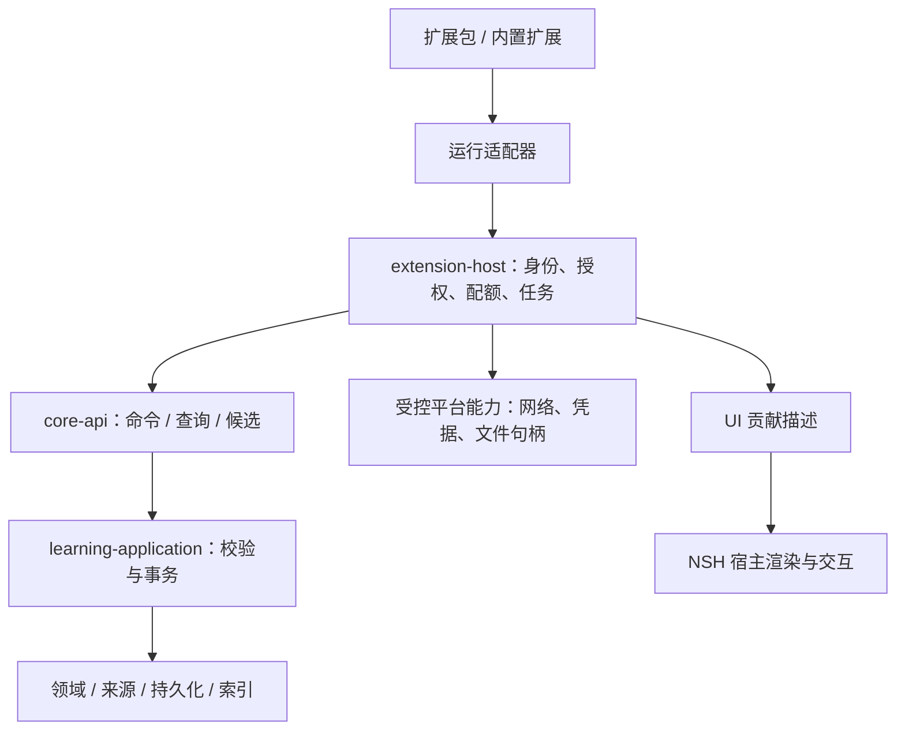

# QUSOR 插件扩展架构

日期：2026-11-07。状态：**插件化是用户已明确要求的基座能力；已推进 0.1 协议与无界面宿主策略实现，完整 SDK、包安装、运行隔离和具体插件仍未交付。** 插件与扩展在本文中同义。决策见 [ADR 0002](adr/0002-extension-boundary.md)，产品范围见 [功能矩阵](../product/scope.md)。用户后续已确认第一阶段开放第三方且第一方功能插件化，分期以 [ADR 0003](adr/0003-plugin-first-delivery.md) 及第12节为准。

本阶段的代码目录、全部 Feature 的功能插件归属与依赖约束见 [目录架构](workspace-layout.md)；持久安装、授权恢复、升级/回滚与长驻宿主见 [包生命周期设计](plugin-lifecycle.md) 和 [验收规格](../product/plugin-lifecycle.md)。新授权及实施顺序见 [ADR 0006](adr/0006-plugin-workspace-layout.md)。

## 0 本轮实现与验证边界

用户在前期材料收集后明确先实现基座，见 [功能规格](../product/foundation.md) 与 [ADR 0004](adr/0004-headless-extension-policy.md)。本轮新增 extension-api 与 extension-host：0.1 JSON 策略协议、manifest 策略投影、三项能力协商、内存安装元数据、资源范围授权、宿主会话、启停/撤权/升级/卸载及贡献查询。

一个宿主实例绑定一个库，身份不能由插件载荷自报。会话和许可绑定宿主实例、安装实例与授权世代；同步分派在调用受信任回调前重新验证并消费许可。升级仅接受同包同发布者的更高版本及不同摘要，成功后禁用并清空授权；旧会话/许可失效。失败升级保持原有效状态。

SelectionRead、DocumentMetadataRead 与 CapturePropose 在本轮只实施策略判定，没有读取正文、保存候选或正式写库。安装仅注册元数据；package_digest 是未来受信任包验证器的输入，本轮不校验包字节、签名或发布者身份。manifest、内存注册和同步回调均不构成安全执行沙箱或 Core 事务实现。

下文是完整目标架构，超出上述内容的设计仍未实现。F-EXT-01/03/04/06 仅有策略层部分，F-EXT-05 及 EXT-B/P 全部门槛继续保留；独立包、运行隔离、真实知识保留/导出、贡献 UI 与五平台均未验收。本地协议/宿主回归和无界面示例已通过，详见 [验证记录](../development.md)；不把编译进宿主的示例当成外部插件包。

后续用户授权独立执行实验；[本机结果](../../experiments/extension-wasm/RESULTS.md) 已验证 Wasm 外部包、受控合成选区及部分权限/预算/中止路径，决策见 [ADR 0005](adr/0005-wasm-runtime-probe.md)。它位于独立 Workspace，未改变上述生产策略职责，也未完成完整 SDK、安全安装或五平台运行门槛。

## 1 目标与边界

增加 RSS、阅读服务接入或其他学习能力时，优先新增扩展包和能力声明，不改领域核心，不复制一套知识库存储。RSS 与微信读书只是检验接口是否足够通用的场景，不把服务名写进 Core 的枚举或业务分支。

插件负责发现资料、转换内容、提供动作或呈现方式；Core 负责知识实体、来源、事务、审核、撤销、索引和导出。卸载插件不得导致已收录段落、用户笔记、引用和关系不可读。真正新增领域语义仍可能需要受控 Core Schema 升级；不承诺任意新功能永远无需改变核心。

learning-domain 已实现 FSRS-5 词汇调度内核（仍零外部依赖）；extension-api 与 extension-host 已按本轮具体职责创建并将公开能力推进到 0.7。下面其余模块表达未来职责，出现实际用例时再创建 crate。

## 1.1 功能围绕插件开发

用户已确认：第一阶段支持第三方插件开发、安装与分发，第一方功能也围绕插件化开发。这里的“第一阶段”落实为首个可用版本M0的交付要求；当前已进入无界面基座策略实现，不提前实现产品业务。完整决策见 [ADR 0003](adr/0003-plugin-first-delivery.md)。

### Core、Host与功能插件的责任

| 归属 | 保留的能力 | 判断标准 |
|---|---|---|
| Core | 规范数据与来源、事务/版本/审核/撤销、通用检索和完整导出恢复、领域算法与ports | 插件全部停用后数据仍可理解、校验和恢复；数据不变量只有一份 |
| Host | 插件管理/授权/调度、导航与视图槽位、NSH渲染、平台资源与受控Surface、故障恢复界面 | 负责承载与强制边界，不内置某个来源或学习工作流 |
| 功能插件 | Library工作区、阅读流程、笔记编辑、研究/画布工作流、复习体验、Reader AI角色与工具组合、RSS等来源接入 | 通过manifest注册入口，用SDK调用能力，拥有各自流程/展示/配置 |
| 受控原生服务 | PDF/EPUB底层解析渲染、文本选择、必要GPU Surface等经验证的底层实现 | 实现放在host/core adapter，插件通过公开能力请求；不暴露NSH/FFI对象 |

“功能插件”不是每个按钮一个插件；按完整用户能力划分。上表映射是架构归属，不提前决定画布/学习/AI进入M0。通用Agent执行与审计、图结构校验、学习调度等仍可在Core服务内实现，角色、入口与学习工作流由功能插件组合。

官方功能插件与第三方插件使用同一版本化SDK、贡献点注册与命令链路。安装来源可以不同，权限由同一策略授予；“官方”不是绕过审核、直接调用application/storage或读取全库的特殊授权。受信任原生服务与可分发功能包明确分开，不能将官方流程藏在私有host API中、只给第三方开放一个弱化示例接口。

### 开发规则

1. 每项功能规格先填写“插件归属、贡献点、所需宿主能力、数据所有者、停用行为、SDK版本”。共享不变量才进入Core；新增Core能力写明为什么不能由已有SDK表达。
2. 正常导航/动作通过贡献注册发现；不能在宿主里写固定官方package_id的业务分支。宿主可有随安装提供的默认插件清单，清单不改变调用路径。
3. 功能插件只能依赖公开SDK及经允许的纯计算依赖，不直接依赖application、storage、NSH内部crate；UI由贡献协议与受控Surface协作。原生服务只在单独adapter中使用NSH。
4. 第一方需要的新能力先进入有文档、schema和契约测试的SDK提案，再通过真实用例验证；禁止永久“先私有直连，以后再开放”。
5. 在关闭全部非必要插件时，宿主仍能启用/修复插件、通用查看已保存正文/来源及完整导出恢复。停用阅读插件可停止高级阅读交互，不删除文件或要求原插件才能导出。
6. 插件独立版本与包构建；官方功能逻辑应能通过同一包安装/更新路径验证，不要求改动或重新编译宿主。随应用预装只是分发便利，不能成为唯一可用路径。
7. 纯内部算法重构不强行做成插件；新增领域语义、原生服务或平台能力可以升级Core/Host，但已有公开能力范围内的第三方扩展不能要求改主程序。

## 2 模块边界与调用链

上图为运行调用。编译依赖另行约束：

| 当前与规划模块 | 编译依赖与职责 | 不允许 |
|---|---|---|
| extension-api | 已实现 0.1 策略 wire DTO、manifest 投影、贡献点与错误；完整能力后续由 host 映射到 core-api | NSH、SQLite、Core内部实体布局、具体服务SDK |
| extension-host | 当前只依赖 extension-api，执行内存策略；后续按用例接入 core-api/平台 ports 和运行适配器 | 直接使用 SQLite repository 提交业务写入 |
| 执行适配器 | 实现宿主侧运行port；随应用编译、沙箱解释器、桌面隔离进程分别实现 | 将 runtime 句柄带入领域模型 |
| nsh-adapter | 将声明式贡献映射为原生菜单/面板/表单/选择动作 | 将任意插件脚本注入 NSH 主 QuickJS 上下文 |
| qusor-host | 装配 application、extension-host、UI和运行适配器 | 让 domain 反向依赖插件加载器 |

第三方 SDK 面向 wire contract，不暴露 Rust trait object、vtable、内存地址或泛型内部类型。Host原生服务可使用宿主侧trait适配；第一方功能包仍消费公开SDK，不把 Rust 动态库ABI当作跨版本插件接口。不把 Core 每个内部方法都镜像成插件权限。

## 3 扩展点与能力协商

| 扩展点 | 提供的能力 | 宿主保留的职责 |
|---|---|---|
| SourceProvider | 枚举外部资料、读取已授权资料、返回选段/摘录/更新候选 | 来源映射、入库、去重、持久化 |
| Importer / Exporter | 解析额外格式，生成规范内容或用户请求的导出 | 文件范围、预算、格式校验、导出清单 |
| SelectionAction | 对用户选区提供“收录”“解释”“发送至…”等动作 | 选区快照、调用范围、确认与保存结果 |
| Command / View | 命令入口、资料列表、详情、设置表单、状态提示 | 导航、主题、无障碍、快捷键冲突 |
| SearchProvider | 返回授权外部来源的搜索候选 | 与本地结果区分；未收录结果不冒充本地证据 |
| Processor / AgentTool | 转换、抽取、辅助研究或工具能力 | AI策略、来源校验、候选审核、资源限制 |
| Reader / Visualization | 后续额外格式呈现、知识视图 | 独立Surface生命周期、基础交互与文本替代 |

扩展点按真实功能逐步公开，不表示首个SDK全部开放。首批必须覆盖SourceProvider、SelectionAction、Command、声明式工作区/列表/表单及首个正式官方功能所需能力。若首版交付阅读，公开受控Reader/Surface契约；不能仅给第三方简单菜单、让官方阅读器调用私有API。自定义渲染Surface、导出全库、模型Provider分别分级授权。

manifest 描述 package_id、publisher_id、package_version、manifest_version、host_api_range、required/optional capabilities、各平台/渠道的runtime profiles、contributions、settings_schema、private_state_version、包摘要及签名信息。名称采用命名空间，显示名称不能证明发布者身份。

安装后由宿主协商实际启用能力；缺少 required capability 则禁用对应功能并说明原因，缺 optional capability 可降级。不同平台的能力表不能仅靠“支持Android/iOS”两个布尔值。未知权限、未知必需贡献点或不兼容主版本拒绝激活；普通可选字段按协议规则保留或忽略。

声明式UI由宿主控制主题、焦点、无障碍和信任标识。插件不能伪装宿主授权/审核对话框、提升来源可信标记或常驻遮挡阅读；自定义HTML/TSX/Surface另设执行等级。移动端贡献采用原生适配布局，不要求与桌面像素一致。

所有贡献ID、命令ID、设置键带扩展命名空间。插件不直接加载另一个插件的代码；首版不建立任意依赖包执行链，后续如需跨插件协作，通过宿主显式服务接口和权限交集。

## 4 调用协议、权限与任务

### 请求上下文

请求携带 api_version、request_id、method、payload、deadline；大内容通过带配额的流或一次性对象句柄传递。版本/序号等可能超过 JavaScript 精确整数范围的值沿用 Core 的十进制字符串约定。

**身份不能由插件payload自报。** 宿主基于已验证的安装实例和连接，注入 installation_id、package_id/package_digest、runtime_session_id、vault_id、grant_epoch、actor和用户动作上下文。插件传入的vault必须与宿主绑定上下文一致；切库、退出、卸载或撤权后旧会话/句柄失效。

委托调用的有效能力还须与上游调用者的任务范围相交，后续读取流也重新检查授权；Agent→插件→MCP不能扩大起始权限。

权限是“调用主体 + 动作 + 资源范围 + 目的地 + 有效期/授权世代”，至少分开：

- 当前选区/指定资料/指定库的读取；读取元数据不自动授予正文。
- 提交入库候选与正式提交；网络读取不自动授予全库读写。
- 网络目的地与用途；读本地笔记不自动授权发送给外部服务或云模型。
- 用户选择的文件句柄、插件私有存储、后台任务。
- 受控凭据使用；密钥原文、Cookie导出和任意shell不属于通用API。

manifest 只是权限请求。宿主在每次调用、回调接受和事务提交时重新验证权限、资源版本与授权世代；批准过的动作不能在撤权后继续应用。授权变更与提交需定义明确的序列化点：先提交的操作保留审计，先撤权的操作不得继续提交。

插件同时拥有知识读取和网络能力时，实际可接触的数据存在出站风险；不能声称“有域名白名单就无法泄漏”。权限界面显示组合后的范围。优先提供目的明确的broker调用；高敏数据不向仅需当前选区的插件开放。

网络由broker限制scheme、host/port、重定向后的目的地、请求/响应体大小、时间和并发；默认拒绝内网/loopback等非预期地址，本地模型等例外单独授权。凭据按来源连接和目标绑定，由安全存储注入，不跟随跨源重定向。远程HTML、feed、工具结果均视为数据，不能变成宿主指令。

### 写入与审核

三类动作明确分开：

1. **用户直接发起的确定性收录**：宿主展示当前选段及来源，用户点“加入知识库”可构成此次提交意图，不再叠加无意义的逐项批准。
2. **订阅/批量导入**：可授权指定来源的收件箱收集或批量导入；范围和保存去向明确，不由后台插件自行扩大为全库改写。
3. **AI 生成或改写正式知识**：仍走候选 → 单项或批量审核 → payload hash/目标版本校验 → Core事务 → 操作记录与补偿撤销。插件/MCP/内置扩展都不能降低这条要求。

Core 原子写入规范实体、来源绑定、收录回执、operation、可同步投影/outbox和索引作业；网络与插件代码不在 SQLite事务锁内运行。插件不能通过私有KV、独立数据库或自建同步旁路写正式知识。

### 任务与事件

任务有 submitted/running/waiting_input/succeeded/failed/cancelled 等状态，以及进度、超时、重试、checkpoint和可观察错误。插件崩溃后恢复到最后持久检查点，不重演已提交副作用。消息可重复，提交依靠幂等键；不承诺消息通道“恰好一次”。

移动后台只能请求系统允许的执行机会，不承诺精确轮询周期或常驻运行。外部副作用超时不代表没有执行，先查询幂等状态；不可撤销的远端动作不伪装成本地撤销成功。

UI事件只提供有范围的通知；可靠工作由持久任务和可重放游标驱动。事件带来源actor/run，限制递归触发深度、频率、并发与重试，防止“插件写入→事件→再次写入”的无限环。

错误至少区分 permission_denied、capability_unavailable、auth_required、stale_context、version_conflict、unsupported_version、rate_limited、budget_exceeded、cancelled、source_unavailable。错误详情与日志脱敏；不能以一个通用“失败”吞掉可恢复原因。

## 5 外部资料进入统一知识库

### 两个来源层次

**本地证据快照**用于长期复现已保存的内容；**外部来源描述**用于说明出处、再次访问及增量更新。两者独立，不能用外部URL或服务端offset替代本地不可变版本。

沿用 [DocumentVersion、Passage 与 QLA](../research/03-core-data-architecture.md)：

- 收录段落时，宿主保存其文本/必要结构为本地blob，生成document/version、section/extraction及source_map，再创建QLA anchor和Passage。现有 document_versions.blob_hash 非空约束保持。
- 外部摘录是“摘录快照”，不是整本电子书；本地接收完整性与相对外部来源的覆盖范围分别记录，保留 content_extent=excerpt/summary/full_document、capture_method与 captured_at。不得将服务返回的摘要标成全文。
- 原文、用户批注、AI改写分字段；用户复制/分享的摘录使用user_provided_excerpt，人工转录仍为user_transcription，OCR仍单列。插件返回的“来自原文”是来源声明，不等于已获官方验证。记录提供者和采集方式，不伪造真实性保证。
- 对应的外部作品可有多个摘录快照/版本。外部作品身份与采集项身份分开：同一本书的新选段创建独立采集项及快照，只有明确更新同一采集项才为其Document追加版本，不能按book ID覆盖上一个选段。重复采集不是任意覆盖用户编辑笔记或换掉旧引用。
- 无文本只有URL的输入可以保存链接资料，不能创建“已有原文快照”的Passage。完整书籍缺失不影响已保存摘录阅读，未采集部分不保证离线可用。

### CaptureDraft 契约草案

CaptureDraft 是插件提交的输入，CaptureResult 是宿主校验后的结果；草案不等于已冻结SDK。多项导入使用batch_id和独立item_key，默认逐项事务并返回部分成功；一个采集项的正文、版本、引用、逐项回执必须全有或全无，不能因批次失败重复已成功项。请求级记录绑定冻结批次，逐项回执决定哪些项需要恢复，批次状态可由它们汇总。

| 部分 | 必需含义 |
|---|---|
| 协议/重试 | capture_protocol_version、宿主颁发的capture_request_id、batch/item关联；重试使用冻结payload |
| source | provider_namespace、public/account范围、外部item ID（可未知）、类型、元数据及其observed/user_provided来源 |
| content | 有大小/MIME/hash约束的载荷句柄、实际取得范围、是否完整接收；不把局部载荷声明为整书 |
| selection | 来源选文与可得上下文、载荷内范围和计数单位；由宿主重新计算/校验定位 |
| provenance | capture_method、声明来源、提取/规范化版本；原文、个人批注和AI文本分离 |
| external | 可净化的来源链接、远端revision及其作用对象、可选locator；未知允许为空 |
| update | 可选前一capture及expected version；不能原地改写被引用快照 |

宿主补充身份/作用域/接收时间，校验实际字节和scope，建立规范内容；返回operation_id、receipt、document/version、anchor/passages及来源限制。插件不能自选核心已有实体ID来覆盖另一份资料。

未知外部ID创建带identity_status=unconfirmed的宿主别名，不凭同名标题合并；后续匹配通过显式操作关联。格式描述实际保存的载荷，而不是外部商品类型：微信读书选文存文本快照，不能标成EPUB。

### Schema 增量草案

以下是对未冻结Schema的补充设计，**不是迁移**。所有资料关联保持同vault复合外键，源ID和插件ID不能当作本地主键。

| 模型 | 关键字段与约束 | 数据性质 |
|---|---|---|
| source_accounts | vault_id、id、provider_namespace、非敏感显示名 | 逻辑来源账户的随机别名；没有邮箱/原始账号/token；映射由用户确认，不凭显示名合并 |
| source_items | vault_id、id、provider_namespace、identity_scope、source_account_id?、external_id?、identity_status、标题/作者、sanitized_url? | 外部作品/条目身份；公共来源和账户私有来源去重空间分开 |
| source_captures | vault_id、id、source_item_id、document_id/document_version_id、extent、capture_method、captured_at、external_revision?、captured_hash、provenance | 核心所有的不可变采集记录；版本必须属于对应document；hash证明捕获内容一致，不证明远端完整版本 |
| external_locators | vault_id、id、capture_id、provider_namespace、locator_schema_version、标准URL/章节/quote信息、受限opaque定位数据? | 外部回跳提示；不能成为唯一可读内容或替代本地QLA |
| locator_verifications | vault_id、locator_id、verification_id、verified_at、method、actual_revision?、result、reason | 追加验证结果，不修改历史QLA或原locator；宿主记录观察者与证据 |
| capture_receipts | vault_id、capture_request_id、batch_payload_hash、actor_installation_id、来源scope绑定、batch_state | PK(vault_id,capture_request_id)；绑定批次内容与授权范围；安装实例是审计，不是长期去重键 |
| capture_item_receipts | vault_id、capture_request_id、item_key、item_payload_hash、operation_id?、result_ids、state、retry_input_ref? | PK(vault_id,capture_request_id,item_key)，FK请求；同键同payload返回原结果，改payload报冲突；成功回执与该项知识同事务 |
| device_source_connections | device_id、vault_id、source_account_id、connection_id、credential_ref、授权世代 | 本地设备安全映射，凭据与会话不进入同步/导出 |
| extension_installations / grants / private_state | 安装实例、包摘要/版本、平台profile、权限、带版本私有配置/游标 | 运行管理，不是知识事实；安装代码与权限不随知识同步自动激活 |

已知源身份唯一键由 provider_namespace + identity_scope + scoped external_id 组成，限定vault；账户scope必须含source_account_id，公共scope不混入私人身份。provider_namespace是来源语义标识，package_id是实现者，换插件不应换掉原来源。不同实现认领同namespace需宿主注册/用户迁移确认，不能靠自报标识接管已有来源或凭据。

source_accounts逻辑别名在选择同步/备份这些资料时随规范来源数据保留，跨设备和恢复复用同一ID并重新授权；不凭新设备登录自动合并账户。unconfirmed来源别名也持久保留。后续确认身份使用有审计的关联/合并操作，保留原ID及历史引用，不直接覆盖唯一键造成碰撞。

永久外部ID如果本身包含敏感token，不得直接入规范字段；使用宿主生成的不透明别名，必要映射留设备安全存储，并如实降低跨设备自动回跳能力。URL按已知provider规则保留重访所需非敏感标识，不普遍删除query参数。外部locator只保存无秘密描述；signed URL、feed私密token、Cookie和认证头都不进入引用、日志或导出。秘密映射留本地安全存储；删除token后链接可能失效，不能标为可用回跳。恢复后缺映射时明确降级为本地快照或重新授权。

插件私有状态可保存游标、配置或派生缓存，但“已收录知识”必须先转换成Core可读结构。将来确需自定义元数据时，要求命名空间、schema版本、尺寸/隐私声明及通用展示/导出降级；不允许借opaque JSON藏整段知识、凭据或自动获得云同步资格。

同步只采用已明确授权的规范数据投影；外部描述中的URL、quote、账户别名仍须按敏感范围分类。新设备有内容不代表有插件、登录态或执行授权。导出包含可读快照、来源描述、定位与规范关系，不导出插件可执行代码、秘密或自动重建权限。

### 幂等、更新与恢复

重试幂等键与业务去重键分开。一次捕获动作的request ID由宿主发放并持久化，重启继续使用；相同幂等键绑定payload hash与授权范围。hash覆盖规范化后冻结的语义载荷、稳定源身份与内容hash，不含会过期的流句柄/凭据；权限仍在重试时重新校验。再次主动选择同一句可以是新用户动作，是否合并由去重策略决定，不能吞掉新的批注。长期资料去重不依赖插件安装ID或版本；不同书籍/章节即使文本hash相同也不自动合并。

RSS优先采用feed身份 + item GUID（或Atom id）；缺可靠ID时保留降级去重策略与碰撞处理，不仅以标题/日期唯一。条目内容变化生成新capture/version，已有引用仍指旧快照。采集游标只跨过已成功收录或已可靠接管的连续范围；失败项只有保存可独立恢复的输入/稳定资源引用并进入持久重试队列，才算接管，只有错误日志不算。并发更新通过任务序号/CAS防止旧游标覆盖新游标。远端仅能部分分页时允许重放，不能假装全量完成。

每项先把规范blob写入宿主暂存区、校验并可靠落盘，再以短事务登记内容与成功回执；崩溃遗留未引用blob按宽限期回收，成功回执不能先于文件可恢复。沿用Core文件协议及耐久验证；插件缓存清理/卸载不能删除宿主管理的已收录blob。

插件卸载/禁用取消任务、移除贡献点、撤销句柄和连接授权；保留规范知识与回执。删除已导入内容是单独的用户动作。请求重试已撤销的旧operation返回其已撤销状态，不自动复活内容；显式重新收录使用新请求。

## 6 本地回源与外部回跳

QLA v1继续定位本地document/note的不可变版本，不增加“任意插件字符串就是有效ReaderAnchor”的捷径。保存外部段落得到的QLA exact，仅表示精确返回该次本地摘录，不表示已定位外部服务中的原始段落。

外部访问使用独立的 ExternalResolveResult：

| 结果 | 用户看到的含义 |
|---|---|
| external_exact | 当前来源版本及选段经验证匹配；记录验证方式/时间/版本 |
| external_section / external_item | 只能打开章节或作品；不宣称精确到段落 |
| link_only | 可以打开普通来源链接，尚未验证定位 |
| auth_required / resolver_unavailable | 缺当前设备登录态或插件解析能力 |
| source_changed / ambiguous / unavailable | 内容变化、多匹配或无法访问 |

插件声明支持精确定位不等于实际成功；仅调用URL打开API返回成功不能升级成external_exact。缺验证能力时显示较弱结果；本地快照仍可打开。原始外部revision未知就留空，不用抓取时间或本地hash伪装服务端版本。

AI可以引用已验证的本地摘录，但上下文必须包含“仅有摘录”的覆盖范围，不能声称通读整书。来源URL、外部定位提示与本地QLA一同导出；移除插件后host仍能展示书名/作者/时间/摘录及普通链接，精确外部回跳可以暂时不可用。

## 7 两条贯穿场景

### RSS 扩展

用户添加feed → 宿主授权该来源访问 → 插件解析条目 → 宿主展示条目/收件箱 → 用户收录或按明确订阅规则收录 → 规范快照/来源/索引。

feed返回summary时只标summary；获取文章全文和enclosure是独立动作/网络范围，不跟随任意外链全部下载。处理XML实体、HTML脚本、压缩包/大附件、重定向、重试和请求限流。关闭插件后文章快照与用户笔记可读；更新远端条目不修改原引用。RSS GUID与Atom id的标准依据见末尾来源。

### 外部阅读服务选段（以微信读书为例）

2026-11-08 更新：用户明确希望接入微信读书；[dsh-weread 源码研究](../research/08-weread-plugin-study.md) 已发现官方域名下 API Key / Agent Gateway 候选路径。下文“未确认公开稳定契约”仍成立，但不再代表没有可调查入口；具体服务已成为需求，首版深度与时间仍未确定。账户实测、官方契约核对和各端回跳尚未完成。

可行接入入口先验证：官方开放接口/导出 → 用户主动分享或复制的内容 → 经平台能力和服务规则验证的WebView/浏览器协同入口。这里列的是候选途径，不表示微信读书已提供这些入口。

流程目标：用户在可用入口选段 → 收录面板显示原文、作品/章节、来源与个人批注 → 一次“加入知识库” → 保存摘录快照、QLA、来源描述和操作记录 → 可以检索、引用、关联概念并撤销。

嵌入网站窗口不自动带来可读DOM或选区。登录会话、WebView隔离、分享输入、DOM/Canvas文本、桥接来源校验与官方接入条件分别验证；远程页面不得获得本地知识库通用bridge。桌面浏览器协同和手机分享入口可采用不同适配器，但输出同一CaptureDraft。

截至本次检索，未确认微信读书公开、稳定的段落选取/笔记导出API契约；不据此断言不存在。官方协议对未经授权的工具接入有明确限制，因此不能将逆向内部接口或复制登录Cookie作为已确定的长期路线。能否实现内嵌选择、自动同步笔记及精确回跳，单独验收；具体插件是否进入首版仍未决定。

## 8 运行与分发策略

2026-11-08，C-14/F-EXT-07 明确允许单平台插件与同包多平台实现；平台目标、能力、渠道、实现选择与升级恢复的详细设计见 [平台兼容规格](plugin-platforms.md) 和 [ADR 0031](adr/0031-platform-aware-plugins.md)。这是待实现的新版本契约，不表示现有 Manifest 已支持平台筛选。

统一的是契约与数据，不是承诺五端任意下载同一个可执行包。

| 执行profile | 设计用途 | 当前决定 |
|---|---|---|
| host_native | 随应用构建的平台/底层服务 | 不是可安装功能插件profile，不接受第三方包声明为原生宿主服务 |
| declarative | 宿主解释的有限表单、命令、数据映射与视图描述 | 跨端公共基础；限制语义/规模，不能藏通用脚本 |
| sandboxed_wasm / isolated_js | 独立分发的来源/处理/功能逻辑，只有显式host imports | 第一阶段必须选定并验证至少一种实用受限执行路线；具体运行时尚未确定 |
| desktop_process | 特殊桌面工具或MCP适配进程 | 可选后续路径；进程隔离故障不等于OS权限沙箱 |

bundled（预装）属于分发来源，不是执行profile。官方功能包与第三方功能包使用相同SDK/安装/授权路径；预装不能替代独立安装验收，也不意味着任意原生权限。

NSH使用QuickJS不等于应用已有安全插件环境；不复用NSH主JS上下文执行第三方逻辑。QuickJS字节码、Wasmtime预编译缓存、原生动态库都不作为通用第三方可执行包直接信任。沙箱至少限制CPU/墙钟、内存及host分配、网络、并发、句柄和响应大小，取消必须穿透宿主I/O。

分发策略按desktop_direct/mac_app_store/android_play/ios_app_store区分。实际可用能力取运行时支持、分发策略与有效授权的交集。各承诺首发平台都要验证第三方包的安装与实用执行能力；移动路径尚未证明，不预先承诺任意动态代码，也不能将仅内置当作通过。存在阻断时保留问题并评估替代方案，平台范围调整需有明确产品决定。

C-07已确认第一阶段开放第三方开发、安装与分发，SDK/包管理/隔离进入关键路径；可安装包仍须满足声明能力、兼容与授权规则。中心插件市场、收费和后台自动更新独立规划。本轮仅有内存安装元数据与策略实现；尚不接受真实外部包、执行插件代码或发布 SDK。

## 9 生命周期与兼容

安装：校验包大小/路径/摘要/来源 → 检查API、平台与必需能力 → 展示权限 → 建立安装实例 → 激活。没有被授予的能力不能靠安装成功补足。内置扩展也采用同一契约测试，不设置写库后门。

更新不热替换运行中代码，先排空或中断旧实例。审核/执行绑定输入版本、payload和安装包摘要；代码变化后重新验证有效上下文，不能让旧批准执行新内容。

更新：暂存新包 → 验证兼容及权限变化 → 备份/迁移插件私有状态 → 试激活 → 原子切换。扩大权限须重新授权。失败恢复旧包及匹配私有状态；已提交的Core业务操作保留，不通过降级回滚知识数据库。

禁用/卸载：停止新任务 → 取消或排空在途操作 → 撤销会话/句柄 → 移除UI贡献 → 处理私有缓存/连接凭据。是否清理私有配置与是否删除知识分开；安装ID/审计出处可作为历史标识保留。

API major不兼容拒绝运行；minor扩展通过能力协商。包版本、host API、manifest、私有状态、捕获格式、QLA和vault Schema分别版本化。尚未发布SDK前允许修订设计；发布后必须有兼容窗口、迁移说明与契约回归，不能依赖NSH内部版本暗中破坏插件。

MCP是工具/资源连接协议，可以作为某类扩展适配器；它不自动提供插件UI、安装管理、沙箱、知识入库契约或来源保证。Agent是调用者：它调用插件工具仍受相同授权和AI审核约束；嵌套工具不得放大权限或把插件输出当系统指令。

## 10 可执行验证计划

下表是完整验收目标，尚未整体通过。EXT-P04/P06/P11 的本机子集已有 [Wasm 证据](../../experiments/extension-wasm/RESULTS.md)，不能据此将整项或平台矩阵勾为完成。与 [M-1](../research/06-milestones-risks.md) 同样使用 [验证记录](../templates/validation-record.md)，独立实验不提前加入生产 Workspace。

| ID | 阶段/责任 | 输入与动作 | 通过标准 |
|---|---|---|---|
| EXT-P01 | M-1 / Core | 合成feed与外部选段两个受信任适配器走同一CaptureDraft | Core无服务名分支；同一入库/来源/导出结构 |
| EXT-P02 | M-1 / Core | 重复请求、改变payload、提交后杀进程、游标恢复 | 一次意图无重复实体；hash冲突可见；游标不先于结果 |
| EXT-P03 | M-1 / Core+UI | 摘录保存后卸载插件，空库恢复导出，再查来源 | 本地摘录/引用/笔记可读；无凭据；外部降级状态准确 |
| EXT-P04 | M-1 / Core | 伪造vault/身份、撤权交错、旧回调、网络重定向 | 拒绝越界；撤权前后提交有明确顺序；不读取其他库 |
| EXT-P05 | M-1 / UI | 五端声明式选区动作/表单/列表、键盘/触控/读屏 | 按平台记录真实可用项；无NSH对象泄漏给插件 |
| EXT-P06 | M-1、M0功能前置 / Core+平台 | 死循环、超量内存/host分配、超大响应、坏包、宿主I/O卡住 | 预算可强制中断，主应用可恢复；分别证明权限与故障隔离 |
| EXT-P07 | M-1定路线、所选渠道发布前复核 / TL | 确定的运行profile、包来源、原生bridge与更新方式 | 官方政策映射和实际渠道验证独立留证，不以沙箱通过替代 |
| EXT-P08 | M0接入前 / Core | manifest/API不兼容、扩大权限、状态迁移失败、升级回滚 | 不静默执行不兼容包；知识不回滚丢失；旧权限不被继承扩大 |
| EXT-P09 | 外部服务插件前 / UI+Core | 实际可用入口、用户选段、登录失效、源文本变化、多匹配 | 入口证据、来源真实性范围、回跳等级可复现；不能用合成fixture冒充服务已打通 |
| EXT-P10 | Agent/处理器扩展前 / Core | 插件提出AI写入、返回提示注入、事件自触发 | 必须候选审核；来源不伪造；任务循环有界 |

EXT-P01–P08及第12节新增EXT-P11–P13共同验证第一阶段基座；所选执行profile的隔离、独立包安装与渠道路线不再是可推迟项。未通过不能以受信任内置演示宣布第三方基座完成。真实RSS/微信读书交付时间不从此表自动推导。

当前允许清单继续拒绝 learning-domain 的所有外部依赖；extension-api 仅使用协议序列化依赖，extension-host 普通依赖仅为 extension-api。工程检查覆盖 normal/dev/build/target/optional 的声明入口。后续依赖扩展继续审查传递路径：domain 不得到达 extension-host/runtime，extension-api 不得到达 NSH/存储，extension-host 不得绕过 core-api 直写 storage；当前没有运行时或 storage 集成可供验收。

## 11 外部依据与证据范围

以下在2026-11-07检索，属于官方规则/运行时文档；不是QUSOR运行验证结果。本文架构边界是结合这些约束作出的设计。

- [RSS 2.0规范](https://www.rssboard.org/rss-specification)与[Atom RFC 4287](https://www.rfc-editor.org/rfc/rfc4287.html)：条目标识、摘要/内容等格式语义；不能从feed标题推导稳定唯一身份。
- [微信读书官方协议](https://cdn.weread.qq.com/app/weread_user_agreement_android.html)第6.1.2节：第三方工具接入限制。当前未找到足以冻结SDK的官方选段接口契约；不使用社区“API”名称作为官方保证。
- [Apple审核指南](https://developer.apple.com/app-store/review/guidelines/)2.5.2及4.7：动态代码限制与有条件的插件路径并存；学习产品定位不自动获得代码教学例外。
- [Google Play设备和网络滥用政策](https://support.google.com/googleplay/android-developer/answer/16559646?hl=en)与[Android动态加载说明](https://developer.android.com/privacy-and-security/risks/dynamic-code-loading)：外部原生代码与解释型代码条件不同，不能因采用解释器便断言允许发布。
- [Wasmtime安全](https://docs.wasmtime.dev/security.html)、[平台支持](https://docs.wasmtime.dev/stability-platform-support.html)、[资源限制](https://docs.wasmtime.dev/api/wasmtime/trait.ResourceLimiter.html)、[预编译加载](https://docs.wasmtime.dev/api/wasmtime/struct.Module.html#method.deserialize)：host imports、移动验证、宿主内存与编译缓存分别管理。当前在线API含开发版本，选型后必须固定发布版复核。
- [QuickJS手册](https://bellard.org/quickjs/quickjs.html)：字节码版本绑定与不可信加载限制；内存/栈/interrupt机制不是完整OS沙箱。

最初设计轮次未实现插件能力；随后策略实现与独立 Wasm 包运行见第 0 节。生产运行时仍未集成，未接入微信读书账号或订阅 RSS；实验使用独立作者与合成输入，不代表真实服务接入。

## 12 第一阶段交付顺序与发布门槛

C-07已确认，不再把第三方支持推迟为“未来可选”。M-1同时验证插件执行/安装和阅读平台风险；M0先建立最小插件开发闭环，再按已确认功能范围开发官方功能插件。此前工期估算需要据此重估。

### 最小第三方交付闭环

第三方作者在独立工程中只使用发布的SDK/协议资料 → 构建版本化扩展包 → 通过文件或作者分发渠道交给用户 → 用户在未改动的QUSOR中校验/授权/安装 → 使用能力 → 更新、停用、卸载；正常安装不需要修改主工程或重编译QUSOR。

首版具备手动包安装与更新、作者身份/包完整性验证、版本与权限差异提示、失败恢复和兼容性诊断。包的签名/内容摘要与发布者身份绑定；初次信任、发布者换钥和包ID接管有明确处理。开发模式可放宽来源信任提示，但不能关闭运行隔离、权限或写库规则。

最低分发不依赖中心市场：可使用用户主动下载的包或平台允许的作者分发方式。插件商店、收费和后台自动更新不是这个闭环的必要条件，具体产品范围仍待未来任务；这不削减第三方开发、安装与分发要求。

第一阶段至少要支持一个实用的、受限执行逻辑的第三方profile，加上声明式UI与受控网络/捕获能力；仅修改主题或安装静态模板不足以证明来源/处理型插件可用。Wasm/隔离JS等具体实现通过M-1选定，不由用户选择底层运行库。

### 顺序与可验收产物

| ID | 阶段/前置 | 交付物 | 验收 |
|---|---|---|---|
| EXT-B01 | M-1，最先开展 | 执行profile、平台/渠道矩阵、威胁模型与资源预算 | EXT-P04/P06/P07明确通过/阻断；未知项不计通过 |
| EXT-B02 | M0基座，EXT-B01与相关Core技术门槛通过 | SDK协议、manifest schema、公开能力目录、版本策略及作者文档 | 独立工程不导入Core内部代码即可构建插件；未知必需能力拒绝 |
| EXT-B03 | M0基座，EXT-B02 | 宿主、隔离运行适配器、权限broker、取消与任务恢复 | 故障/越权/撤权测试通过；插件代码无法绕过broker |
| EXT-B04 | M0基座，EXT-B02/B03 | 包构建/校验、安装、升级、停用/卸载、发布者信任与恢复 | 外部包不重编译主程序即可装载；篡改/接管被拒；数据保留 |
| EXT-B05 | M0基座，EXT-B03 | 公开贡献点、声明式工作区UI、选区上下文和受控阅读Surface契约 | 原生布局/键盘/触控可用；插件不拿原生指针；官方与外部包同接口 |
| EXT-B06 | M0纵向基础，EXT-B03/B04及持久化/定位门槛 | 最小通用捕获、来源、幂等、审核/撤销与导出链 | EXT-P01–P03通过；无服务名领域分支 |
| EXT-B07 | M0功能，EXT-B02–B06 | 首个正式官方功能插件，外部示例和契约测试套件 | EXT-P11/P12通过；至少一个官方功能用普通插件身份可运行 |
| EXT-B08 | M0发布，承诺平台/渠道和功能均明确 | SDK发行包、作者上手资料、能力矩阵与安装用户流程 | EXT-P13和所选profile全部门槛通过；第一方插件与宿主版本可核对 |

在M-1可用隔离实验与合成资料证明协议和运行边界；这些实验不能冒充M0真实存储或官方功能插件。实际Core命令与首个官方插件按纵向用例协同实现，避免先搭一个无真实消费者的大而全平台。

### 新增验收

| ID | 目的 | 通过条件 |
|---|---|---|
| EXT-P11 | SDK独立可用 | 独立工程只拿SDK和文档生成来源/选区插件包，主程序字节不变即可安装运行；不得通过把插件源码编译进Host通过 |
| EXT-P12 | 第一方真实使用公开边界 | 一个官方功能包使用普通插件身份及最小权限完成同一旅程；撤权实际生效；替换/停用包不会绕回隐藏宿主实现；代码依赖不达application/storage/NSH |
| EXT-P13 | 分发与长期兼容 | 独立包在干净环境安装；API兼容升级可运行，不兼容明确阻止；篡改包/身份接管/权限扩大/迁移失败均有可恢复结果；卸载后知识可导出 |

EXT-P01–P08、EXT-P11–P13是第一阶段所选profile的门槛；涉及AI或真实外部服务再叠加EXT-P09/P10。各首发平台必须证明承诺的第三方开发/安装/执行路径，不能以桌面结果代表移动端。

移动渠道若暂时无法满足选定执行能力，记录为未解决的发布阻断并提出可验证替代路径；不得自动退回“仅内置”、静态配置，或擅自把移动端移出首发。首发平台范围C-04仍待确定，未来的明确产品取舍才可调整发布矩阵。

本节完整验收尚未执行；无界面策略实现只是 SDK/宿主的部分基础，未交付发布 SDK、包管理器、执行隔离或产品业务。实际实现范围与独立验收见第 0 节。
