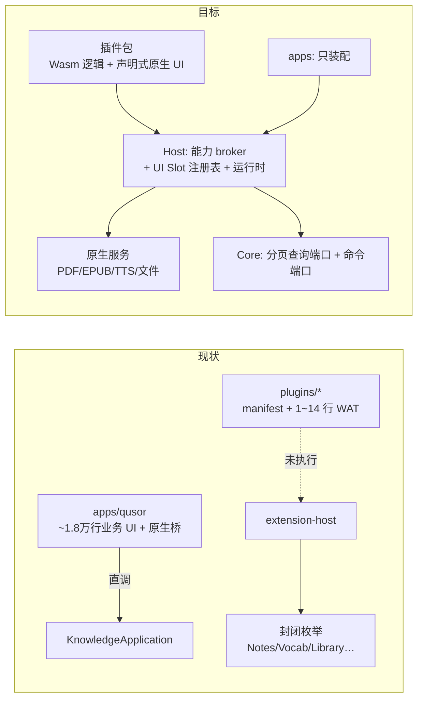

# QUSOR 架构评审（2026-11-14）

评审范围：生产根 Workspace（crates/adapters）、`apps/qusor`、`plugins/*`、插件协议与运行时、架构文档。方式：三位 Gemini 4 Hydrogen 只读评审员分头审查，关键结论由我抽查源码复核（标 ✅ 的已亲自核对）。**未修改任何代码，未运行构建或测试。**

## 总体结论

**方向对，但"插件化"目前只停留在形状上：实际仍是单体应用加插件形状的元数据。**

做得好的部分（建议保持）：

- Core 不依赖 NSH/UI，`unsafe_code = "forbid"`，`architecture.toml` 依赖白名单加脚本检查
- 知识归 Core 所有，单事务提交，并带审计/outbox；来源、锚点、快照的建模很严谨
- 签名包 + 发布者键绑定 + Host 注入 vault 身份，构成防篡改与数据保护的最小闭环

结构性问题集中在三点，对应下面的 P0：**插件是空壳**、**Host 协议按功能写死**、**存储端口按全量快照读取**。这三点不解决，后面加任何功能都会让单体继续变重。

---

## P0：结构性问题

### 1. 功能与 UI 实际在 app 里，插件只是空壳 ✅

| 证据 | 事实 |
|---|---|
| [contributions.tsx](file:///Users/karl/workspace/ai/qusor/apps/qusor/contributions.tsx) 6934 行，[App.tsx](file:///Users/karl/workspace/ai/qusor/apps/qusor/App.tsx) 1968 行 | 四个功能（资料库/阅读/笔记/词汇）的 UI 全部写在宿主里 |
| `native/src/{library,vocab,notes}_native.rs`、`epub_reader.rs` 等，约 6900 行 | 功能级原生逻辑也在 app 里 |
| [plugins/vocab/guest.wat](file:///Users/karl/workspace/ai/qusor/plugins/vocab/guest.wat)；library 和 reader 的 guest 是空 `(module)` | 插件里没有可运行的业务逻辑 |
| [library_native.rs:291](file:///Users/karl/workspace/ai/qusor/apps/qusor/native/src/library_native.rs#L291-L300)、[notes_native.rs:130](file:///Users/karl/workspace/ai/qusor/apps/qusor/native/src/notes_native.rs#L130-L136) | app 绕过 Host 直接 new `KnowledgeApplication` 做删除/分页，vault 写死为 `"qusor-vault"` |
| [profile.rs:208-220](file:///Users/karl/workspace/ai/qusor/apps/qusor/native/src/profile.rs#L208-L220)、[vocab_native.rs:22](file:///Users/karl/workspace/ai/qusor/apps/qusor/native/src/vocab_native.rs#L22) | 按官方包 ID 硬编码 |

这违反了项目自己写下的不变量（"apps 只装配""官方功能走同一公开 SDK""不按官方 package ID 分支"）。文档里"已通过"的资格切片，证明的是 Host 策略与 Core 存储这两部分，并不代表插件真正承载了功能。

### 2. Host API 按功能递增小版本，而且能力被锁死在单一版本 ✅

[extension-api/src/lib.rs:164-180](file:///Users/karl/workspace/ai/qusor/crates/extension-api/src/lib.rs#L164-L180) 中的 `capability_available_in`：

- `NotesRead` 只在 0.4 可用，`VocabRead/VocabReview` 只在 0.5，`LibraryRead` 只在 0.6/0.7，`ReaderSurface` 只在 0.2
- 一个会话只协商出一个版本，所以**单个插件无法同时使用 `notes.read` 和 `vocab.read`**
- `Capability` 和 `ContributionKind`（`VocabWorkspace`/`LibraryWorkspace`…）都是封闭枚举。每加一个功能都要改 Host、升小版本、给宿主加一个渲染器

对第三方来说，这等于每次宿主升级都可能让旧插件失效，插件之间也组合不起来。

**建议**
- Host API 版本改为**累积式**：0.7 必须兼容 0.2–0.6 的全部能力
- 能力改为命名空间化的正交原语，各自独立 semver 协商（如 `core.capture@1`、`core.query@1`、`ui.slot@1`、`native.pdf@1`），而不是 `vocab.read` 这类业务名
- 业务专属协议（vocab/notes/library 的 wire）由提供它的插件声明成扩展点，Host 只做路由和授权。`capability-composition` 里的 provides/requires 已经有这个雏形，可以合并进来

### 3. 存储端口按"全库快照"读取，无法扩展到长书和大书库 ✅

- [learning-ports/src/lib.rs:25-62](file:///Users/karl/workspace/ai/qusor/crates/learning-ports/src/lib.rs#L25-L62) 中，`KnowledgeStore` 的核心只有 `snapshot() -> ArchiveV2`、`commit(CommitPlan)`、`restore` 三个方法，后续需求靠带默认 `unavailable()` 的方法零散追加
- [learning-application/src/lib.rs:35-57](file:///Users/karl/workspace/ai/qusor/crates/learning-application/src/lib.rs#L35-L57) 中，`receipt()` 和 `query(id)` 每次都执行 `export_all()`，即读全库并做整体校验；SQLite 的快照路径还会把 PDF 原件从 CAS 读进内存（[storage-sqlite/src/unix.rs:345-360](file:///Users/karl/workspace/ai/qusor/adapters/storage-sqlite/src/unix.rs#L345-L360)）
- `StudyStore` 同样频繁调用 `study_snapshot()`（[study.rs:142](file:///Users/karl/workspace/ai/qusor/crates/learning-application/src/study.rs#L142) 等多处）

在移动端内存和长书场景下，这一点会直接成为瓶颈。

**建议**：拆成三类端口：`*Query`（有界分页、按 ID 读取）、`*Command`（增量事务命令，保留现有审计/outbox 原子性）、`ArchivePort`（仅用于全量导出/恢复）。事务语义不变，只是不再把"一致快照"当作通用读取路径。

---

## P1：插件可用性与平台

### 4. 缺少插件 UI 协议，这是第三方生态的关键缺口

现在第三方插件无法贡献自己的 UI：UI 只能由宿主按 `ContributionKind` 渲染（[contributions.tsx:6815](file:///Users/karl/workspace/ai/qusor/apps/qusor/contributions.tsx#L6815) 附近）。

**建议**：定义一个受控的**声明式原生 UI 树 / Slot 协议**。插件在沙箱里产出 UI 描述和事件订阅，Host 用 NSH 原生组件渲染，即 Figma 式的"沙箱逻辑 + 宿主渲染"消息模型。可以参考 **Raycast**：扩展用 React/TS 编写、由宿主原生渲染，形态和 NSH 的 TSX 原生渲染很接近。
- 可以评估一个候选：**插件 UI 直接用 NSH 的 TSX/JS 运行时承载**，即受限的 JS 包，不是 WebView。这样第一方现有的 TSX 能逐步迁出。是否可行取决于 NSH 能否隔离多个 JS 上下文、限制 API 面，需要按 AGENTS 约定先核对 NSH 上游，再做隔离实验。

### 5. 运行时预算和 ABI 无法承载真实插件；六端策略也还没定

- Wasm 预算：包 256 KiB、内存 128 KiB、响应 4 KiB、无状态 `run()`（[runtime-wasm/src/lib.rs:29-37](file:///Users/karl/workspace/ai/qusor/adapters/runtime-wasm/src/lib.rs#L29-L37)）。插件 ABI 是手写 WAT 加裸指针
- `runtime-process` 只支持 Linux/macOS；`extension-store`/`blob-store` 只支持 Unix；非 Unix 的 `storage-sqlite` 没有实现 `StudyStore`，存储层的错误信息也被泛化吞掉
- PDF provider 只支持 `cfg(unix)` 加 arm64，Windows、iOS、Web 的路径还没有着落

**建议**
- 统一走**进程内 Wasmi + WIT/Component Model**（Zed 的做法）。发布 `qusor-sdk`（Rust 优先，可选 TS）和 `qusor dev` 本地调试命令，加一个开发期加载未签名包的开关；预算放宽到 MiB 级，支持长驻实例和流式响应
- 进程监督只保留给桌面端的原生 helper 或 MCP 这类真正需要的场景
- **iOS 要尽早定策略**：App Store 对下载可执行逻辑有审核风险（Wasmi 虽然没有 JIT，结论仍需你确认）。可选做法是商店版只开放随包/审核过的插件加纯声明式插件。这关系到"六端都支持第三方"的承诺能否兑现

### 6. Core 分层与命名

- `core-api`（契约层）里混入了 `ArchiveV2` 全库校验、outbox/index_job、`BinaryBlob` Base64 编解码（[core-api/src/knowledge.rs](file:///Users/karl/workspace/ai/qusor/crates/core-api/src/knowledge.rs)）。建议下沉到 application 或持久层，`core-api` 只保留 DTO 和锚点纯函数，并统一四个子模块里重复定义的错误码
- 命名名不副实：`learning-domain` 只有 FSRS；`learning-application` 约 5100 行，承载的是捕获、PDF/EPUB 文库、草稿状态机。建议拆成 `knowledge-*`（捕获/来源/文库）和 `study-*`（学习调度）
- `adapters/extension-store` 依赖 `extension-host` 来实现端口，存在 adapter 依赖策略层的倒置。建议抽出 `extension-ports`
- 文档里的依赖图和 `cargo metadata` 对不上：文档称 core-api 依赖 learning-domain、extension-host 依赖 core-api，实际都没有

---

## P2：节奏与治理

### 7. 安全与生命周期机制，相对当前阶段做得太早

pidfd、孤儿隔离、worker 租约、升级时清空授权、四张状态机表……这些在**还没有任何一个插件真正运行业务逻辑**之前就已经做得很重了。

**建议**：先打通一条"真实 Wasm 插件 + 自带 UI + 读写 Core"的端到端链路，再按需要补监督能力。签名、键绑定、Host 注入身份和 Core 事务门必须保留；同权限升级应保留授权，只有扩权时才重新授权。

### 8. 文档治理成本偏高，且已经出现漂移 ✅

- 7 天写了 47 篇 ADR（11-12 当天 15 篇）。AGENTS.md 约 11 KB，并且混入了大量进度流水
- 同一份 [README.md](file:///Users/karl/workspace/ai/qusor/docs/architecture/README.md#L98) 里既说"0.1 策略协议"又说"当前 0.7"，[workspace-layout.md:16](file:///Users/karl/workspace/ai/qusor/docs/architecture/workspace-layout.md#L16) 仍写 0.1

**建议**：ADR 只记录决策；完成状态集中到一份状态表（最好由脚本生成）；AGENTS.md 只保留不变量和入口链接。这样也能明显降低每次 Agent 协作的 token 开销。

---

## 建议路线（按顺序）

| 阶段 | 内容 | 验收 |
|---|---|---|
| 1. 止血 | 冻结新增业务专属 Capability/ContributionKind；清理 app 对 `KnowledgeApplication` 的直调和写死的 vault/包 ID；修正文档漂移 | `rg` 搜不到 app 直调；Host API 改为累积兼容的单测 |
| 2. 端口重构 | 拆分 Query/Command/Archive 端口；`query(id)` 和分页不再读全库 | 万条摘录加大 PDF 下的读取延迟和内存基准 |
| 3. 插件协议 | WIT ABI 加正交能力，UI Slot/声明式原生 UI 协议，再加 `qusor-sdk` 和 dev 加载 | 仓库外用 SDK 写出一个带 UI、读写 Core 的插件 |
| 4. 迁移 | 先把**词汇**（最独立）从 contributions.tsx 迁成真插件，再迁笔记、资料库、阅读；PDF/EPUB 引擎作为 Host 原生服务暴露 | 停用插件后宿主没有残留 UI，数据仍可导出 |
| 5. 平台 | 定下 iOS/Web 插件策略；补齐 Windows 存储/PDF 适配 | 各端分别留证 |

## 需要你拍板的决策

> [!IMPORTANT]
> 1. **第一方功能的交付形态**：ADR 0003 要求第一方也以独立动态包交付，这是"插件化"一直难以落地的主要阻力之一。一个折中是"同一公开契约、两种交付形态"：第一方可以是静态链接的 Rust 模块，但只允许调用公开 SDK trait，并用契约测试和依赖检查保证它不用私有 API；第三方则用 Wasm 包。这会改变一项你已确认的决策，要不要放宽，由你决定。
> 2. **iOS/Web 是否必须支持动态安装第三方插件**，还是接受"商店版仅随包插件 + 声明式插件"？
> 3. **插件 UI 技术路线**：自定义声明式 UI 树协议，还是在 NSH 的 TSX/JS 运行时上做受限隔离？两者都需要先做 NSH 实验。
