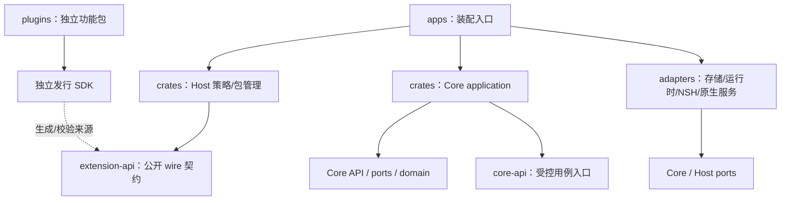

# 目录与插件职责

> 权威范围：本文件定义仓库目录归属、独立 Workspace 边界与功能插件划分（[ADR 0006](adr/0006-plugin-workspace-layout.md)）。当前实际 crate 依赖图与 ADR 索引见 [架构入口](README.md)，实施与验证状态见 [项目状态表](../status.md)，阶段顺序见 [下一阶段计划](../product/next-phase.md)。

## 目录总览

```text
qusor/
├── apps/                 应用入口、装配、打包；当前 apps/qusor 为独立 Workspace
├── crates/               Core、公开协议、宿主策略等平台无关 Rust 库
│   ├── learning-domain/         零外部依赖；FSRS-5 词汇调度内核
│   ├── core-api/                捕获/来源/锚点、知识记录与词汇学习纯契约及统一错误基元
│   ├── capability-composition/  零外部依赖；service 接缝、profile 与激活规划
│   ├── learning-ports/          Query/Command/Archive 六端口与归档/outbox/index_job 整库核验
│   ├── learning-application/    knowledge / session / study 三层用例与交互会话状态机
│   ├── extension-package/       有界签名容器与发布者键绑定校验
│   ├── extension-runtime-api/   Host 侧无授权副作用执行端口与预算
│   ├── extension-api/           Host API 0.1–0.7 JSON 策略协议、声明式 UI 契约、manifest 投影与校验
│   ├── extension-ports/         持久安装/授权/恢复纯端口（仅依赖 extension-api）
│   └── extension-host/          安装元数据、授权、会话、生命周期、UI 槽位状态机与贡献查询
├── adapters/             SQLite/CAS、插件持久内核、Wasmi 执行与进程身份适配器
├── plugins/              独立功能包（vocab / notes / library / reader 预览切片）
├── sdk/                  公共契约的发行、绑定与作者入口（尚未正式发行）
├── experiments/          独立验证 Workspace，不属于生产 Workspace
├── config/               成员登记与依赖允许清单
├── scripts/              工程边界、原生 UI 与文档检查
└── docs/                 产品范围、设计、架构决策、状态表与研究
```

目录说明不生成全套空 crate、占位 API 或假界面。C3 后按 [ADR 0018](adr/0018-core-api-contract-source.md) 将捕获契约迁入 core-api，实验兼容入口转发同一实现；现有三个 crate 不搬家。

## 代码应该放在哪里

| 目录 | 放入条件 | 明确禁止 |
|---|---|---|
| [apps](../../apps/README.md) | 可执行入口、依赖注入、平台启动、安装包清单 | 实现阅读/笔记业务，按官方 package ID 分支，持有私有写库捷径 |
| [crates](../../crates/README.md) | 领域规则、版本化 Core API、ports、应用事务、宿主策略/任务状态机 | NSH/DOM/运行时类型进入 domain 或 wire 协议 |
| [adapters](../../adapters/README.md) | 实现 ports 的 SQLite、文件、运行时、NSH、PDF/EPUB 服务 | 复制用户工作流，将原生对象或数据库连接交给插件 |
| [plugins](../../plugins/README.md) | 用户可使用的完整功能、入口、交互与工作流 | 依赖 Core/Host 私有实现、直写宿主库、预装特权 |
| [sdk](../../sdk/README.md) | 契约发行材料、绑定、作者工具、兼容性样例 | 第二套手写 wire schema、第一方专用接口 |
| [experiments](../../experiments/README.md) | 有假设、通过条件和结果的技术验证 | 自动转为生产依赖，以实验替代平台/业务验收 |

应用静态装配 Core/Host 与受控原生适配器；功能插件逻辑不能静态编译进应用后冒充独立安装。随安装包附带插件只是一种包来源，装载、校验、授权与第三方一致。

## 规划模块与创建时机

下列区分已落位与后续候选路径，尚未创建不表示实现完成。新增成员仍需更新 [依赖策略](../../config/architecture.toml)、给出真实消费者并运行相关检查。

| 规划路径 | 单一职责 | 创建触发 |
|---|---|---|
| `apps/qusor-desktop/`、`apps/qusor-mobile/` | 平台入口、装配与发布包 | 对应 NSH 实验通过；目录不决定首发平台 |
| `crates/core-api/` | 已有捕获/来源/锚点契约；持久用例命令/查询入口随后补齐，与 Host wire 独立版本 | C3 后公开契约已落位，非生产存储完成 |
| `crates/capability-composition/` | 已落位：服务 provides/requires、profile 层、确定性激活规划；不含运行时、权限或存储 | 桌面 Notes/Vocab 启用门消费；通用挂载与用户覆盖待实现 |

应用级 `VaultStore` 位于 `apps/qusor/native`，只作为 `vault.read`/`vault.write` 的可信 provider；它不是插件 SDK 类型，也不把 SQLite 连接交给插件。`runtime.rs` 使用 `RuntimeScope` 挂载 Core/Notes/Vocab Host 并统一释放顺序。迁移与边界见 [ADR 0039](adr/0039-single-core-provider.md) 与 [ADR 0040](adr/0040-runtime-mount-scope.md)。
| `crates/learning-ports/` | 已落位：Query/Command/Archive 六端口与归档/outbox/index_job 整库核验（`learning_ports::archive`） | 由真实知识 application 与 SQLite 消费（[ADR 0050](adr/0050-split-storage-ports-and-incremental-transactions.md) · [ADR 0054](adr/0054-core-layering-and-naming.md)） |
| `crates/learning-application/` | 已落位：`knowledge/`、`session/`、`study/` 三层用例、校验与事务计划 | 捕获实验与生产壳通过同一实现执行（[ADR 0054](adr/0054-core-layering-and-naming.md)） |
| `crates/document-engine/`、`crates/anchor-engine/` | 规范文档/来源与定位算法；无平台 view | 阅读、导入、引用用例需要 |
| `crates/extension-package/` | 包格式、内容清单、身份/兼容证据校验；不保存安装状态 | 包格式实验通过；受信任校验结果交给 Host |
| `crates/extension-ports/` | 已落位：持久安装/授权/恢复纯端口（`Grant`、`DurableGrant`、`AuthoritySnapshot`、`AuthorityRead`、`AuthoritySource`、`RemovedInstallation`、`VersionedRequest`、`ComponentInstallation`、`ComponentAuthoritySource`、`GrantUpgradeDecision` 与 `preserve_grants`），仅依赖 `extension-api` | 消除 `extension-store -> extension-host` 依赖倒置（[ADR 0055](adr/0055-lifecycle-and-port-decoupling.md)） |
| `crates/extension-host/`（现有） | 唯一的安装/授权/升级/UI 槽位状态机，经 `extension-ports` 与持久存储解耦 | 持久生命周期与同权升级保留授权已落位；不另建第二套安装状态机 |
| `crates/extension-runtime-api/` | Host 侧执行、取消、预算端口；不属于作者 SDK | 实验转生产执行适配器 |
| `adapters/storage-sqlite/`、`adapters/blob-store/` | 已落位：增量与整体事务、schema 迁移与耐久 CAS/单 writer | 当前 Linux/macOS 本机证据；其他平台仍待资格验证 |
| `adapters/extension-store/` | 已落位：包、安装/授权材料、同权升级保留授权、私有成对状态和 worker lease 的唯一 SQL 实现 | 不存规范知识；默认缺少服务失败关闭，完整安装 UI/监督仍待验 |
| `adapters/runtime-wasm/` | 已落位：不自带授权的受限 Wasmi 执行与长驻/流式会话 | 六端通用插件隔离运行器（[ADR 0053](adr/0053-runtime-budgets-abi-and-platforms.md)） |
| `adapters/runtime-process/` | 已落位：仅用于桌面原生 helper / 外部 MCP 进程身份、父死守卫与清理 | 普通插件统一走 `runtime-wasm`；其他平台明确 `Unsupported`（[ADR 0053](adr/0053-runtime-budgets-abi-and-platforms.md) · [ADR 0055](adr/0055-lifecycle-and-port-decoupling.md)） |
| `adapters/nsh/`、`adapters/platform/` | 贡献 UI、Surface、平台资源与安全存储 | NSH bridge/输入/资源门槛通过 |
| `adapters/pdf/`、`adapters/epub/` | 解析、渲染和选区的受控服务 | 对应格式实验通过 |

领域和应用服务不按插件名称复制。来源、版本、幂等与审核只有一份权威实现，插件通过公开能力组合它们。

## 依赖和运行路径



实线是代码依赖方向；SDK 到 wire 的虚线是工件生成关系，不是插件对主仓库的源码依赖。运行路径：

```text
插件 → SDK 请求 → 受限运行适配器 → Host 身份/授权/预算
     → Core API → application 校验/事务 → ports → 存储适配器
     → 受控 Surface/平台能力 → NSH 承载
```

最终写入在 Core 提交边界重新验证资源、版本与有效授权；取消/撤权与提交有明确顺序。“已保存”只依据持久提交回执，不依据插件返回或策略许可。

UI 通过贡献目录发现工作区、命令和选区动作，不硬编码官方包 ID。插件返回声明式描述和有界数据；Surface 使用 Host 发放、绑定库/安装实例/授权世代的 opaque handle，不传 NSH 节点、DOM 对象、原生指针或数据库连接。

## 用户功能的插件归属

UI扩展进一步区分区域、角色与提供者，见 [软件分区](../design/composition.md) 和 [ADR 0028](adr/0028-extensible-native-workspace.md)。Host治理外壳、原生承载、焦点与权限；工作区/组件插件经同一公开契约组合，Core持有内容与来源。正式UI实现先采用 [设计基线](../design/README.md)，不把功能布局写死在apps或第一方包名分支里。

下表覆盖现有 [Feature 清单](../product/scope.md)。路径是功能包划分建议，不表示全部立即开发或进入首版。相近功能作为完整插件，不按按钮拆包。

| 候选功能包 | Feature ID / 用户流程 | Core / Host 保证 | 停用行为 |
|---|---|---|---|
| `plugins/library/` | F-LIB-01/02/03：导入、资料列表、标签、查找 | 原件/版本/索引/导入任务属于 Core；文件选择由 Host 提供 | 移除高级工作区；原件/元数据可查看导出 |
| `plugins/reader/` | F-READ-01/02/03、F-SRC-01：PDF/EPUB、目录、进度、书签、选区/标注 | 解析/渲染是受控服务；锚点/标注/位置由 Core 保存 | 高级阅读停止；已存正文/摘录/来源可通用查看，原件可导出 |
| `plugins/notes/` | F-NOTE-01/02、F-SRC-01：编辑、引用与回源 | 稳定块 ID、历史、引用、事务与撤销 | 编辑停止，规范笔记与引用可读/导出 |
| `plugins/data-transfer/` | F-DATA-01：日常导入导出/备份/迁移向导 | 完整导出恢复/schema 校验属于 Core；Host 保留最小恢复入口 | 便利向导移除，完整导出恢复仍可执行 |
| `plugins/reader-ai/` | F-AI-01/02/03：解释、翻译、摘要、选区问答与候选保存 | Host 控制范围/凭据/出站；Core 强制来源区分、审核、版本和撤销 | 不产生新回答；已接受内容保留来源/审核记录 |
| `plugins/knowledge/` | F-KG-01/02：概念、观点、证据和语义关系 | 规范实体/关系、引用与约束属于 Core | 工作流停止；规范关系/证据可查看导出 |
| `plugins/canvas/` | F-CAN-01：空间布局、拖动、连线、分组 | 布局与语义分开存储；Host 提供受控绘制/输入/无障碍 | 空间交互停止；布局可导出，删除布局不删知识 |
| `plugins/research-agent/` | F-AI-04/05/06：候选结构、跨资料研究、写作与计划 | 有限工具执行/审计、引用核对和正式修改规则 | 停止新任务；成果/来源可读，旧任务不自行复活 |
| `plugins/learning/` | F-LEARN-01/02/03：卡片、复习、测验、路径 | 调度算法、真实复习记录、版本和历史属于 Core | 提醒/复习入口停止；卡片/记录可读导出 |
| `plugins/providers/<provider>/` | F-AI-07：模型/MCP 接入及配置 | 受控网络、凭据引用、预算；工具不放大授权 | 关闭连接/任务，不影响原文/笔记及其他 provider |
| `plugins/sync/` | F-SYNC-01/02：设备、设置、同步状态、冲突与备份流程 | Core 保留 outbox/投影/冲突规则；Host 提供安全存储/后台服务，远端 I/O 走 adapter | 停止新同步/备份；本地内容可用，凭据不导出 |
| `plugins/sources/<source>/` | F-EXT-02、F-LIB-02：来源接入与选段收录 | 统一 CaptureDraft、不可变快照与来源归 Core | 内容/引用保留，外部回跳按实际能力降级 |

F-EXT-01/03/04/05/06 是全部插件的 SDK、Host、包管理和贡献接口要求；F-PLAT-01 是平台适配与交付要求，不伪装成业务包。F-UX-01/02 由 Host 保证导航、主题、焦点、授权与无障碍基线，插件遵循工作流内的体验规则。全局隐私、AI 审核及来源真实性标记不能被插件覆盖。

同步/AI 的流程归属不决定其首版范围与云默认行为。RSS/微信读书仍是来源例子，不提前创建对应包或假设可用服务接口。

## 独立 Workspace 与 SDK 来源

生产根 Workspace 只显式注册已验证的 `crates/`、`adapters/`、`apps/` 成员，不使用吸收插件/实验的通配符。插件与实验各有 Workspace/lockfile/版本；插件不继承根 workspace 依赖或包属性。

正式插件只能依赖发行 SDK 和允许的纯计算依赖。开发期若用本地 SDK，必须是完整导出工件且通过仓库外构建；禁止依赖主仓库 Core/Host/application/storage/NSH 私有源码，主程序也不得静态链接功能插件。

当前 Host 策略 wire 权威源是 [extension-api](../../crates/extension-api/README.md) 的 DTO/schema/契约测试。捕获/来源/锚点权威源为 [core-api](../../crates/core-api/README.md)。SDK 从公开源生成/校验发行工件，版本可对应；不复制一份任意漂移的协议。尚无发布 SDK，目录说明不算发行完成。

跨插件通过 Host 能力发现/路由和 Core 规范数据协作，不导入对方代码或共享私有数据库；缺可选提供者时显示不可用，循环调用有预算。插件 ID、版本和发布者绑定独立于目录/显示名。

## 第一条实施链与验收

1. NSH 环境/启动/输入/离线 Surface 与插件持久安装实验并行，分别记录平台与失败。
2. 相应持久化/定位门槛通过后，围绕真实摘录实现必要 Core API、事务与导出恢复。
3. reader 请求公开阅读 Surface、选区与标注能力；library/notes 随闭环接入，不以私有 Host 流程补缺口。
4. 仓库外作者构建、普通身份、撤权、升级恢复、停用后导出一起验收。

普通文本 PDF 是第一条实验/开发链，不缩减 PDF/EPUB 长期要求；完整 M-1、首版平台和其他功能范围仍由 [范围记录](../product/scope.md) 与实测决定。目录登记守卫检查 Cargo 路径和依赖登记；它不能证明插件运行权限、UI 正确或 SDK 发行独立性。

[ADR 0019](adr/0019-atomic-knowledge-persistence.md) 说明新增生产实现的单事务计划、公开计划的重新校验、稳定错误和平台限制；实验不保留分叉的 SQL/CAS。


## Agent 工作台与开发工作区职责（设计，未创建模块）

C-13 / F-AGENT-01–05 的完整边界见 [ADR 0029](adr/0029-local-agent-workbench.md)。`plugins/agent-workbench/` 提供任务工作流，`plugins/agent-backends/<backend>/` 提供公开后端贡献，`plugins/agent-orchestrator/` 提供可替换调度策略；`plugins/development-workspace/` 规划组合项目/文件/搜索和开发流程（编辑、Git、终端与预览作为独立提供者，详见 [开发工作区](../design/development-workspace.md)）。任务/会话/事件/委派的通用协议与 Host 策略留 `crates/`；操作存储、协议传输、PTY 与服务留 `adapters/`；`apps/` 只装配，具体包粒度在真实切片中决定，本阶段不预建空 crate。后端不能直写知识库，外部源码修改与 Core 知识提交是不同边界。
