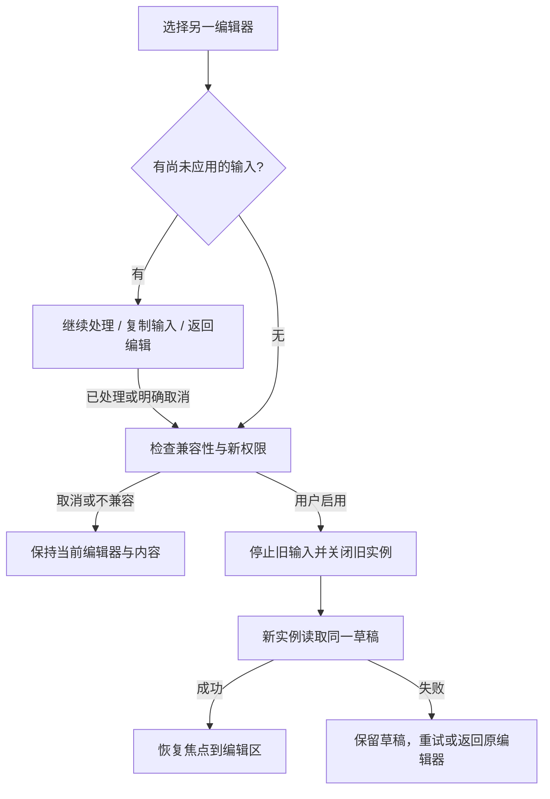

# 想法编辑与提供者切换

状态：实现前的交互约束，尚未通过原生窗口验收。关联 C-09/C-11/C-12、F-NOTE-01、F-EXT-03/04/05/06、F-UX-01/02。文本语义以[段落契约](../product/paragraph-editor-contract.md)为准；沿用[设计基础](foundations.md)的语义颜色、间距、焦点与控件，不为提供者另起一套界面。

## 编辑区

想法区保留稳定的引用预览、编辑内容与底部保存操作。标题旁的“编辑方式”入口显示当前方式，更多菜单提供“更换编辑器”。不把插件包名、协议、执行进度或权限术语放进正文。提供者名称只在选择器和必要的错误详情中出现；“已保存”始终依据Core回执。

段落模式中，每段有原生多行输入与按需出现的操作菜单；菜单提供“上移”“下移”，首尾不可用动作明确禁用。不依赖拖动或悬停完成移动，键盘可访问同一命令。空段仍显示可聚焦的输入位置。当前段的操作应靠近该段，避免长段下寻找位于面板外的按钮。引用预览不参与段落排序。

“逐段 / 全文”是编辑方式切换，不代表保存或切换提供者。全文模式保留所有尾空行，允许修改末尾换行。逐段模式不显示CRLF等技术标识。输入包含换行后，动作完成才按新版本更新段落；保持当前输入焦点和可见位置，不因后台响应跳到首段。无法保持准确光标时保留完整输入、明确重新定位，不能猜测后删除文字。

尚有待处理的局部输入时，当前段可继续输入并合并最新完整值；其他段的输入与移动暂不可用，邻近状态显示“正在处理这段内容”。超时或失败后停止忙碌反馈，显示“这段内容尚未应用”，保留输入和复制、重试入口。重试必须确认当前正文版本；有冲突时先展示保留的输入，让用户决定重新应用，不能按旧行号自动写入另一段。处理时间很短时不闪烁提示；取消或失败仍须清楚可见。

## 会话与提供者的生命周期边界

同一份想法的应用草稿、不可变来源、原保存operation与回执属于NoteSession，不随编辑器视图或提供者销毁。ProviderInstance只持本次普通签名包的mount、编辑／投影broker、Controller及待退休run、行句柄与native owner。切换不得在原mount里替换包或继承权限；旧实例实际退休后，新实例重新批准并读取同一个精确Draft。当前这项拆分与B接线在隔离候选中实施，尚未通过真实B窗口或A→B→A验收。

旧实例Closing时保留自己的真实owner与会话草稿。新实例失败、权限拒绝或释放不明，都不能清空NoteSession；未处理的局部输入继续保留，直到用户处理或明确放弃。保存冻结期间不切换。正式Core知识仍归Core，Session只在当前会话协调未保存草稿，不因此承诺崩溃后草稿持久化。

## 切换流程

“取消尚未应用的输入”需要明确告知只取消哪一段待处理输入，并保留可复制内容直到用户离开该提示；不能把选择编辑器本身解释为放弃输入。若当前提供者无法处理该输入，先复制或由用户明确取消，再进入全文编辑。Host不能为了切换把局部输入自行拼为全文。

切换选择器展示兼容提供者、来源和必要的新权限。安装不自动启用，授权拒绝不关闭当前编辑器。确认后旧回调失效；新提供者重新获得精确草稿的本会话许可。返回原提供者也创建新实例，不能复活旧回调或继承另一提供者权限。

切换期间保留当前文本、引用和返回入口；旧资源尚未释放时显示“编辑器正在关闭”，提供重新检查。不能把JS卸载当作资源释放完成。若新提供者启动失败，草稿保持未保存，原提供者可用且重新授权后可返回；两者都不可用时仍可查看、复制草稿，不能强迫清空内容或重新导入资料。

## 状态与验收

| 状态 | 用户看到的结果 | 必须验证 |
|---|---|---|
| 输入已应用到草稿 | 内容和段落更新，仍为“未保存” | 未发生正式知识写入；焦点不被异步结果抢走 |
| 移动成功 | 正文顺序更新，引用保持 | 混合换行无损；成功逆移动恢复原字节 |
| 移动不能保留文本边界 | “无法直接移动这段内容，可使用全文编辑” | 原文不变；无空上传或错误版本递增 |
| 输入超限或版本冲突 | 就地说明，保留输入及复制/重试 | 不截断、不trim、不写到另一段 |
| 切换取消或授权拒绝 | 当前编辑器继续可用 | 内容、待处理输入和焦点仍在 |
| 旧实例有迟到结果 | 当前编辑器无可见变化 | 旧结果不能修改草稿或新实例 |
| 保存处理中 / 结果未知 | 保留内容，提供查询或同操作重试 | 不重复创建知识，不擅自解锁或显示成功 |
| 保存成功 | 就地显示“已保存”，允许继续阅读 | SQLite重开及完整导出恢复包含相同内容与来源 |

原生宽窗与窄窗分别实测：选择器键盘进入/退出、中文组合输入中按Esc、段落移动后的焦点、失败后复制/重试、A→B→A全文保真。Esc只关闭最上层临时菜单，组合态取消不触发丢弃或关闭面板。长文本不为每段常驻创建控件；需在窗口化渲染下证明焦点与未应用输入不会随滚动丢失。现有A大文本进程证据不等于这些UI行为已通过。

## 原生接入前的剩余接口

旧B的变换事件只返回续传进度。新普通签名B已通过公开只读投影的八项真实进程测试（76 worker/412 calls），但尚未接入原生渲染；`ParagraphEditor`静态描述不自动解决显示与输入问题。接入时须补公开、有界、绑定当前草稿版本的提供者投影：请求可见范围，返回有限段落的索引及正文span；长段以有界片段读取，明确是否完整。父组件只展示结果、传递完整用户输入与typed动作，不能自行分段、排序或拼正文来填补缺口。引用预览继续来自可信Core来源，不采信提供者的投影。

投影须有取消、过期、错误和长段入口；不完整片段不能被当作完整段落替换提交。编辑目标以当前版本和完整正文范围核对；滚动离屏不能清除待处理输入。公开契约、普通SDK作者与真实投影进程消费者已实施，见[验证记录](../../experiments/capture-core/evidence/projection-cache-os8/record.json)。共享编辑broker已抽出并完成局部测试，当前继续验证编辑/投影共用同一真实运行链；原生可编辑行句柄、输入接线和窗口验收尚未完成，不能用宿主私有props宣告完成。

另有原生文本边界：[本地源码与GLib探针](../../experiments/nsh-reader/evidence/native-text-nul-boundary/record.json)确认，当前Rust GLib调试转换检查内嵌NUL；实际GLib显式长度校验也拒绝该样本，而该字节仍是契约允许的UTF-8。不能把原始NUL直接送给未验证的Input／Text／剪贴板，也不能strip、trim或将可视转义当原文提交。隔离B候选先保留原字节并明确安全阻断，完整NUL呈现／编辑／复制仍是未完成能力，不将只读或转义预览算作契约完成。该探针未实际证明GTK控件release行为或可逆输入方案。

功能证明与交互延迟分别验收。记录输入大小、段落分布、实际fresh VM数量、耗时及取消响应；超长文本操作不能冻结窗口或阻断复制/返回。先解决算法与续传正确性，再测并优化重复扫描、进程启动和展示投影；不能因大文本功能测试通过就将长等待作为最终体验，也不能通过缩小1MiB能力或放宽单次执行预算掩盖问题。
