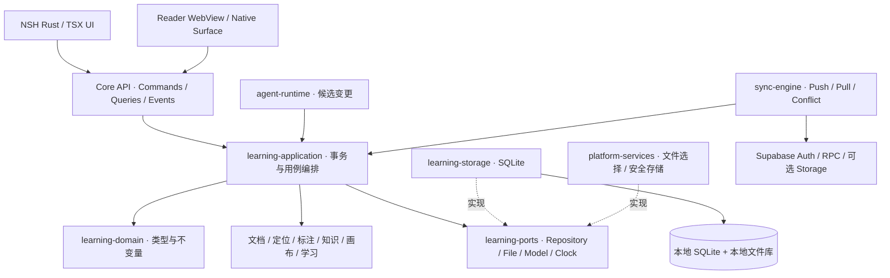

# QUSOR Rust Core 数据模型与定位协议

日期：2026-11-07。状态：设计基线，须经 M-1 验证后冻结 v1；本文件不是可执行迁移。UI 实现依据见 [NSH 审查](./01-nsh-gpui-audit.md)，同步协议以 [同步设计](./05-local-first-sync.md) 为准。

> 2026-11-07插件化增量：来源账户/外部条目/采集快照、CaptureDraft及外部导航验证以 [插件架构](../architecture/extensions.md) 为补充。本文DocumentVersion与QLA本地主干保持；Schema尚未冻结，不新增业务迁移。后续已确认第一阶段第三方支持及第一方功能插件化，产品流程与Core/Host归属以 [ADR 0003](../architecture/adr/0003-plugin-first-delivery.md) 为准；下文原有UI→Core图表示底层调用，不授权官方插件绕过公开SDK。

## 1 架构边界

采用模块化单体和独立 Cargo Workspace。共享的是领域模型、命令与查询、存储和协议；桌面与移动不共享全部交互。NSH 原生控件、阅读 WebView、图形 Surface 都是可替换适配器。



图中的“调用”不等于任意 crate 互相依赖。编译依赖只能向下：domain 不依赖 ports；ports 依赖 domain；各 engine 依赖 domain/ports；application 编排 engines；storage、provider 和平台层实现 ports；composition root 装配实例。sync/agent 通过 application 暴露的命令接口提交，不直接写数据库。为了避免循环，命令接口定义在独立 core-api，application 实现它。

### 模块及职责

| Crate | 职责与公开能力 | 禁止承担 |
|---|---|---|
| learning-domain | ID、版本、实体、Anchor、ChangeSet、领域校验、错误类型 | SQL、NSH、网络、系统时间隐式读取 |
| learning-ports | Repository、BlobStore、Clock、IdGenerator、Embedding、模型、同步传输、任务队列接口 | 具体实现 |
| core-api | Command/Query/Event DTO、分页、取消、协议版本、能力协商 | NSH 信号、DOM、数据库连接 |
| learning-application | 导入、阅读标注、候选审核、导出等用例；UnitOfWork；权限与幂等 | 控件、渲染和模型厂商分支 |
| learning-storage | SQLite repository、迁移、事务、全文索引、持久化作业队列 | 直接决定 UI 或同步冲突策略 |
| document-engine | MIME/哈希、元数据、章节、文本抽取、版本快照、安全解包 | 页面交互和所有 EPUB 排版 |
| reader-engine | 定位解析、位置恢复、跨格式文本映射、阅读会话 | 保存屏幕像素坐标作为唯一定位 |
| annotation-engine | 标注、书签、引用、重新锚定、来源完整性 | 向量检索候选冒充原文 |
| knowledge-engine | 概念、观点、问题、证据、关系、来源遍历与去重候选 | 画布坐标及全库力导向动画 |
| canvas-engine | 视口、几何、命中、分组、连线、撤销命令；场景快照 | GPU 平台资源、知识真值 |
| learning-engine | FSRS 适配、卡片与复习事件、学习路径 | 将 AI 分数直接作为客观掌握度 |
| retrieval-engine | 分块、FTS、向量适配、融合、引用结果、索引重建 | 模型自己生成来源 ID |
| agent-runtime | 有界工具循环、ProviderAdapter、预算、候选及审计 | 任意 SQL、任意文件路径或自动应用写操作 |
| sync-engine | outbox、shadow、版本比较、冲突保留、重试、snapshot | 复制 SQLite 文件、以时间戳覆盖冲突 |
| nsh-adapter | Rust 模块注册、TSX DTO、主线程事件、WebView 有限桥接 | Core 业务规则 |
| platform-services | 文件授权、沙箱目录、Keychain/Keystore、系统通知、生命周期 | 分叉五套知识模型 |
| qusor-host | composition root、配置、运行时启动、版本信息、关闭流程 | 领域规则 |

模块名称不意味着 M0 必须创建全部空 crate。M0 实现 domain/ports/api/application/storage/document/reader/annotation/retrieval/agent/nsh-adapter 的最小闭环；canvas、knowledge 深层功能在 M1 实装，learning 在 M2 实装。禁止为了目录完整预先铺业务代码。

### API 与线程

统一请求 envelope：api_version、request_id、vault_id、command/query、expected_local_versions、payload。返回 typed result 或 code/details/retryable 错误；事件含 request_id、entity_id、local_version，避免乱序旧事件覆盖新状态。ID 使用 UUID 字符串；u64/i64 版本和毫秒时间在 TSX/JSON 中以十进制字符串传输，避免 JavaScript 53 位精度问题。

提供 import_document、open_document、resolve_anchor、add_annotation、save_note、search、propose_changes、apply_changeset、undo_operation、export_vault 等有限 API。查询分页；大文本分段；图像/字体通过带作用域的资源句柄，不经 JSON/base64 传整本书。JS 只能使用注册模块，不能获得 Connection 或原生文件系统对象。

UI/NSH 对象只留在所属主线程。SQLite 单写队列、短事务；读任务独立连接。CPU 抽取/哈希/布局计算用受限阻塞工作池，网络与任务编排用异步运行时；队列有上限、优先级和取消。不得在数据库锁内调用模型、HTTP 或平台 UI。移动后台只保存 checkpoint；系统终止后依据 durable job 恢复，不承诺持续后台运行。

## 2 本地存储规范

每个 vault 使用独立 SQLite、文件库和缓存目录；无账户也可工作。账号绑定不改变 vault ID。运行时数据库放在设备应用本地目录，不能直接放在 SMB、WSL 网络共享或同步盘上；源码工作区位置与运行时数据目录是两回事。[SQLite WAL](https://www.sqlite.org/wal.html) 要求共享内存参与者在同一主机，WAL 也仍只有一个 writer。

拟选 bundled SQLite + rusqlite，使用独立 writer actor；sqlx 仅作为 M-1 对比选项，不同时维护两套 repository。每个连接启用 foreign_keys；WAL、busy_timeout、checkpoint 设定做崩溃实验。写入确认的耐久目标采用 synchronous=FULL 并实测移动耗电；不把 NORMAL 下掉电丢最近事务的可能性当作“零丢失”。SQLite 版本及 FTS5 编译选项由工程锁定并核验安全修复。

SQLite 外键需要显式启用；复合外键目标必须具备匹配唯一键。[官方外键说明](https://www.sqlite.org/foreignkeys.html)。本设计所有跨实体引用均包含 vault_id，不能仅检查 UUID 是否存在。

文件使用 content-addressed blob：SHA-256 + size + MIME。先写临时文件、flush、原子改名，再以短事务登记 document version；崩溃产生的未引用文件由宽限期 GC 回收。不得在数据库提交前删除旧版本。移动 SAF URI/security-scoped bookmark 仅属于设备文件授权；默认导入应用私有目录以保证离线可用，无法复制时明确显示“外部文件依赖”。

缓存（缩略图、抽取文本索引、embedding、布局、下载中间块）可重建；原始文件、笔记、审计、锚点和历史不可作为缓存删除。

## 3 Schema v1 数据字典

### 3.1 公共约定

下列表均采用 SQLite STRICT（适用普通表），外键默认 RESTRICT。PK 中 I 表示规范 UUID TEXT，T 表示 UTF-8 TEXT，N 表示 INTEGER，R 表示 REAL，B 表示 BLOB，J 表示经 json_valid 检查的 TEXT。普通 UUID 以 TEXT 存储便于导出；不依赖 SQLite rowid 作为同步 ID。

**E 公共实体列**：vault_id I、id I、kind T、local_version N>=1、created_at_ms N、updated_at_ms N、deleted_at_ms N?、origin T（user/source/ai/import）、agent_run_id I?、schema_version N。PK(vault_id,id)，UNIQUE(vault_id,id,kind)。删除为 tombstone。时间用于展示，不裁决同步先后。主体表 entities 保存 E；子类型表以同 PK FK 引用实体。严格类型连接用 kind 常量 CHECK + 三列复合外键；避免“entity_type + entity_id”无约束悬空指针。

子类型删除和回收由应用事务统一控制。entity 可不属于知识图谱；graph_nodes 是实体的投影资格表，不复制实体内容。云端按(owner_id,vault_id)独立同步流；实体 server_version、sync shadow 与本地 local_version 分离，详见同步设计。

### 3.2 资料、来源、阅读与笔记

| 表 | 主要列 | 约束与索引 |
|---|---|---|
| vaults | id I PK、name T、format_version N、created_at_ms N | 一个本地 vault 不跨账号混用 |
| entities | E | 索引(vault_id,kind,deleted_at_ms)、agent_run_id；kind 枚举受迁移管理 |
| documents | E引用、title T、format T、language T?、source_url T?、current_version_id I?、import_state T | format=pdf/epub/markdown/web/other；current_version 属于本 document；索引 title/format |
| document_versions | vault_id、id I、document_id I、blob_hash T、mime T、byte_length N、source_revision T?、captured_at_ms N | PK(vault_id,id)，UNIQUE(vault_id,document_id,id)供复合FK；同文档同哈希去重；版本不可变 |
| blobs | vault_id、hash T、byte_length N、mime T、availability T | PK(vault_id,hash)，hash格式与size检查；不保存可跨设备误用的绝对路径 |
| device_blob_locations | vault_id、device_id、blob_hash、relative_path T?、external_bookmark B?、verified_at_ms N? | PK(vault_id,device_id,blob_hash)，本地设备表；授权token不上传 |
| extraction_revisions | vault_id、id I、document_version_id I、engine T、engine_version T、normalization_version T、status T | PK(vault_id,id)及 UNIQUE(vault_id,document_version_id,id)；重抽取创建新revision |
| document_sections | vault_id、id I、document_version_id、parent_id I?、ordinal N、resource_href T?、title T、media_type T | PK(vault_id,id)；UNIQUE(vault_id,document_version_id,id)和(version,ordinal)；parent限定同版本 |
| section_texts | vault_id、section_id、extraction_revision_id、text T、text_sha256 T、source_map J | PK(vault_id,section_id,extraction_revision_id)；映射表支持UTF-16/标量/字节与页面几何转换 |
| reader_anchors | vault_id、id I、source_kind T、document_version_id I?、note_version_id I?、section_id I?、protocol_version N、selectors J、quote J?、extraction_revision_id I? | PK(vault_id,id)；source_kind与两个version字段以CHECK保证恰好匹配一种来源；section/extraction须属于同document version；anchor内容不可变 |
| anchor_resolutions | vault_id、anchor_id、target_version_id、resolver_version T、status T、candidate_anchor_id I?、confidence R?、confirmed_by T? | 缓存/重定位记录；用户确认的新anchor不覆盖原anchor |
| passages | E引用、anchor_id I、quoted_text T、text_sha256 T、extraction_revision_id、provenance T | 原文快照只追加；provenance区分source_extract/ocr/user_transcription/user_provided_excerpt；不得写AI润色文本 |
| reading_positions | vault_id、document_id、device_id、anchor_id、progress R?、session_seq N、updated_at_ms N | PK(vault_id,document_id,device_id)，progress在[0,1]；last和furthest分开；不自动取max页码 |
| bookmarks | E引用、anchor_id、title T? | 索引anchor_id |
| annotations | E引用、anchor_id、style J、body_md T?、annotation_type T | highlighter/comment/region；原文取Passage，不与body混合 |
| notes | E引用、title T、format T、body_md T?、document_json J?、format_version N、current_version_id I? | format=markdown/richtext；Markdown以body_md为事实源，RichText以版本化JSON为事实源，另一格式只作导出视图，不能假定任意语法无损往返 |
| note_blocks | vault_id、id I、note_id、ordinal N、block_kind T、text T、source_span J? | PK(vault_id,id)，note FK；UUID块ID移动时保留，内容改动不自动换ID |
| note_versions | vault_id、id I、note_id、format、body_md T?、document_json J?、content_hash T、created_at_ms N | PK(vault,id)，UNIQUE(vault,note_id,id)；不可变内容快照；notes.current_version引用同note版本 |
| note_block_revisions | vault_id、note_version_id、block_id、ordinal N、text T、source_span J? | PK(vault,note_version_id,block_id)；版本内保留稳定块ID及当时内容；块删除保留历史 |
| tags | E引用、name T、normalized_name T | 同vault活跃normalized_name唯一，部分唯一索引 |
| entity_tags | vault_id、entity_id、tag_id | PK三列；两个实体FK，tag类型复合校验 |
| attachments | E引用、owner_entity_id、blob_hash、name T | FK entities/blobs；默认文件本地保存 |

Markdown 文件导入形成 document/version；可编辑 Note 是独立用户实体。用户笔记作为他处引用来源时，创建不可变内容版本并保留块 ID 映射，不能引用随时变化的 body_md。网页保存净化快照、canonical URL、抓取时间、哈希；仅 URL 不足以长期追溯。Source map 是原文定位所需数据，不是简单把抽取文本再切一遍就能重建的装饰信息。

### 3.3 知识、证据与画布

| 表 | 主要列 | 约束与索引 |
|---|---|---|
| graph_nodes | vault_id、entity_id、node_kind T | PK(vault_id,entity_id)，FK entities；允许 Document/Concept/Claim/Evidence/Note/Question/Person |
| concepts | E引用、name T、definition_md T、aliases J | 名称可重名；合并需显式命令和来源迁移 |
| claims | E引用、statement_md T、epistemic_status T | status=proposed/accepted/disputed；accepted代表用户收录，不代表已证真 |
| questions | E引用、question_md T、status T | open/exploring/answered，回答引用Claim/Note |
| persons | E引用、display_name T、aliases J、external_ids J? | 不以姓名作唯一键 |
| evidence | E引用、summary_md T、passage_id I?、note_version_id I?、evidence_kind T | source_evidence必须指Passage，reflection可指用户版本；至少一个来源且类型匹配 |
| relationships | E引用、from_entity_id、to_entity_id、relation_type T、qualifier_md T? | 两端 FK graph_nodes；类型supports/refutes/causes/contains/similar/derived_from/cites；索引两端+type |
| evidence_links | vault_id、id I、subject_entity_id、evidence_entity_id、role T、rationale_md T? | subject可为Claim或Relationship等实体；evidence必须为Evidence；唯一(subject,evidence,role) |
| canvases | E引用、title T、settings J | 全局语义图与主题Canvas不同 |
| canvas_nodes | E引用、canvas_id、entity_id I?、parent_group_id I?、node_type T、x/y/w/h R、z_order N、display J | UNIQUE(vault_id,canvas_id,id)；parent限定同Canvas；有限数/非负宽高；entity为空仅允许临时自由卡片或分组 |
| canvas_edges | E引用、canvas_id、from_node_id、to_node_id、relationship_id I?、route J、style J | 两端复合FK限定同Canvas；relationship非空时校验节点语义端点一致 |
| canvas_viewports | vault_id、canvas_id、device_id、x/y/zoom R | 本地设备偏好，zoom设上限下限；不覆盖其他设备布局 |

关系本身是实体，所以“这条因果关系依据哪一段原文”可以通过 evidence_links 表达。无来源的用户假设允许保留，但明确标记 hypothesis；AI 来源空缺的推断只能作为候选，不伪造 source_evidence。支持/反驳不是判真算法；因果图可有循环，不对所有语义关系强加 DAG。分组父链和学习路径依赖必须防循环。

similar 为对称关系时归一化两端 ID，避免反向重复；其他关系保留方向。同类型同端点可以有不同限定条件，不做粗暴全局唯一。画布上一个实体可出现多次；删除显示节点不删除知识实体，删除视觉连线不默认删除语义关系。

### 3.4 学习、Agent、事务和索引

| 表 | 主要列 | 约束与索引 |
|---|---|---|
| flashcards | E引用、card_type T、prompt_md T、answer_md T、content_version N、source_entity_id I?、source_anchor_id I?、suspended N | 卡片必须有来源或明确用户自建标记；内容与调度分离 |
| review_events | vault_id、id I、card_id、device_id、device_epoch I、local_event_seq N、rating N、reviewed_at_ms N、elapsed_ms N、base_schedule_rev N、card_content_version N、algorithm_version T、parameters_id I | 追加事件；rating 1..4；UNIQUE(vault,device,device_epoch,local_event_seq)；事件序号独立于同步批次client_seq；索引(card,time,id) |
| card_schedules | vault_id、card_id、due_at_ms N、stability R、difficulty R、last_review_id、projection_revision N、algorithm_version T、parameters_id I | PK(vault_id,card_id)；可由有效事件重算；索引due_at_ms |
| learning_paths | E引用、title T、description_md T | 路径不等于模型自动安排的强制日程 |
| learning_path_items | vault_id、path_id、id I、entity_id、ordinal N、status T | UNIQUE(path,ordinal)；progress只表达用户/测验事实 |
| learning_path_dependencies | vault_id、path_id、item_id、prerequisite_id | 同path复合FK；应用层循环检测 |
| agent_runs | vault_id、id I、agent_kind、provider/model、state、started/finished、budget J、usage J、prompt_version、retrieval_snapshot_id?、error J? | 日志默认本地；敏感上下文受保留策略控制 |
| agent_steps | vault_id、run_id、step_no N、tool_name?、args_redacted J?、result_ref?、latency_ms N、state | PK(vault,run,step_no)；tool结果是数据，不是指令 |
| change_sets | vault_id、id I、agent_run_id?、state T、payload J、payload_hash T、expected_versions J、reviewed_at? | draft/proposed/approved/applied/rejected/stale；批准绑定payload_hash |
| operations | vault_id、operation_id I、actor T、change_set_id?、forward J、inverse J、affected_versions J、created_at_ms | 一次用户意图/变更组一个operation；撤销产生补偿operation |
| jobs | vault_id、id I、job_type T、payload J、state T、checkpoint J、attempt N、next_retry_ms N | durable queue；索引(state,next_retry_ms)；导入/重索引/导出可恢复 |
| search_chunks | rowid N、vault_id、id I、source_entity_id、anchor_id?、extraction_revision_id?、content_hash、text T、kind T、index_generation N | 稳定I外部引用，rowid仅本地FTS映射；UNIQUE(vault,id) |
| embeddings | vault_id、chunk_id、model_id T、model_revision T、dimensions N、normalization T、content_hash T、vector B | 复合PK；不混用不同模型空间；派生数据默认不云同步 |
| index_jobs / index_generations | generation、tokenizer_version、embedding_version、status、watermark | 后台构建新generation后原子切换，旧查询完成后回收 |
| sync_outbox / sync_shadow / sync_inbox / conflicts / sync_state | 由同步文档定义 | 必须与本地实体事务兼容，不新增第二套实体版本语义 |

FSRS 具体 crate/version 在 M2 固定；[fsrs-rs 官方实现](https://github.com/open-spaced-repetition/fsrs-rs) 提供调度与优化能力。保存算法、参数和事件以支持重算；算法升级不隐式重写历史。并发复习先保留事件，调度投影按明确策略重算，不能相加 stability 或 last-write-wins 复制 due 时间。

导入迁移顺序：entities → documents → versions → extraction/sections → anchors → passages → annotation/knowledge。current_version 循环引用通过先NULL后更新的同事务写入解决。所有要求多行一致的操作只能经 application 命令，数据库CHECK/FK和命令验证共同守约；迁移期必须做 foreign_key_check 与完整性检测。

## 4 统一文档定位协议 QLA v1

### 4.1 信封

ReaderAnchor 是不可变定位描述，不包含机器绝对路径，不把阅读进度当来源位置。示意结构：

```json
{
  "protocol": "qusor.anchor",
  "version": 1,
  "document_id": "uuid",
  "document_version_id": "uuid",
  "content_sha256": "hex",
  "media_type": "application/pdf",
  "section_id": "uuid",
  "extraction": {
    "id": "uuid",
    "engine": "selected-engine",
    "engine_version": "pinned",
    "normalization": "qusor-text-v1"
  },
  "selectors": [
    {"type": "PdfPage", "page_index": 12, "page_label": "9"},
    {"type": "TextPosition", "unit": "unicode_scalar", "start": 126, "end": 133},
    {"type": "PdfQuads", "space": "cropbox-unrotated-normalized", "quads": [[0.1,0.2,0.4,0.2,0.4,0.23,0.1,0.23]]}
  ],
  "quote": {"exact": "以连接发现规律", "prefix": "思考探索本质，", "suffix": "。"},
  "quote_sha256": "hex"
}
```

这是Document来源的信封示例；Note来源使用source_kind=note及note_id/note_version_id，禁止同时携带Document版本，通用selector/hash/normalization不变。存储与wire Schema均校验这一判别联合。CFI内部text assertion的空白归一化遵循CFI标准，不能直接复用QLA quote的原文空白规则。以上数字只展示字段形状；真实offset和quote必须从同一source_map计算并验证，不能把示意值用于测试oracle。多个 selectors 是同一目标的约束与补充，不是在数据库里随意择一相信。跨页/跨章节选择表示为有序 anchor segments，每段均有完整局部定位，不能把一个页内offset跨到下一页。

### 4.2 各格式约定

| 格式 | 主定位 | 冗余定位与限制 |
|---|---|---|
| EPUB | 原始出版物版本 + spine资源href + CFI point/range | CFI保留原始语法及UTF-16计数；另存章节逻辑文本的scalar range、quote和进度；sanitize/拆DOM须保留原始节点映射 |
| PDF | 内容哈希 + 0-based page_index + unrotated CropBox quads | page_label只展示；保存CropBox/MediaBox/rotation和文本抽取版本；页面内部text range需source_map |
| Markdown | 文档版本 + 持久化block UUID + scalar range | 外部Markdown首次导入产生sidecar块映射；段落移动保留ID，内容diff重定位；行号只是辅助 |
| Web | canonical URL + 抓取快照版本 + quote/context | DOM路径/CSS selector可辅助，不能唯一依赖；无本地快照时准确复现不能保证 |
| 用户 Note | Note不可变内容版本 + block UUID + scalar range | 当前可编辑内容与历史引用分离 |

PDF 坐标定义：CropBox 内归一化[0,1]、左上原点、x向右y向下、未应用显示旋转。导入时显式从PDF用户空间（通常左下原点）变换；渲染时再应用旋转、zoom、DPI。四边形顶点按阅读方向的上左/上右/下右/下左顺序保存；RTL/竖排另存文字方向，不能假设所有文字水平。扫描页没有真实文本层时可保存区域；OCR 产物标识 engine/version/confidence，不能与原生抽取等同。

EPUB CFI 标准规定字符偏移按 UTF-16 code units；QLA通用文本范围按 Unicode scalar/code point，[EPUB CFI 1.1](https://idpf.org/epub/linking/cfi/epub-cfi.html) 与 [W3C Web Annotation](https://www.w3.org/TR/annotation-model/#text-position-selector) 采用的表示不能混算。JS string.length、Rust byte offset、grapheme游标都必须经source_map转换。端点不切开用户可见字素簇。

qusor-text-v1 规定：文本逻辑顺序；解析实体；去标签而不把标签名加入文本；CRLF→LF；块间固定一个LF；段内不折叠空白，不做NFKC、简繁转换或大小写折叠。保留原始提取文本及字节/scalar/UTF-16映射。为搜索另建可归一化副本；搜索命中的offset不得直接当原文offset。PDF连字、断词和多栏顺序需要提取器source_map，而不能仅靠Unicode正规化推测。

外部服务选段先保存真实本地快照，以document来源QLA定位；其外部URL/章节/选区定位另存并单独验证。QLA exact只证明返回当前快照，不证明远端书籍段落精确可达，详见 [插件来源契约](../architecture/extensions.md#6-本地回源与外部回跳)。

### 4.3 解析状态和重定位

解析流程：

1. 校验协议与文档内容版本，检查资源是否本机可用。
2. 精确selector解析并核对quote hash；成功返回 exact。
3. 同版本同章节搜索 exact + prefix/suffix；唯一且一致可返回 recovered，记录原因。
4. 新版本或抽取器变化时返回候选及差异；需用户确认后新增anchor，保留旧anchor和reanchor操作。
5. 多匹配返回 ambiguous；没有匹配返回 orphaned；文件未同步返回 source_unavailable。不得默默跳到第一个相似句。

返回值必须包含状态、实际版本、匹配方式、候选数量和可信区间说明。模糊匹配可帮助寻找，但不算“准确回原文”。AI引用只允许 exact 或已确认 recovered；来源丢失仍展示旧引用文本并清楚标注不可解析。

验收样本包含 emoji/组合音标、中文标点、RTL、PDF旋转/裁剪/双栏、重复段落、扫描件、EPUB字体/窗口宽度变化、Markdown块移动、网页快照更新。同一字节版本跨设备至少300个锚点100%精确或显式报歧义，不允许错误命中；更新版本重锚定单独报告召回与误配，不能混入准确率。

## 5 历史 撤销 导出与迁移

本地事务同时写实体、operation、可同步outbox及index job。AI审核/用户命令走相同路径。逆操作绑定受影响实体的应用后版本；有后续修改时撤销进入冲突处理，不能用旧snapshot覆盖新笔记。撤销本身有新operation_id；redo同样是新命令。索引失败可以重建，业务提交失败必须整体回滚。

导出 qusor-vault-v1 包含 manifest（schema/app版本、hash清单）、规范JSONL实体、Markdown笔记、可选原始文件、锚点和证据关系、画布、审计和复习事件。SQLite备份作为快捷恢复选项，不代替开放格式；运行中备份用SQLite backup API或一致性snapshot，不能只复制.db忽略WAL。API密钥和设备授权token永不导出；完整内容导出需清楚列出选择范围。

迁移前备份；本地schema版本与同步协议版本独立；先兼容读再升级写。旧客户端遇未知实体保留原payload、禁止误删，必要时只读。导入到空vault和再次导出应保持实体ID、内容hash、引用可解析性；不能仅以导入行数判成功。

## 6 决策及验证

| 决策 | 理由 | M-1/M0 验证 |
|---|---|---|
| 模块化Rust单体和平台适配器 | 保持事务一致并隔离UI依赖 | Core单元测试无NSH依赖，空UI可调用同一API |
| SQLite单写队列 | 简化移动端生命周期和锁竞争 | 同时导入/阅读/搜索，崩溃恢复及busy处理 |
| 不可变文档版本+多selector锚点 | 兼顾精确定位和版本变化 | 300锚点跨端回跳，不误配 |
| 实体超类型+强FK知识图 | 保持语义、来源、画布引用可校验 | 删除/撤销/迁移无悬空FK，关系证据可查询 |
| 索引、向量为派生数据 | 可更换模型/抽取器和重建 | 删除索引后重建结果可追溯，原数据不丢 |
| 同步和AI不直写SQL | 共用校验、审计和撤销 | 故障注入前后无部分写入 |
