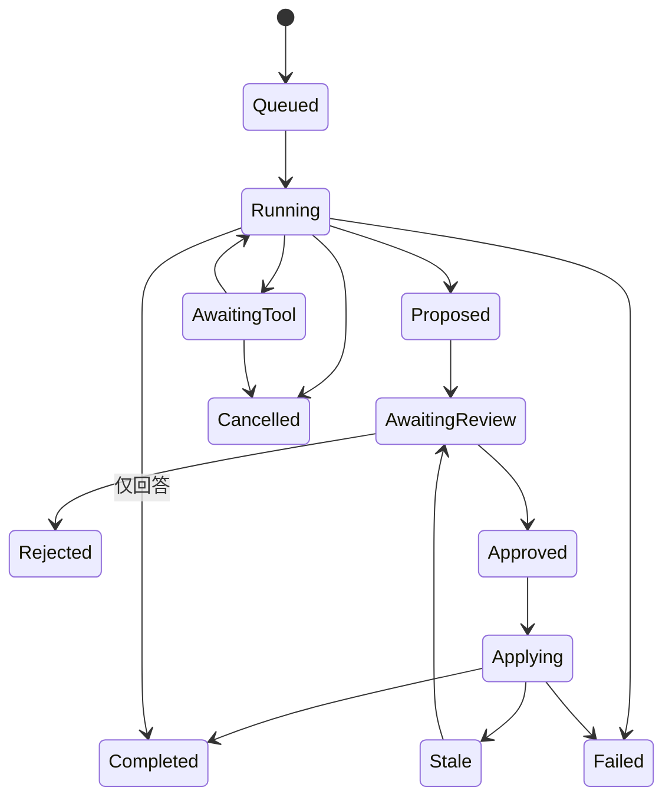

# QUSOR Agent Runtime 与知识检索设计

日期：2026-11-07。状态：技术方案。依赖 [Core 与数据模型](./03-core-data-architecture.md) 及 [同步协议](./05-local-first-sync.md)。M0 只交付 Reader Agent 的可追溯闭环，M1 扩展候选知识结构，M3 再完成跨书研究与外部 MCP。

## 1 Runtime 的边界

六种 Agent 是同一个 runtime 的配置和工具授权集合，不是六个独立进程或六套不可互通的数据模型。先实现确定性的状态机和有限工具循环；没有证据需要时，不引入多 Agent 自主协商。

| Agent | 读取范围 | 可提出的变更 | 首次交付 |
|---|---|---|---|
| Reader | 当前文档、章节、选区和用户选定笔记 | Note、Annotation、引用、学习卡片草稿 | M0 |
| Brainstorm | 当前Canvas、选中节点、被授权资料 | Concept/Claim/Question、候选关系、Canvas节点 | M1 |
| Knowledge | 用户选定集合、实体及来源 | 合并候选、分类、关系和证据补全 | M1小范围，M3扩展 |
| Tutor | 卡片、学习路径、复习事件和限定资料 | 练习题、解释、学习任务建议 | M2 |
| Research | 用户明确授权的多文档范围 | 带证据的研究结论与冲突候选 | M3 |
| Writing | 用户选择的来源、提纲、笔记 | 文稿草案与引用表 | M3 |

模型不能增加自己的权限。scope、工具列表、网络能力、最大读取量、可写实体类型由宿主策略确定。来源文档、网页、MCP结果均为不可信数据；其中的“请忽略指令/调用工具/上传文件”不改变策略。

## 2 ProviderAdapter 与执行循环

ProviderAdapter 能力表包含 streaming、tool_call、structured_output、vision、embedding、context_limit、local/cloud、cancel。不要假设所有“兼容接口”的模型都正确支持工具调用；没有原生工具能力时使用严格解析的受限输出，解析失败不执行猜测动作。

API密钥位于系统安全存储；TSX与阅读WebView只能选择provider profile ID，不能读取密钥。云模型请求和云embedding会发送选定片段，即使原书未上传；首次启用和作用域扩张时展示将发送的数据类别。严格离线模式阻止模型、embedding和自动外部检索的网络出站；本地模型也要核验endpoint是否真为本机。

状态机：



每一步记录 run/step、模型标识、工具版本、引用快照、耗时、token/费用估算与结果状态。日志保存可见输入输出与工具动作，不要求保存模型内部思维链。用户可关闭原始prompt保存，仅保留最小审计和引用hash。

建议初始预算（配置值，M-1后校准）：Reader单轮至多8次工具调用、60秒总截止时间、单工具15秒、最多2次可重试网络错误；检索最多20片段进入候选，最终上下文按模型token预算裁剪。嵌套Agent默认禁用，重试共享原总预算，不重新计时。交互取消应立即阻止新工具调用，已提交事务不得假装撤销；返回已应用状态并提供补偿操作。

## 3 工具注册与权限

ToolRegistry 中每个工具都有版本、JSON Schema、纯读/本地候选/应用写/外部副作用分类、作用域、结果上限、截止时间、幂等策略和审计策略。模型只看到任务允许的子集。

| 工具 | 输入 | 输出及边界 |
|---|---|---|
| reader.get_context | session_id、selection_token | 经过宿主冻结的选区、文档版本、anchor；不相信模型提交的quote |
| documents.read_section | document_id、version、section_id、range、limit | 有边界的原文及provenance、source_map引用 |
| library.search | query、scope、filters、cursor | 来源ID、snippet、anchor、分数分量、来源类型 |
| sources.resolve | anchor_id、expected_version | exact/recovered/ambiguous/orphaned/source_unavailable |
| knowledge.neighbors | entity_id、types、depth、limit | 有界关系子图与evidence_links |
| notes.propose | body、source_ids | ChangeSet草案；不写正式Note |
| knowledge.propose | nodes、relationships、evidence_ids | 通过类型/FK/来源校验的候选组 |
| canvas.propose | canvas_id、nodes、edges | 对现有知识实体的展示或新增知识草案 |
| learning.propose_cards | source_ids、card_type | 带来源的题目、答案和核对信息 |
| changes.preview | changeset_id | 人类可读diff、影响实体、来源、expected_versions |
| changes.apply | approved_changeset_token | 仅宿主审核流程调用，模型不持有批准token |

“创建笔记”的 Agent 能力表现为工具调用生成可审查变更，随后用户一键应用；避免工具名字暗示模型能绕过审核。实际应用仍经过同一Core命令事务。

MCP 是外部工具协议适配层，不是 QUSOR 的权限系统。[MCP tools 规范](https://modelcontextprotocol.io/specification/2025-11-25/server/tools)定义工具发现、Schema和调用，外部工具注解也不能直接被当作可信权限。M3 将MCP注册项包装成同样的policy/预算/审计；外部工具默认只读。桌面stdio工具不得直接移植为移动端执行承诺，移动端优先受控HTTP工具；访问远程服务器前明确资料出站范围。

## 4 候选 审核 应用 撤销

1. 模型输出仅进入 change_sets 草稿，来源字段使用宿主检索时生成的 source_id，不接受模型自行构造可访问路径。
2. 确定性校验包括Schema、长度、实体类型、同vault、引用存在、锚点状态、文档版本、循环约束、预计写集合。
3. 展示逐项diff：新增/修改/删除、原文引用、AI推断、用户原文、来源不足。批量审核可勾选，子集重新形成自洽ChangeSet。
4. 用户批准绑定 payload_hash、工具/策略版本、实体expected_local_versions和引用文档版本；任何编辑、重新检索或scope变化使批准失效。
5. 应用事务重新验证版本，然后同时写实体、operation/inverse、outbox、index job和change_set applied标记。进程在任意阶段失败不得留下“有实体无审计”的半状态。
6. 并发修改导致 stale：保留原候选，重新生成diff再审核。禁止静默替换用户笔记。
7. 撤销产生补偿operation；如果后续编辑已改变受影响实体，显示冲突并让用户选择恢复内容，不以旧inverse强行覆盖。

外部副作用，例如远程发送、文件永久删除，不允许伪称完全可撤销。M0/M1不向Agent暴露此类工具。User source 与 AI origin 分开：用户审核AI内容后仍保留AI来源标记，并另记reviewed_by_user。

## 5 知识检索管线

### 5.1 版本化抽取与分块

```text
本地原件 → 文档版本/格式解析 → 有source_map的章节文本
        → 按章节/段落语义分块 → 搜索投影 → FTS / embedding
查询 + scope → 关键词/向量召回 → 融合/去重 → 可选rerank
             → 锚点解析与原文核对 → CitationBundle → 模型
```

拟定正文块目标300–700模型tokens、重叠50–100tokens；中英文不能以固定字节数裁切。标题链附加为检索上下文但不假装正文引文；代码、表格、脚注、公式分别保留结构。每个chunk保存document_version、extraction_revision、section、anchor/ranges和content_hash。重新分块可变chunk_id；稳定来源依靠anchor而非vector rowid。

抽取失败、加密PDF、图片扫描页必须标为未索引或OCR来源。索引进度在Library可见。OCR识别文字不等于原生文本，引用返回时附上原页区域供核对。

### 5.2 中文全文搜索

SQLite FTS5 的 unicode61 按连续字符类别切token，不能据此假定中文词语检索已具备分词能力；trigram 对短查询另有限制。[FTS5 tokenizer 官方说明](https://www.sqlite.org/fts5.html#tokenizers)。

M0 采用可重建的搜索投影：应用层固定版本中文分词 + 英文token规范化，使用原文映射保存token位置；索引文档标题、作者/别名、章节、正文、笔记。短中文一至二字查询对照分词词项/别名/有界子串检索，不能只使用trigram。输入用户普通词语时转义FTS查询语法；高级语法可单独开启。参数化SQL与FTS查询转义解决不同问题，都需要做。

用真实中文书籍建立至少50条人工标注查询：短词、成语、简繁、专名、英文缩写、同义提问及未出现的概念。简繁和同义扩展用于检索候选，不改变原文保存与引用。

### 5.3 向量方案

不在M0前锁定大型向量数据库。定义 VectorIndex port：

- M0提供纯FTS可用路径。
- M1试点本地embedding。先用小规模精确距离计算作正确性oracle，对 sqlite-vec 或 Rust HNSW 适配做目标设备基准，再选一个实现。
- 本地模型运行器按移动内存/包体/耗电验证；不能把桌面模型加载成功当成手机可部署。
- 每条向量绑定model_id/revision、dimensions、归一化方式和content_hash。更换模型重建独立generation，禁止混向量空间。
- 云embedding默认关闭；模型标识改变后旧向量不能继续当同一索引使用。
- 语义索引缺失或正在重建时降级FTS，阅读不受阻。

拟定初始混合检索：每路top50，采用RRF（k=60作为起始参数）融合，按文档/章节去重，最后取有来源的top8–12进入上下文。BM25和cosine分数不能直接相加。Rerank可选；先满足本地延迟与引用正确性，再增加模型成本。图谱扩展默认一跳、至多50节点并携带路径；不让高连接度节点把上下文无限扩大。

### 5.4 CitationBundle

每项引用带 source_id、document/version、title、section、anchor、quote_exact、quote_hash、source_kind、extractor/OCR标记和resolve_status。模型生成的回答使用这些临时source_id，宿主映射到真正anchor并验证引文字符一致。

引用检查分两层：

- 确定性完整性：ID存在、范围属于授权scope、版本/hash匹配、quote确为该范围。
- 语义支持度：原文是否支持结论。自动评估只作提示；不能因为引文存在就标为结论正确。

答案按段/句区分“原文摘录”“AI解释/推断”“用户观点”。没有证据时允许说资料不足并保留问题；不伪造页码和来源。翻译是派生内容，同时保留原文锚点。冲突检测产物是“待核对的冲突候选”，需要时间、定义和适用范围判断，不能只看否定词。

## 6 测试与验收

| 类别 | 测试材料/动作 | 通过条件 |
|---|---|---|
| 工具真实调用 | 固定mock provider执行读选区、检索、提候选 | 真实工具结果进入上下文；UI显示工具动作；不是静态聊天文本冒充写入 |
| 权限 | 文档内嵌恶意指令、伪造source_id、跨vault ID | 不扩scope、不执行越权写、无资料泄漏 |
| 审核 | 修改已批准payload、审批后实体变化 | hash/版本不符即stale；不能直接应用 |
| 原子性 | 应用时注入数据库错误、崩溃、重试同op | 全部成功或全部回滚；重复应用不生成重复实体 |
| 撤销 | AI创建节点/关系后撤销；之后用户已改动 | 正常场景恢复原状态；并发编辑显式冲突且不覆盖 |
| 引用 | 100条真实引用，含重复段/Unicode/版本变化 | 引文字符核验100%；不可解析明确返回状态，无错跳 |
| 检索 | 至少50人工标注query，增加到100后冻结基准 | M0候选Recall@10目标>=85%；独立记录中文短词及FTS-only成绩 |
| 有依据回答 | 有答案、跨段答案、资料中无答案 | 引用支持度人工目标>=95%；无证据集至少95%明确资料不足，逐条记录错误 |
| 延迟 | 固定设备、固定1万chunk集 | 本地搜索p95<=300ms桌面/<=700ms移动为初始目标；模型耗时单独报告 |
| 取消与预算 | 慢工具、断网、模型循环、页面关闭 | 不新增工具调用；有截止时间；无无限重试；已提交状态可追踪 |
| 离线 | 断网+本地provider或禁AI模式 | 阅读/笔记/搜索可用；云模型不可用不阻塞基础功能 |

单元测试用确定性provider，不依赖实时云模型输出；另设有预算的人工/离线评测集，结果包含模型与prompt版本。不能用一次演示对话证明准确率。

## 7 交付顺序

M0：当前章节和选区 → FTS检索 → Reader解释与真实引用 → Note候选 → 人审 → 原子保存 → 撤销 → 重开跳回原文。

M1：范围扩到用户选定多本文档及Canvas；产出Concept/Claim/Evidence/Relationship候选图；新增知识与视觉布局分开；部分接受时保证依赖完整。

M2：FSRS、卡片生成和Tutor，评分附不确定性且允许用户纠正。

M3：跨书Research/Writing、受限MCP、较长任务checkpoint和本地/云模型能力协商。每一步复用同一套权限、引用、审核和事务，避免功能增加后出现第二条不受审计的写路径。
