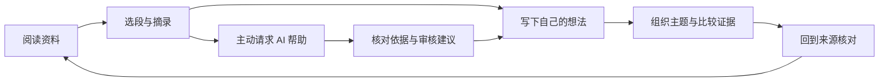

# QUSOR UI / UX 设计参考研究

调研日期：2026-11-07。状态：第一轮公开资料研究与设计假设，尚未冻结视觉风格、信息架构或首版功能。

2026-11-08，用户要求把研究沉淀成可执行设计，并明确可扩展分区。后续工作基线见 [设计入口](../design/README.md)：研究→规则映射、token、组件/分区/提供者、阅读流程、可视稿及验收。本文保留原始研究证据范围，工作基线不把未测假设改写成竞品或平台已验事实。

用户提出在架构拟定后开始吸收优秀 UI / UX / UE 设计。本轮研究视觉、交互和完整使用体验。UX 与 UE 在本任务中都指用户体验；另外单独观察交互流程，避免只评判截图。

产品要求以 [功能范围](../product/scope.md) 为准，既有约束见 [体验基线](../product/experience.md)。本轮没有实现 UI、连接模型或开展 NSH 平台实验。

## 1 方法与证据范围

“顶级”没有单一客观排名。本轮选择在阅读、复杂工具、知识组织、扩展生态和原生设计规范上有参考价值的案例，优先读官方产品说明、帮助文档和设计复盘。

区分官方机制说明、展示图观察与我们自己的推导。它们都不能替代真实任务测试。

- 已读取 Linear、Readwise Reader、Heptabase、Raycast、Google 来源问答工具的公开说明，以及 Apple HIG、Fluent 2 的官方原则。
- 已查看 Linear 改版展示图、Reader 高亮展示图的实际图像。两张均为带透视或修饰的宣传素材，不能用于测量实际字号、对比度、触控尺寸或操作延迟。
- Apple HIG 部分正文通过官方页面搜索索引核对，直接正文抓取受页面渲染限制；其他材料以实际读取的公开页面为依据。
- 未登录或安装上述产品，未完成动态交互、中文长文、辅助技术、离线行为和真机体验测试。
- Linear 复盘发表于 2024-03-28，是历史设计案例；其余动态页面记录本次访问日期，不据此声称全部是 2026 年新发布设计。

## 2 案例：具体吸收什么

| 参考与已观察机制 | 对 QUSOR 的启发（建议） | 适用边界 |
|---|---|---|
| [Linear UI 改版复盘](https://linear.app/now/how-we-redesigned-the-linear-ui)：减少外框噪声、校准导航层级与对齐；按环境、主题和视图状态检验设计 | 建立稳定的导航、主内容和辅助面板层级；同时比较列表、阅读、空状态和异常状态 | 工单列表的信息密度不直接用于长文正文；深色展示图不能证明阅读舒适 |
| [Readwise Reader](https://readwise.io/read)：多格式阅读、高亮、批注和键盘操作围绕阅读展开 | 缩短“选段→摘录/想法→继续阅读”，保留正文上下文 | 官网的性能和体验宣传未实测；不照搬全部来源、AI 或订阅模式 |
| [Reader 工作流配置](https://docs.readwise.io/reader/guides/workflows/library-configuration)：提供 Triage、Shortlist、Classic 三种资料处理方式 | 研究“继续阅读”和主动阅读清单如何帮助选择下一篇；归档后仍可查找 | 不把阅读等同于清空待办，也不据此增加三套首版配置 |
| [Heptabase 界面逻辑](https://wiki.heptabase.com/user-interface-logic)及[产品页](https://heptabase.com/)：卡片、白板、来源和摘录相互引用；右栏随当前对象提供工具，Insight 可回原文分块 | 保持主任务稳定，让参考内容在旁边出现；摘录进入笔记和画布时延续身份 | 不复制所有面板；空间相邻或连线不自动构成事实关系 |
| [Raycast Action Panel](https://manual.raycast.com/action-panel)：选中对象对应主动作、分组动作和可搜索动作；菜单展示快捷键，扩展也贡献动作 | 插件共享可发现的入口、命名和键盘习惯；先能看见操作，再逐渐学会快捷键 | 命令面板不能成为唯一入口；触控也应完成同一任务 |
| [Raycast v2](https://manual.raycast.com/new-in-v2)：根搜索整合文件，配置可就地完成，Quick AI 与完整聊天保持熟悉的表达 | 减少小操作对当前任务的打断；短问答与持续研究可有不同容器 | 不照搬未匹配查询转 AI、自动携带屏幕上下文等策略；数据出站按 QUSOR 自身授权范围 |
| [Google 来源问答帮助](https://support.google.com/gemininotebook/answer/16179559?hl=en)：选择回答使用的来源，引用可预览并进入上下文，保存回答时保留引用 | AI 的输入范围和答案依据可看、可改、可回访 | 本次官方页面标题为 Gemini Notebook；只研究来源交互，不由此采用其上传模式或保证答案正确 |
| [Apple 设计原则](https://developer.apple.com/design/human-interface-guidelines/design-principles/)及[材料规范](https://developer.apple.com/design/human-interface-guidelines/materials)：内容可达、操作可恢复、跨设备保留上下文；玻璃材料用于导航与控件层 | 安静界面仍有可发现操作；正文和引文使用稳定阅读表面，材料效果克制 | 苹果平台语言不直接成为 NSH 五端统一皮肤；透明度和动效须适配系统设置 |
| [Fluent 2 排版](https://fluent2.microsoft.design/typography)及[无障碍](https://fluent2.microsoft.design/accessibility)：文字角色、平台字体、可见焦点、缩放和可预测导航 | 统一正文/标题/说明/来源等语义角色，按平台映射字体；设计关闭面板后的焦点去向 | 西文 UI 字号表不能作为中文长文规格；固定版式 PDF 与可重排正文分别验证 |

## 3 视觉观察与候选方向

Linear 的[官方展示图](https://webassets.linear.app/images/ornj730p/production/fbe1a0ae325c93e6ae1c9ec94a63607940408e05-2352x1344.png)里，侧栏、列表、详情拥有不同职责；文字主次、细分隔线、选中底色共同表达层级，强调色集中用于状态和少量对象。对 QUSOR 的启发是优先做好对齐、间距、选中态和信息权重。图中的透视与暗角是展示处理，不应进入实际阅读界面。

Reader 的[官方高亮展示图](https://d34adp677peecb.cloudfront.net/static/images/reader/Highlight-Alpha-No-Note@1x.28c2c4cc2706.webp)同时表现文字和图片标注。可借鉴的是标注与材料的直接联系；图中的斜视角、渐暗和西文排版不能证明中文阅读效果。

后续可比较以下方向；名称仅用于讨论，当前没有产出三套视觉稿。

| 候选方向 | 视觉表达 | 需要验证的问题 |
|---|---|---|
| 安静书房 | 稳定纸张底色、舒适正文、少量辅助线与重点色 | 长文是否舒适；工具是否容易发现；深浅主题是否都可读 |
| 精密工作台 | 中性表面、清晰分区、紧凑但有节奏的列表和检查器 | 大量资料下是否易于扫描；是否挤压正文、产生管理负担 |
| 空间研究室 | 关系和分组明确的画布，来源与当前对象有稳定检查入口 | 是否帮助比较与推理；列表替代路径是否同样可用 |

这些方向可作为同一产品的不同工作状态。既有暖白阅读、蓝紫思考方向继续作为参考；品牌、字体、色值和具体布局仍未冻结。

## 4 对 QUSOR 最有价值的设计假设

### 内容连续，工具按任务出现

用户需要理解自己正在读什么、记下了什么、观点依据在哪里。建议让内容在阅读、笔记、研究中保留来源与身份，切换视图后仍能返回原位置；避免为功能模块反复复制内容。

这是长期体验研究路径，不表示画布或 AI 已确定进入首版。AI 推断、用户观点与原文始终可辨；接受建议也不抹去 AI 来源。

### 安静与可发现同时成立

正文保持中心，高频动作拥有可见入口，低频动作进入上下文菜单或可搜索命令。打开批注、引用或 AI 后，关闭时回到正确焦点和阅读位置。移动端保留同样的数据含义，以聚焦视图完成任务。

弱化辅助信息不等于降低到不可读。长文、来源、状态和禁用态分别设计；中文、英文、混排、代码与公式需要各自样本。对比度、系统字号、屏幕阅读器和减少动效在原型阶段检查。

### 插件能力共享体验规则

第一方和第三方通过同样的公开贡献点提供动作。建议宿主统一入口层级、焦点行为、加载反馈、权限说明和审核表达；插件增加能力时不自动增加永久侧栏。授权和来源标识仍由宿主掌握，功能归属保持 [插件架构](../architecture/extensions.md) 的既有边界。

插件停用后，已收录内容仍可查看、引用和导出；缺少增强视图时给出清晰恢复路径。这既是数据约束，也是用户能感受到的信任体验。

### 可靠性通过状态与操作表达

本地保存、云端同步、模型处理是不同状态。引用失效时说明原件缺失、版本变化或多个匹配，并提供相应操作。不用单个成功提示掩盖部分失败，也不把内部协议名展示给用户。

AI 修改展示影响与差异，支持单项或批量接受、拒绝和撤销。快捷不意味着跳过既有审核；简单确定性的用户保存也不应被多重确认打断。

## 5 后续验证任务，尚未执行

| 任务 | 关联 Feature ID | 应观察的结果 |
|---|---|---|
| 从资料库继续阅读，调整字号，再打开并关闭批注 | F-LIB-01、F-READ-01/02/03、F-UX-01/02 | 是否找到继续入口；位置与焦点是否保持；大字号是否遮挡 |
| 留下摘录与个人观点，稍后从笔记回原文 | F-NOTE-01、F-SRC-01 | 能否区分引用与想法；回源是否落到正确版本与位置 |
| 围绕选段提问，查看依据，接受或拒绝建议后检查撤销 | F-AI-01/02/03 | 能否知道使用范围；是否理解候选与正式内容；能否核对与恢复 |
| 在主题中比较两份材料及其相互关系 | F-CAN-01、F-KG-01/02 | 画布是否帮助理解；不用空间图形是否也能完成关键操作 |
| 安装功能扩展，使用后停用，再查看已收录内容 | F-EXT-03/04/05/06、F-DATA-01 | 入口是否一致；停用是否造成迷路；内容是否仍可读与导出 |
| 遇到保存失败、引用歧义或缺少原文件 | F-SRC-01、F-DATA-01、F-UX-02 | 能否判断问题、重试或恢复；是否存在误导成功提示 |

记录任务完成情况、误操作、寻找入口的停顿、恢复能力与用户感受。用相同材料比较候选方案；具体数值门槛在原型任务明确后拟定，不虚构测试成绩。

后续视觉比较应补充正常正视界面、中文长文、移动窄屏与动态交互证据，再制作有明确模拟边界的原型；产品实现仍受范围确认与平台验证约束。

## 6 当前判断

QUSOR 值得探索的方向是：**阅读时让内容突出，思考时让关系清楚，调用 AI 时让依据与控制权可见。** 以稳定排版、连续上下文和可恢复操作形成质感，以一致的宿主交互承载插件增长。

这是第一轮研究建议。现阶段没有证据宣称某种配色、布局、产品风格或动效已最适合 QUSOR，也没有完成竞品上手评测。
