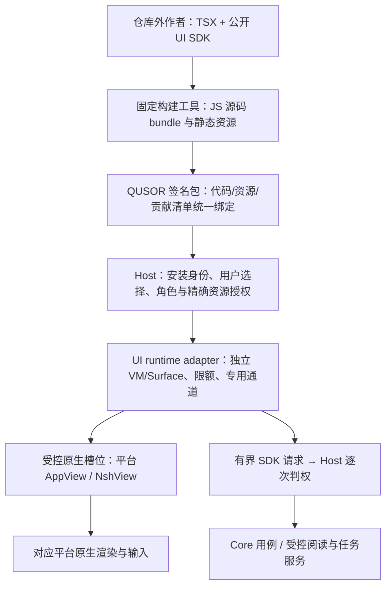

# TSX 插件 UI 到原生界面的通路调研

核对日期：2026-11-08。关联 C-09/C-12/C-13、F-EXT-01/03/04/05/06、F-UX-01/02。状态：官方源码审查与仓库外作者构建通过；独立 UI 的安装、运行隔离、原生挂载与替换未验证。本报告不升级 NSH、不改变现有权限或冻结新的生产执行 profile。

## 结论与前述说明的修正

**通路在技术上成立，NSH 已有动态源码 bundle、每 Surface 独立 VM、原生嵌入视图和双向宿主通道。QUSOR 仍需实现公开 UI 运行契约与受控挂载层，不能把第三方 TSX 直接 import 进宿主就称为隔离原生插件。**

此前“插件也可以用 TSX 写原生 UI”应理解为可验证的技术方向，不表示现有普通 Wasm 包已经能执行自己的 TSX。已有阅读实验的 TSX 外壳和普通签名 Wasm 插件是两个角色；插件参与选区与保存，不等于该插件提供了整份原生界面。详见本地 [plugin_main.rs](../../experiments/nsh-reader/native-host/plugin_main.rs)、[准备脚本](../../experiments/nsh-reader/native-host/prepare_plugin_surface.py) 及 [实验 TSX](../../experiments/nsh-reader/plugin-surface/App.tsx)。

源码使用 `dom`、节点或类似 HTML 的名称，不表示浏览器 DOM。原生目标由 NSH 引擎把节点变化变成平台挂载操作；部分控件使用平台控件，部分内容自绘。“原生”不意味着每个 JSX 节点都是系统标准控件，也不意味着任意 React/网页组件都能直接复用。

## 1 版本和证据

| 对象 | 本次核对 | 对方案的影响 |
|---|---|---|
| 官方发布 | stable v0.4.0；nightly f81b965 | 不自动安装 nightly，也不把两个相同版本号的 SHA 当成同一行为 |
| 最新审查提交 | `893fb84db625045f36363ae9de1f999f588d25fd`，2026-11-08 07:19:09 UTC | 文档和关键代码固定到此提交 |
| 近五次提交 | 编辑器首屏高亮、节点 ID 表回收、指针区域计算、JS heap/节点监视、TUI 嵌入控制 | 节点回收及监视值得纳入长驻多插件验证；TUI 更新不证明桌面嵌入终端可用 |
| 已有实验运行基线 | `913fd76e1f8434ec6cdf248f4476c1ebe08af19f`，CLI `nsh 0.4.0 (913fd76)` | 本轮仅用已有二进制构建样例，不更换原有消费者基线 |
| 本机构建 | Linux / WSL2；仓库外临时作者目录；现有 NSH CLI | 有构建与输出 hash；没有原生窗口/权限/输入隔离成绩 |

核对来源、发布元数据和提交摘要见 [upstream-review.json](../../experiments/nsh-reader/tsx-plugin-ui/evidence/upstream-review.json)。上游测试文件的存在仅是覆盖线索，本轮没有运行其测试或核验该 SHA 的全部 CI。NSH 最新源码和已有本机二进制是不同证据对象。

## 2 上游已具备的基础

| 能力 | 固定官方来源 | 能确认什么 |
|---|---|---|
| 动态源码执行 | [Engine / Bundle](https://github.com/longbridge/nsh/blob/893fb84db625045f36363ae9de1f999f588d25fd/crates/nsh-engine/src/lib.rs) | `Bundle::source` 与 `App::Js` 可加载构建后的 JS；TSX 需先经 bundler 转换 |
| 每 Surface 独立 VM | [sandbox](https://github.com/longbridge/nsh/blob/893fb84db625045f36363ae9de1f999f588d25fd/docs/dev/sandbox.md) | 同一进程可有多个 QuickJS runtime，VM 限额由宿主设置；普通 import、代码分包和 JSX 组件均不自动新建 VM |
| 原生视图嵌入 | [embedding](https://github.com/longbridge/nsh/blob/893fb84db625045f36363ae9de1f999f588d25fd/docs/dev/embedding.md) | 桌面 AppView、iOS NshAppView、Android NshView；可作为宿主区域中的原生视图，未替 QUSOR 完成跨平台装配 |
| 双向宿主消息 | 同上及 [host_channel tests](https://github.com/longbridge/nsh/blob/893fb84db625045f36363ae9de1f999f588d25fd/crates/nsh-engine/tests/engine/host_channel.rs) | launch params、call/reply、post/event、超时和停止；宿主 handler 不能阻塞引擎线程 |
| 声明与宿主许可交集 | [access.rs](https://github.com/longbridge/nsh/blob/893fb84db625045f36363ae9de1f999f588d25fd/crates/nsh-core/src/access.rs) | 可约束内置网络、文件、进程等 API 和 host 方法名；不代替 QUSOR 的资源、版本、生命周期和知识审核 |
| 自定义原生组件 | [embedding](https://github.com/longbridge/nsh/blob/893fb84db625045f36363ae9de1f999f588d25fd/docs/dev/embedding.md) 的 native components | 宿主注册组件，JS 通过 JSON props/events/commands 使用；不是让插件上传 dylib/FFI |
| 停止与预算 | [sandbox.rs](https://github.com/longbridge/nsh/blob/893fb84db625045f36363ae9de1f999f588d25fd/crates/nsh-js/src/sandbox.rs)、[shutdown tests](https://github.com/longbridge/nsh/blob/893fb84db625045f36363ae9de1f999f588d25fd/crates/nsh-engine/tests/engine/shutdown.rs) | 有 heap/stack、执行时间、节点/操作限额与 JS 中断机制；不直接证明所有原生任务和资源已释放 |

作者可以在 TSX 中使用 `nsh`/`nsh/base`，不要求作者链接 QUSOR 内部 Rust crate；但要发布与固定运行时相容的 SDK 声明、组件契约、构建工具和版本范围。构建成功也不等于完整 TypeScript 类型检查通过。

## 3 推荐的目标链路



这是目标链路，尚未接通。关键分工：

1. **包和权限仍由 QUSOR 掌握。** 不绕过已有包安装内核，另开一条 NSH 安装/信任数据库。UI 和逻辑资产绑定同一安装 digest/generation，身份来自可信装载器。
2. **独立活动提供者挂载拥有自己的执行边界。** 第一轮实验用独立 AppView/VM，按需挂载；不为每个按钮开 VM，不在不可见面板中无限保留 runtime。实例数量、heap/原生内存总预算和休眠需实测。
3. **宿主区域负责组合。** 外壳的 TSX 不能把另一份有 `mount()` 的 bundle 当普通组件插入自己的树。应由可信原生 Slot 适配器容纳子 AppView，并治理尺寸、主题、焦点、遮挡和关闭；嵌套原生视图本身也须实际验证。
4. **UI 与业务服务使用公开能力。** 给 UI 专用 `host.call` 门面，背后进入同一 Host，绑定 vault、安装、mount、运行世代及精确资源；插件自报的 ID 不构成身份。读写笔记仍通过 Core，不向 UI 交数据库、文件任意路径或平台指针。
5. **已有 Wasm 与 TSX 不必强行合成一种运行时。** Wasm 可承担逻辑，JS 专注界面；二者如需共享草稿经同一应用服务和修订协议，不把 UI 状态或插件私有存储变成正式知识权威。

短期应继续完成已有 [可替换想法提供者契约](../product/component-provider-contract.md)：有界组合资产 + 普通受限逻辑 + 宿主原生控件。这是可先验证的原生插件 UI 路径。完整 TSX UI 是表达能力更强的后续 profile，不能把当前组合资产直接解释成可执行 JS，也不能把当前已出现的0.3源码类型称为完整TSX支持。现有实现正在演进，其成绩以对应消费者证据为准，本轮不代签该切片验收。

## 4 必须补上的边界

### 4.1 字节码来源与签名不是一回事

[官方 signed-packages 文档](https://github.com/longbridge/nsh/blob/893fb84db625045f36363ae9de1f999f588d25fd/docs/dev/signed-packages.md) 明确 QuickJS 不验证字节码。`Bundle::bytecode` 和 `read_trusted` 是 unsafe；`Bundle::from_package` 会优先使用版本匹配的包内字节码。这依赖签名方对构建来源承担信任。

QUSOR 允许用户信任第三方发布者，不代表这些发布者可以提交任意内存不安全字节码。建议普通第三方 UI 只分发受签名约束的 JS 源码，由本机可信编译器编译；本轮构建产生的 `.nshc` **没有被加载**。后续缓存也仅复用本机可信生成且绑定源码 hash、编译器和字节码版本的产物；签名检查不能升级为安全沙箱结论。

### 4.2 不继承开发宿主的宽松默认

`Policy::default()` 的 declaration/grant 可为空，缺声明保留部分广泛能力；单应用 runner 还会使用 standalone 资源策略。嵌入路径虽然默认有限额，但 QUSOR 必须显式构造最小 declaration 与 granted，而不是依赖默认行为。

建议 UI profile 初始关闭直接网络、文件、进程、剪贴板、picker、音频/麦克风、WebView、URL 打开等能力，仅允许精确 host 门面。必要能力通过同一 Host 按用户策略接入。manifest 与 NSH declaration 要从一个受验证能力投影得到，不能出现两个可独立扩权的配置；无法精确投影的规则拒绝或经 broker 实现。

直接网络/进程等能力一旦交给 VM，当前平台公开 API 未证明可实时原地撤权。用“每次 host 调用重验 + 关闭/重建旧 VM + 取消在途服务”满足当前性；`set_limits` 仅影响下次加载，不能当作当前 VM 已收紧。

### 4.3 自定义原生组件和模块需要额外判权

NSH 官方说明注册的原生组件是宿主代码，不自动应用插件能力检查。QUSOR 提供的 PDF、终端、电脑预览等组件必须自行核 mount/资源/动作权限；props、事件与 commands 都是不可信数据。注册名字不是权限，组件内部不能凭任意路径或句柄执行。

当前审查的 [Linux AppView::load](https://github.com/longbridge/nsh/blob/893fb84db625045f36363ae9de1f999f588d25fd/crates/nsh-platform-linux/src/app.rs) 使用平台全局 `ui_sets()` 并默认空 EngineContext，而 EngineConfig 本身有这些配置。现有实验也用 `set_ui_sets` 注册宿主模块。不能据此假定每个子 View 已获不同模块清单/身份；第一轮应避免向第三方 View 注册高权限 nativeModule，先用每实例 HostChannel。确需原生模块时补可注入的可信上下文/注册控制或模块内逐次判权，并独立回归，不能用字符串包 ID 或跨引擎共享静态状态鉴权。

### 4.4 视图、通道、存储和窗口都要有边界

- HostChannel 会在没有运行 app 时保留事件，并交给后继 app；这是有意设计。替换为另一插件/资源时新建通道并封锁旧世代，不能把旧私密事件送给新提供者。host 事件由宿主主动发送，不因“没有读权限请求”就自动安全。
- `with_app_id`、Storage 路径和缓存根不能由插件自报决定。宿主绑定安装/用户/库的命名空间；私有 Storage 不能保存正式笔记，也不能与既有迁移/回滚内核各保留一份状态权威。
- 插件 Surface 应限制在授权区域，不能遮挡可信权限、任务停止与系统状态。需验证跨 Surface 的焦点、Tab/IME、模态层级和读屏，不从“能嵌入 widget”推导体验已合格。
- 桌面窗口 API 需要额外核对。[Linux window.rs](https://github.com/longbridge/nsh/blob/893fb84db625045f36363ae9de1f999f588d25fd/crates/nsh-platform-linux/src/window.rs) 的主窗口查询会沿 widget root 找 GTK Window，命令路径可处理新窗口和主窗口请求；本轮没有看到这一段按插件 slot 判权。这是须做反例实验的潜在跨区域控制面，**尚未证实实际可利用或已被其他层拦截**。在验证/拦截前不能把“嵌入式 View 不改变宿主窗口”的文档描述当作隔离证据。
- VM 停止、原生控件销毁、图片/解码任务结束、后台任务取消和 quota 退还要分别确认。别把 JS cleanup 或视图移除直接当真实释放回执。

### 4.5 VM 隔离与进程隔离分别验收

独立 QuickJS VM 能隔离 JS 全局对象并施加部分预算，但仍在宿主进程内；引擎缺陷和原生组件错误可能影响整个应用。原生资源不完全计入 JS heap，总数需宿主统一约束。默认每实例限额也不是大量实例同时运行的总内存方案。

同进程 Surface 适合作为首个可行性实验，不能直接宣布第三方完整运行隔离通过。若不能满足项目隔离门槛，备选是受监督进程执行 JS、通过有界且验证过的 UI 操作协议交给宿主原生渲染；这需要新桥接，不是把 OS widget 指针穿进程，也不是现有 Wasm worker 已自动支持。不会因此默认改为 WebView 或缩减第三方能力。

## 5 本机实际做了什么

新增 [隔离研究目录](../../experiments/nsh-reader/tsx-plugin-ui/README.md)，样例只有文本、输入框、按钮和 `qusor.probe.echo` 调用声明；未接用户资料或外部服务。

运行：

```sh
python3 experiments/nsh-reader/tsx-plugin-ui/probe_build.py --output experiments/nsh-reader/tsx-plugin-ui/evidence/linux-build.json
```

脚本复制样例到 `/tmp` 的仓库外作者目录，调用现有固定 CLI 构建；没有依赖 QUSOR 内部 crate，也没调用 npm/Node。退出0，输出 JS 770 bytes、QuickJS bytecode 1245 bytes，以及 source map、app.json、capabilities.json。工具回报的构建耗时是单次记录，不作为性能基准；完整 hash 见 [构建证据](../../experiments/nsh-reader/tsx-plugin-ui/evidence/linux-build.json)。

这证明**独立 TSX 作者构建基础可用**；没有证明运行后按钮/输入正常、宿主 RPC 可达、签名包安装、VM 隔离、中文 IME、普通身份、组件替换、资源释放或跨平台交付。未加载下载来的 bytecode，未启动新原生窗口，未升级生产依赖。

## 6 建议的下一资格切片

先选已有想法草稿角色，两个独立作者提供不同 TSX 界面，共用公开草稿契约。顺序为：已验证安装 → 专用 VM/通道 → 子原生槽位 → 有界草稿读取/替换 → 用户选择 A/B → 关闭/撤权/升级后旧事件拒绝 → 保存后 Core 恢复核对。

退出门槛包括：普通身份/仓库外构建；源码加载；双实例不串数据；无授予的网络/进程/文件调用拒绝；不能调用隐藏原生模块或控制宿主窗口；超时/OOM不拖垮另一实例；中文 composition、焦点/读屏和窄窗；真实释放后才返还配额；已保存内容在提供者停用后可读/恢复。完整步骤和失败备选见 [实验计划](../../experiments/nsh-reader/tsx-plugin-ui/README.md)。

**当前判断：继续沿原生插件 UI 路线调研与隔离验证，无需为插件化默认引入网页。工程重点是安全的装载与组合层，而不仅是把 TSX 编译成功。**
