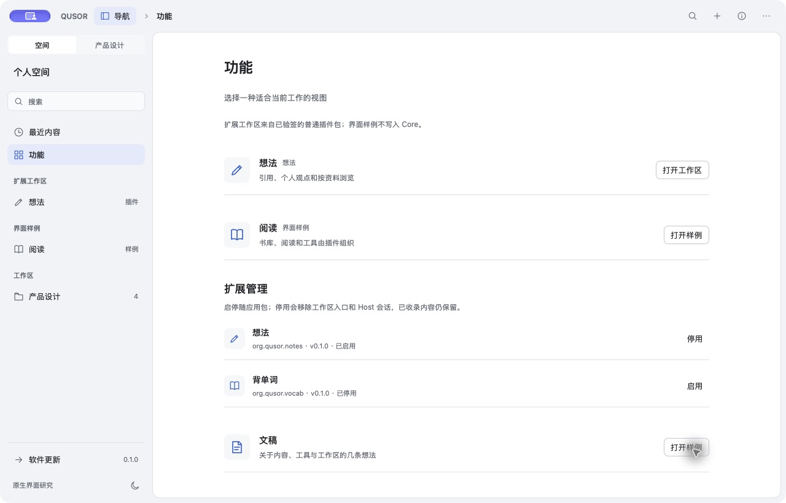
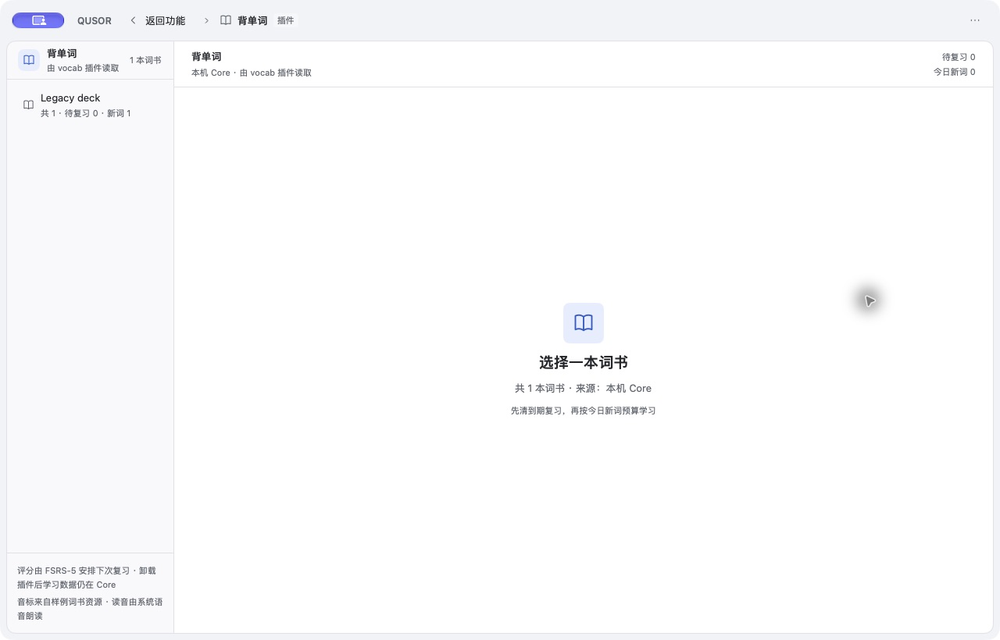

# 随应用插件停用与重新启用

日期：2026-11-12

范围：`apps/qusor` 的随应用 Notes/Vocab 包；验证功能目录的停用、重启保持和重新启用。不代表任意 `.qpk` 安装、卸载 tombstone、第三方包管理或其它平台通过。

## 工件

- 临时应用：`/tmp/qusor-lifecycle-app/QUSOR.app`，应用版本 `0.1.0`，macOS arm64。
- 隔离数据：`/tmp/qusor-lifecycle-home.ReYn7i`，从既有迁移 Core 复制；Core 中有 `Legacy deck` 词书。
- 打包时因本机 `iconutil` 对该图标返回 `Invalid Iconset`，临时移除了 `nsh.json.icon`；验证后已恢复，仓库清单无 diff。

## 步骤与结果

1. 以隔离 `HOME` 启动应用，打开“功能”；扩展工作区显示“想法”“背单词”，扩展管理均显示已启用。
2. 点击“停用背单词插件”。界面立即移除侧栏“背单词”入口、工作区卡片和打开按钮，只保留管理行“已停用”。
3. 检查应用数据：`extensions/preferences.json` 记录 `disabled_packages: ["org.qusor.vocab"]`；Core SQLite 仍能读到 `Legacy deck`。
4. 退出并重新启动同一数据目录。界面仍只有“想法”扩展入口；功能目录显示背单词“已停用”，说明状态跨进程保留。
5. 点击“启用背单词插件”，入口重新出现；打开后显示“本机 Core · 由 vocab 插件读取”和 `Legacy deck`，证明 Host 以新会话重建且 Core 数据未被停用删除。

## 窗口证据

停用背单词后，入口消失、管理行保留：

重新启用并打开工作区，原 `Legacy deck` 仍从本机 Core 读取：

重新启用后偏好文件为空：

[preferences-after-reenable.json](preferences-after-reenable.json)

## 未验证

- 任意用户 `.qpk` 的安装、信任、卸载和 tombstone 清理。
- Windows 上偏好文件替换的原子性；当前 Unix 使用临时文件 + rename，Windows 目标存在时是删除后重命名。
- 停用/启用期间的并发调用、真实资源释放 ACK、第三方插件 UI 独立作用域和六端资格。
